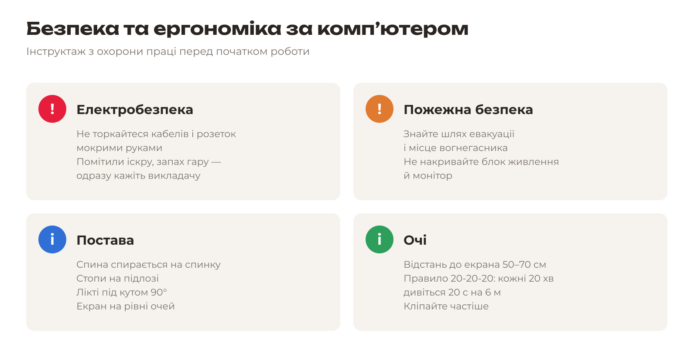
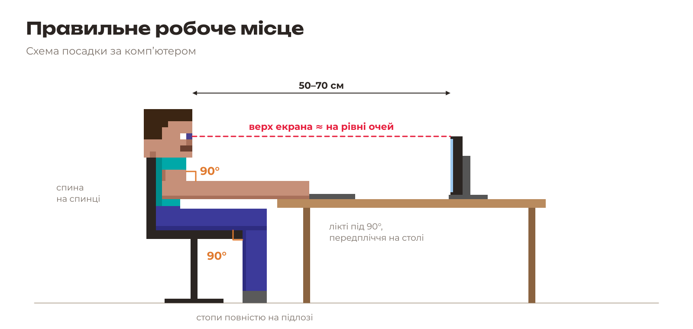
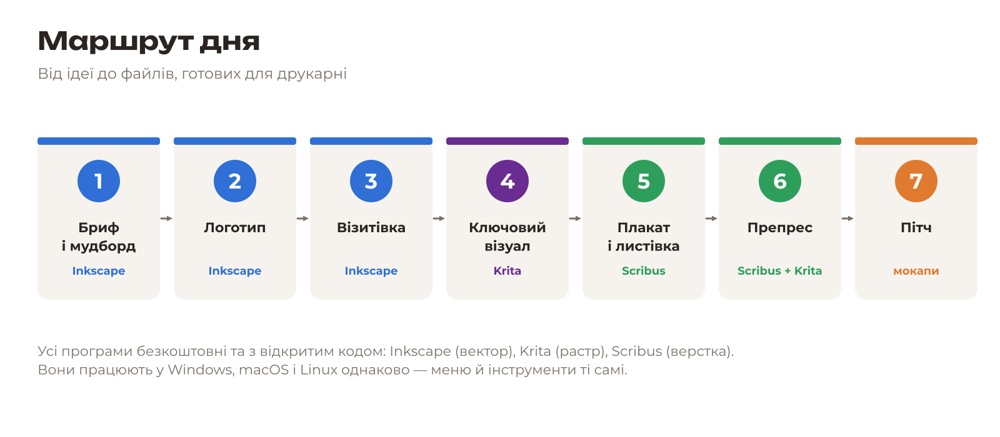
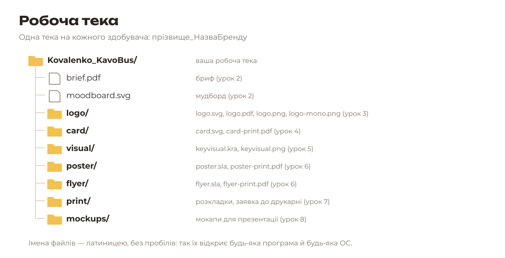

# Урок 1. Вступ: охорона праці, маршрут дня, робоча тека

## 1.1. Інструктаж з охорони праці

Перед роботою з комп’ютером кожен здобувач проходить інструктаж і **розписується в журналі**.

**Під час роботи заборонено:**

- самостійно відкривати корпус ПК, від’єднувати кабелі, ремонтувати обладнання;
- ставити напої та їжу поруч із клавіатурою;
- закривати вентиляційні отвори системного блока й монітора.

**У разі несправності** (немає зображення, іскріння, запах гару, ураження струмом): припиніть роботу, не торкайтеся обладнання, повідомте викладача.

**Перерви:** кожні 45–60 хв — 5–10 хв перерви. У розкладі воркшопу перерви вже заплановано.

## 1.2. Маршрут дня

Сьогодні ви створите **повний фірмовий стиль** вигаданого стартапу і підготуєте його до друку.

| Урок | Результат |
|---|---|
| [2. Бриф і мудборд](../02-bryf-i-mudbord/README.md) | Бриф, палітра з 3 кольорів, 2 шрифти |
| [3. Логотип](../03-lohotyp/README.md) | logo.svg / .pdf / .png / mono |
| [4. Візитівка](../04-vizytivka/README.md) | card-print.pdf |
| [5. Ключовий візуал](../05-kliuchovyi-vizual/README.md) | keyvisual.kra / .png |
| [6. Плакат і листівка](../06-verstka/README.md) | poster.sla, flyer.sla, чорнові PDF |
| [7. Препрес](../07-prepres/README.md) | PDF/X, розкладки, заявка до друкарні |
| [8. Пітч](../08-pitch/README.md) | Мокапи, захист, розрахунок ціни |

## 1.3. Робоча тека

Створіть у своїй теці користувача (або на флеш-носії, як скаже викладач) **робочу теку** та підтеки.

**Правила іменування:**

- латиниця, без пробілів і спецсимволів: `Kovalenko_KavoBus`, а не `Коваленко Кавобус!`;
- малі літери для файлів: `logo.svg`, `card-print.pdf`;
- версії позначайте наприкінці: `poster_v1.sla`, `poster_v2.sla`.

**Зберігайте часто:** `Ctrl+S` після кожного вдалого кроку. Наприкінці кожного блоку скопіюйте теку на флеш-носій.

## 1.4. Матеріали воркшопу

Усі матеріали зібрано в теці `brand-day/`. Їх можна переглянути й завантажити на сторінці [Матеріали воркшопу](materialy.md) або одразу одним архівом: [brand-day.zip](materialy/zip/brand-day.zip).

| Тека | Що в ній |
|---|---|
| {{asset fonts/ short}} | 8 безкоштовних шрифтів із підтримкою української (ліцензія SIL OFL) |
| {{asset photos/ short}} | Фото з ліцензією CC0 за темами стартапів, джерела в {{asset photos/CREDITS.md short}} |
| {{asset templates/ short}} | Бланки брифу, мудборду й заявки до друкарні, шаблон візитівки, шаблони розкладки |
| {{asset icc/ short}} | Колірний профіль друку для перевірки кольорів |
| {{asset mockups/ short}} | Шаблони мокапів для презентації |
| {{asset example/ short}} | Готовий приклад бренду «КавоБус» |

**Встановлення шрифтів:** відкрийте файл `.ttf` подвійним клацанням і натисніть «Встановити» (Windows, macOS) або скопіюйте файли в теку шрифтів користувача (Linux: `~/.local/share/fonts`). Після встановлення **перезапустіть** Inkscape, Krita та Scribus.

## 1.5. Жеребкування стартапів

Кожен здобувач тягне картку стартапу. Можна один раз перетягнути. Запишіть назву стартапу: з ним ви працюватимете весь день.

Жеребкування можна провести на одному комп’ютері для всієї групи, наприклад на проєкторі: стартапи, які вже взяли, вдруге не випадуть.

?

Натисніть «Тягнути картку»

<button type="button" class="mat-button draw-go">Тягнути картку</button><button type="button" class="mat-button draw-keep" hidden>✓ Беру</button><button type="button" class="mat-button mat-button-small draw-redo" hidden>↻ Перетягнути (1 раз)</button>

Усі картки (17)
<ol class="draw-list"><li data-photos="01-kavobus"><b>«КавоБус»</b>: кава з фургона біля входу до коледжу</li><li data-photos="02-fiksit"><b>«ФіксІТ»</b>: ремонт комп'ютерів і телефонів для студентів</li><li data-photos="03-zeldostav"><b>«ЗелДостав»</b>: екодоставка продуктів велосипедом</li><li data-photos="04-piksel-plei"><b>«Піксель Плей»</b>: інді-студія відеоігор</li><li data-photos="05-khvostyk"><b>«Хвостик»</b>: застосунок для пошуку доглядальників тварин</li><li data-photos="06-studdim"><b>«СтудДім»</b>: коливінг для студентів</li><li data-photos="07-smakolyk"><b>«Смаколик»</b>: домашня пекарня з онлайн-замовленнями</li><li data-photos="08-velofiks"><b>«ВелоФікс»</b>: ремонт і прокат велосипедів</li><li data-photos="09-knyhoobmin"><b>«КнигоОбмін»</b>: буккросинг і обмін підручниками</li><li data-photos="10-fitstart"><b>«ФітСтарт»</b>: студентський фітнес-клуб</li><li data-photos="11-linhvachat"><b>«ЛінгваЧат»</b>: розмовний клуб іноземних мов</li><li data-photos="12-ekoshop"><b>«ЕкоШоп»</b>: магазин без упаковки</li><li data-photos="13-kvitkovyi-kurier"><b>«Квітковий кур'єр»</b>: доставка квітів за 60 хвилин</li><li data-photos="14-heimzona"><b>«ГеймЗона»</b>: кіберспортивний клуб</li><li data-photos="15-foto-myt"><b>«Фото Мить»</b>: виїзна фотостудія для подій</li><li data-photos="16-smartkod"><b>«СмартКод»</b>: онлайн-курси програмування для школярів</li><li data-photos="17-soniachna-stantsiia"><b>«Сонячна станція»</b>: монтаж сонячних панелей для приватних будинків</li></ol><button type="button" class="draw-reset">Почати жеребкування заново</button>

[Наступний урок: Бриф і мудборд →](../02-bryf-i-mudbord/README.md)
