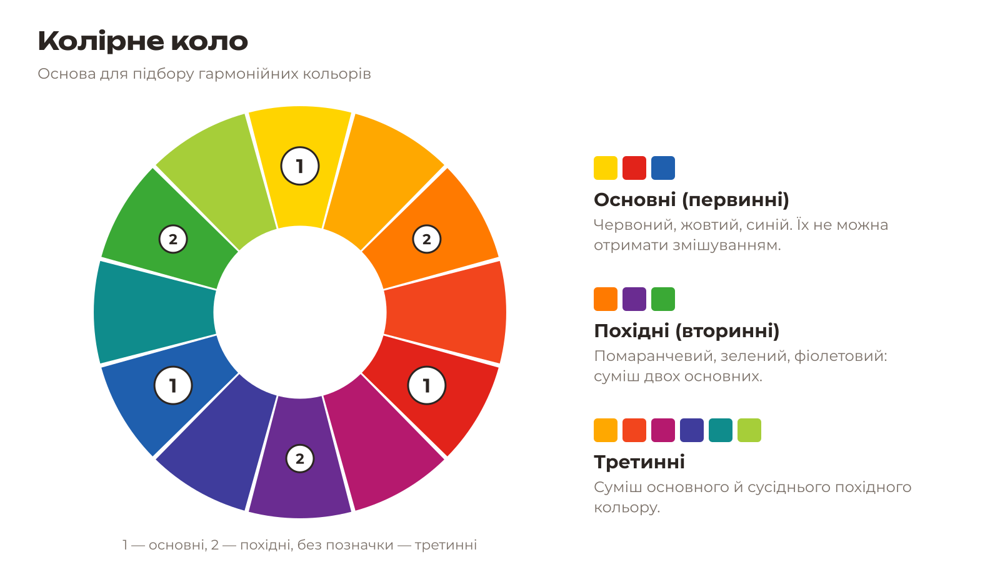
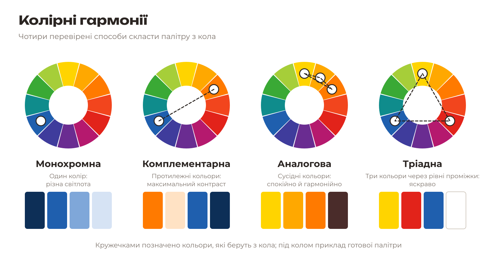
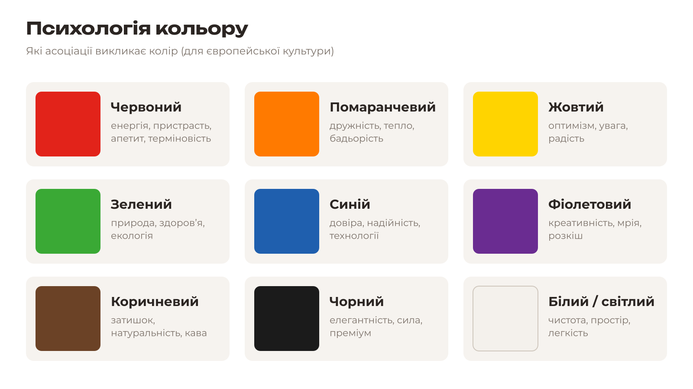
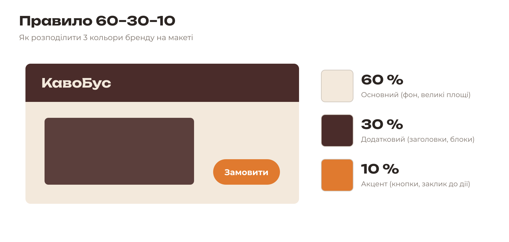
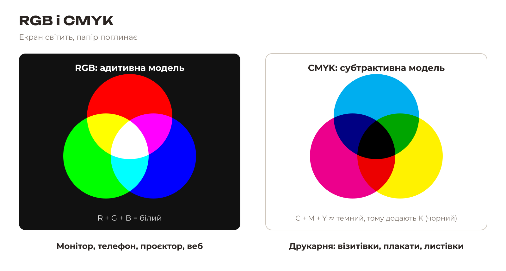
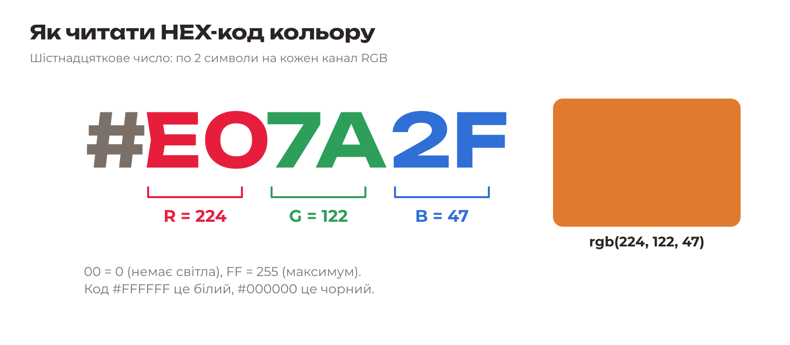

# 2.2. Колір: теорія

[← Бриф](01-bryf.md) · [До уроку](README.md) · [Далі: Шрифти →](03-shryfty.md)

## Колірне коло

Колірне коло показує, як кольори пов’язані між собою. Художники використовують модель з трьома **основними** кольорами: червоним, жовтим і синім. Змішуючи їх попарно, отримують **похідні**: помаранчевий, зелений, фіолетовий. А суміш основного й сусіднього похідного — **третинні** кольори.

## Колірні гармонії

| Гармонія | Як знайти на колі | Ефект |
|---|---|---|
| **Монохромна** | Один колір, різна світлота | Спокійно, стильно, легко |
| **Комплементарна** | Два протилежні кольори | Максимальний контраст, привертає увагу |
| **Аналогова** | 2–3 сусідні кольори | М’яко, природно, гармонійно |
| **Тріадна** | Три кольори через рівні проміжки (трикутник) | Яскраво, весело, по-дитячому |

Палітра «КавоБус» — **аналогова** (теплі коричневі й помаранчевий): тепло, затишно, «кавово».

## Психологія кольору

Колір викликає асоціації ще до того, як людина прочитала назву. Оберіть кольори, які підтримують ваші 3 прикметники.

## Правило 60–30–10

Бренду достатньо **трьох кольорів**:

- **60 %** — основний (фон, великі площі), зазвичай світлий або нейтральний;
- **30 %** — додатковий (заголовки, блоки, логотип);
- **10 %** — акцентний (кнопки, заклик до дії, важливі деталі).

## RGB і CMYK

| | RGB | CMYK |
|---|---|---|
| Де | Екран: монітор, телефон, проєктор | Друк: папір, картон, плівка |
| Як утворюється колір | Світіння: червоний + зелений + синій | Фарби поглинають світло: блакитна + пурпурова + жовта + чорна |
| Усі на максимум | Білий | Майже чорний |
| Охоплення | Ширше: дуже яскраві кольори | Вужче: неонові кольори стають тьмянішими |

Ми малюємо в RGB (так працюють Inkscape і Krita), а перед друком **перевіряємо**, як кольори виглядатимуть у CMYK (урок 7).

## HEX-код кольору

Колір у цифровому дизайні записують **HEX-кодом**: `#` і 6 символів (0–9, A–F). Кожна пара символів — це яскравість одного каналу RGB від `00` (0) до `FF` (255).

| Колір | HEX |
|---|---|
| Білий | `#FFFFFF` |
| Чорний | `#000000` |
| Червоний | `#FF0000` |
| «КавоБус» темний | `#4A2C2A` |
| «КавоБус» акцент | `#E07A2F` |

HEX-код — це «паспорт» кольору бренду. Його вводять у всі програми: Inkscape, Krita, Scribus.

## Перевірте себе

- [ ] Я обрав(ла) 3 кольори й можу пояснити, як вони пов’язані з прикметниками.
- [ ] Я знаю, який колір займатиме 60 %, 30 % і 10 %.

[← Бриф](01-bryf.md) · [До уроку](README.md) · [Далі: Шрифти →](03-shryfty.md)
