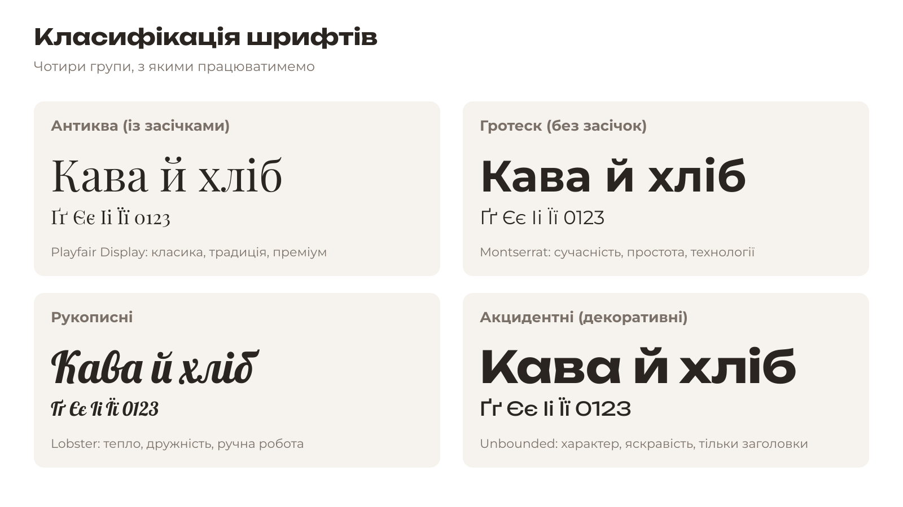
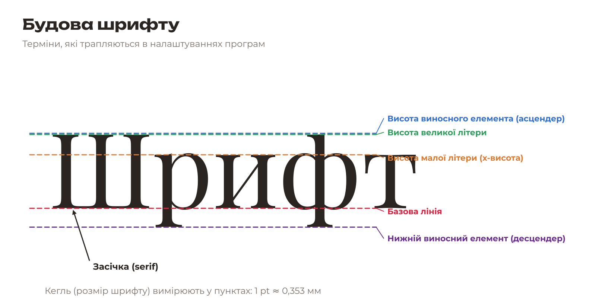
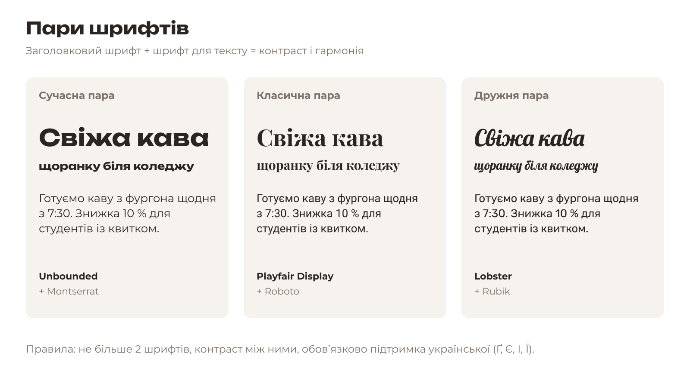

# 2.3. Шрифти: теорія

[← Колір](02-kolir.md) · [До уроку](README.md) · [Далі: Знайомство з Inkscape →](04-inkscape.md)

## Класифікація шрифтів

| Група | Ознака | Настрій | Для чого |
|---|---|---|---|
| **Антиква** (serif) | Є засічки на кінцях штрихів | Класика, традиція, преміум | Заголовки, книжки |
| **Гротеск** (sans-serif) | Без засічок | Сучасність, простота | Будь-який текст, екрани |
| **Рукописні** (script) | Імітують почерк | Тепло, ручна робота | Лише короткі слова |
| **Акцидентні** (display) | Декоративні, з характером | Яскраво, незвично | Лише великі заголовки |

## Будова шрифту

- **Гарнітура** (font family) — назва шрифту: Montserrat, Rubik…
- **Накреслення** (style) — варіант гарнітури: Regular, Bold, Italic.
- **Кегль** (size) — розмір у пунктах (pt). 1 pt ≈ 0,353 мм.
- **Кернінг** — відстань між конкретними парами літер.
- **Інтерліньяж** — відстань між рядками.

## Пари шрифтів

**Правила:**

1. Не більше **2 шрифтів** у фірмовому стилі.
2. Між ними має бути **контраст**: декоративний + простий, із засічками + без засічок, жирний + тонкий.
3. Шрифт для тексту має добре читатися дрібним кеглем.
4. Обидва шрифти **підтримують українську**: є літери Ґ, Є, І, Ї та апостроф.

## Шрифти воркшопу

Усі шрифти в {{asset fonts/}} безкоштовні (ліцензія SIL Open Font License) і мають українські літери:

| Шрифт | Група | Підходить для |
|---|---|---|
| **Montserrat** | Гротеск | Текст і заголовки, універсальний |
| **Roboto** | Гротеск | Текст, технологічні бренди |
| **Rubik** | Гротеск з округленими кутами | Дружні, молодіжні бренди |
| **Comfortaa** | Округлий гротеск | Діти, тварини, м’які бренди |
| **Unbounded** | Акцидентний широкий | Сміливі заголовки, ігри, технології |
| **Playfair Display** | Антиква | Елегантні, преміальні бренди |
| **Lobster** | Рукописний | Їжа, кафе, ретро |
| **Caveat** | Рукописний легкий | Неформальні підписи, нотатки |

> **Ліцензії:** шрифт — це програма, і в нього є ліцензія. Шрифти з Google Fonts (SIL OFL) можна використовувати навіть комерційно. «Безкоштовний» шрифт із випадкового сайту може бути дозволений лише для особистого використання.

[← Колір](02-kolir.md) · [До уроку](README.md) · [Далі: Знайомство з Inkscape →](04-inkscape.md)
