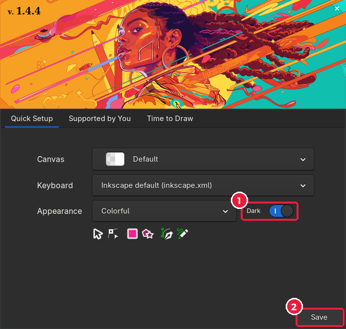
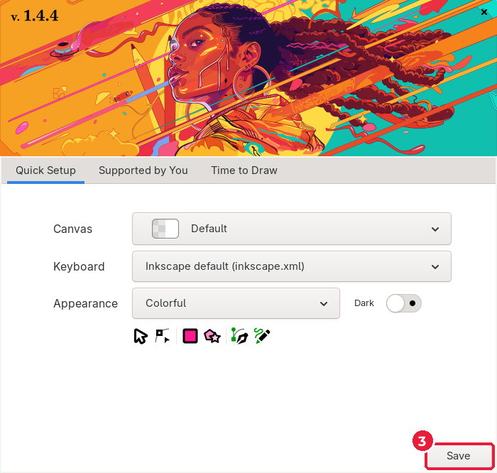
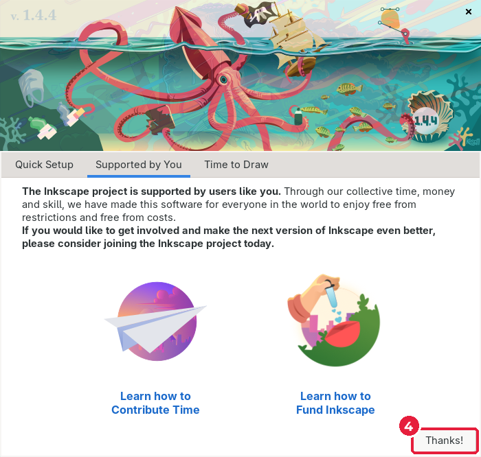
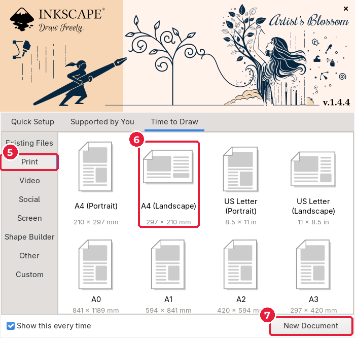
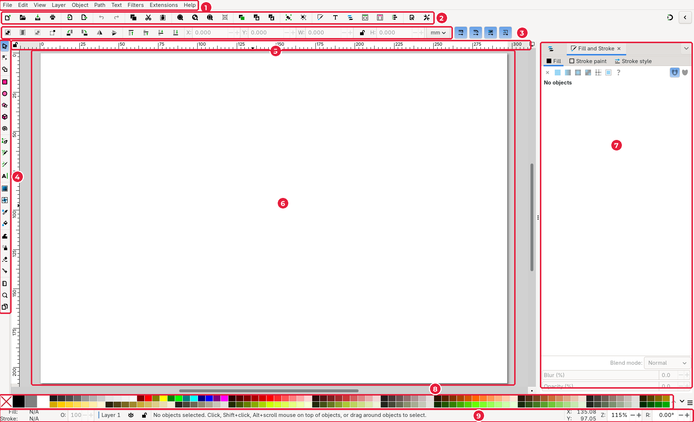
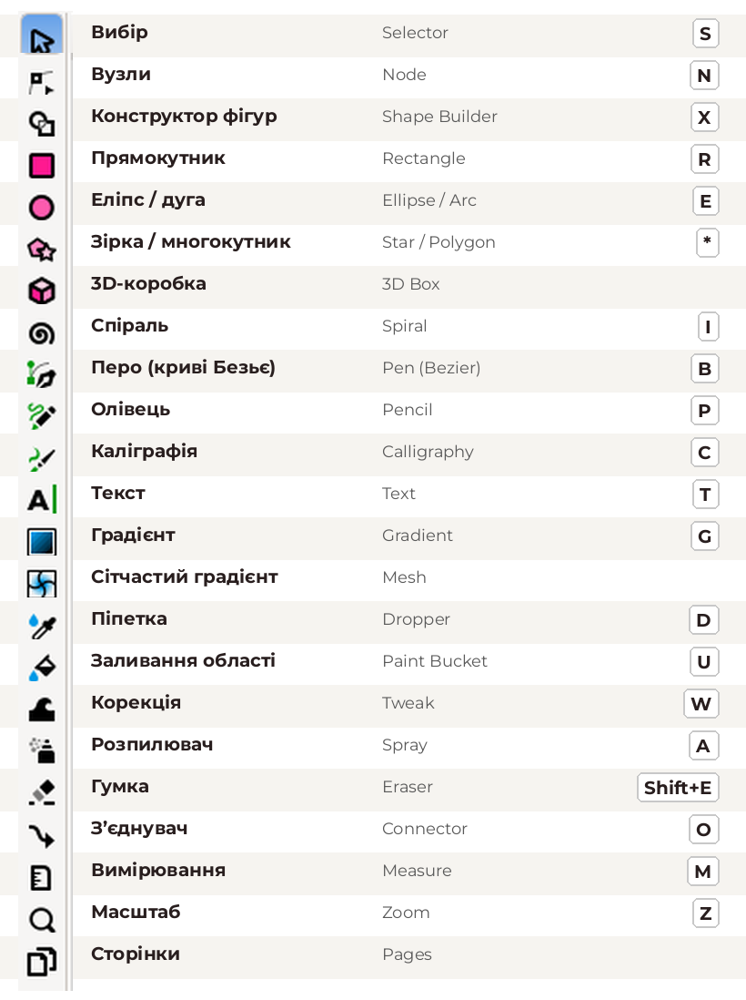

# 2.4. Знайомство з Inkscape

[← Шрифти](03-shryfty.md) · [До уроку](README.md) · [Далі: Мудборд →](05-mudbord.md)

**Inkscape** — безкоштовний векторний редактор з відкритим кодом для Windows, macOS і Linux. Завантажити: inkscape.org. Ми використовуємо версію **1.4**.

## Перший запуск

Під час першого запуску відкривається вітальне вікно.

**1. Вкладка Quick Setup** (*Швидке налаштування*).

- Вимикач **Dark** (*Темна тема*) (1): для навчання зручніше світла тема, вимкніть його.
- Натисніть **Save** (*Зберегти*) (2).

Тема стала світлою. Натисніть **Save** (3).

**2. Вкладка Supported by You** — інформація про те, що Inkscape розвивають користувачі. Натисніть **Thanks!** (4).

**3. Вкладка Time to Draw** (*Час малювати*) — вибір нового документа.

- (5) Категорії форматів: **Print** (*Друк*), **Video**, **Social**, **Screen**…
- (6) Шаблони розмірів: A4, Letter, A3…
- (7) **New Document** (*Новий документ*): створити документ вибраного розміру.

> Щоб це вікно не з’являлося щоразу, зніміть прапорець **Show this every time** унизу ліворуч.

## Інтерфейс

| № | Частина | Що там |
|---|---|---|
| 1 | **Меню** | Усі команди: File, Edit, View, Layer, Object, Path, Text, Filters, Extensions, Help |
| 2 | **Панель команд** | Кнопки частих команд: створити, відкрити, зберегти, скасувати… |
| 3 | **Панель параметрів інструмента** | Змінюється залежно від вибраного інструмента |
| 4 | **Панель інструментів** | Інструменти малювання й редагування |
| 5 | **Лінійки** | Розміри в міліметрах |
| 6 | **Полотно** | Сторінка (біла) і робоча область навколо |
| 7 | **Панель діалогів** | Fill and Stroke, Layers, Align… |
| 8 | **Палітра** | Швидкий вибір кольору |
| 9 | **Рядок стану** | Колір виділеного, шар, підказки, координати, масштаб |

> **Рядок стану (9)** — найкращий помічник новачка. Він завжди підказує, що виділено і що можна зробити далі.

## Панель інструментів

Наведіть курсор на будь-яку кнопку — з’явиться підказка з назвою та клавішею. Найчастіше сьогодні використовуватимете: **Selector** (`S`), **Node** (`N`), **Rectangle** (`R`), **Ellipse** (`E`), **Pen** (`B`), **Text** (`T`), **Dropper** (`D`) і **Pages**.

## Найважливіші клавіші

| Клавіші | Дія |
|---|---|
| `Ctrl+S` | Зберегти |
| `Ctrl+Z` / `Shift+Ctrl+Z` | Скасувати / повторити |
| `Ctrl+D` | Дублювати |
| `Ctrl+G` / `Shift+Ctrl+G` | Згрупувати / розгрупувати |
| `Delete` | Видалити виділене |
| `5` | Показати всю сторінку |
| `+` / `-` | Наблизити / віддалити |
| Пробіл (затиснути) + рух мишею | Пересувати полотно |

[← Шрифти](03-shryfty.md) · [До уроку](README.md) · [Далі: Мудборд →](05-mudbord.md)
