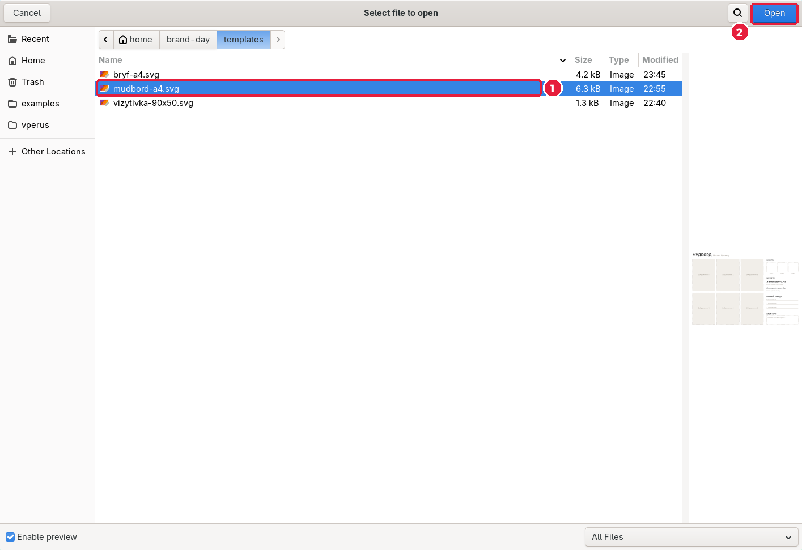
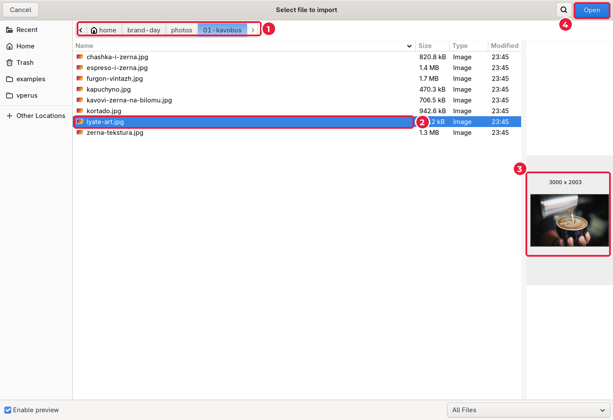
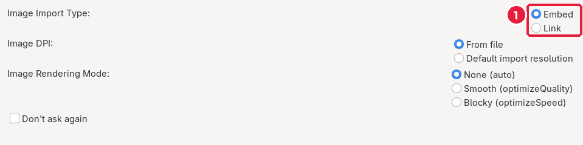
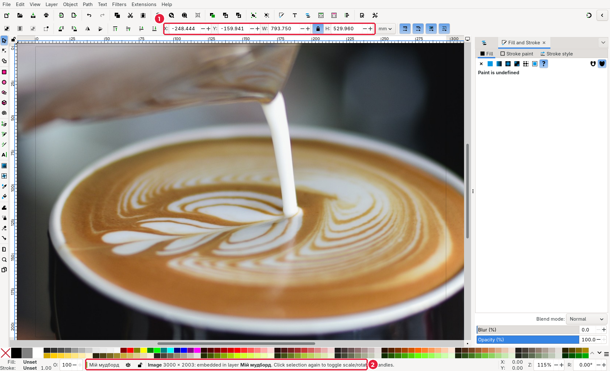
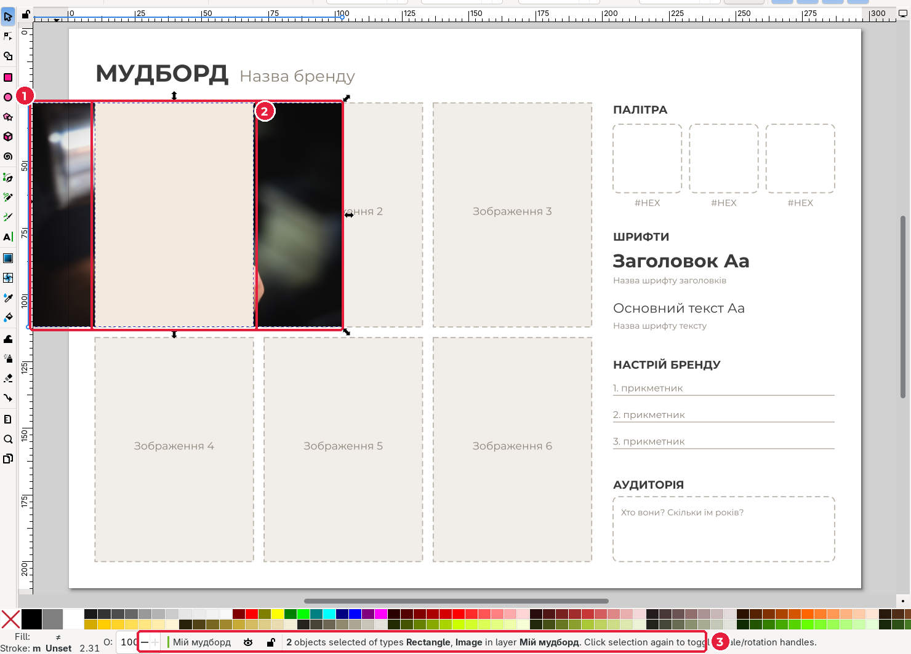
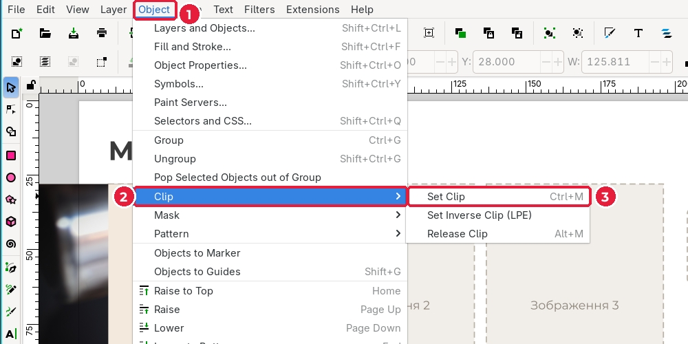
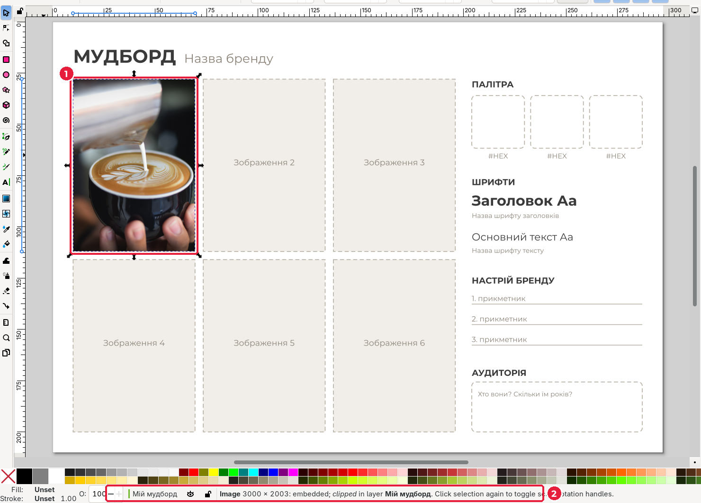
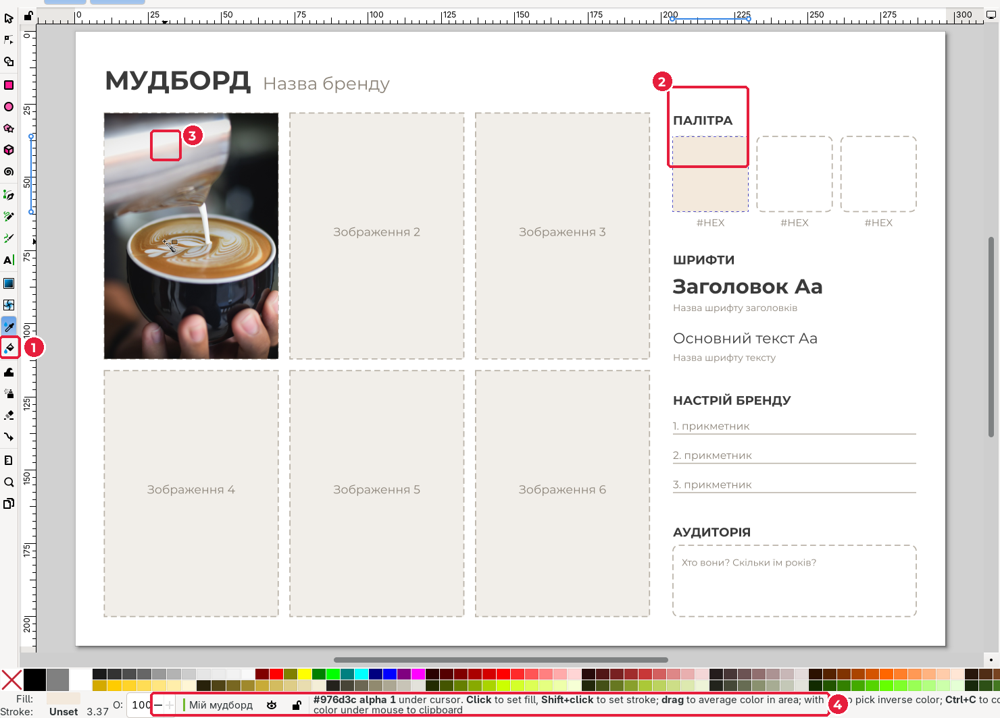
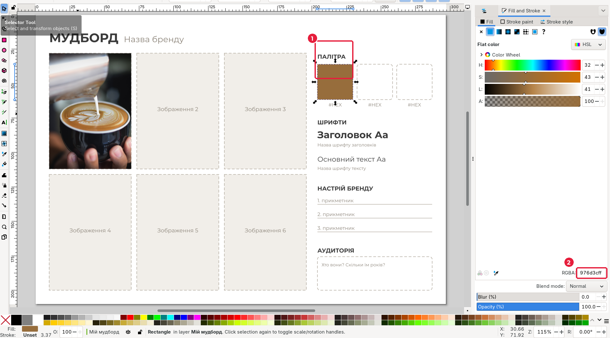
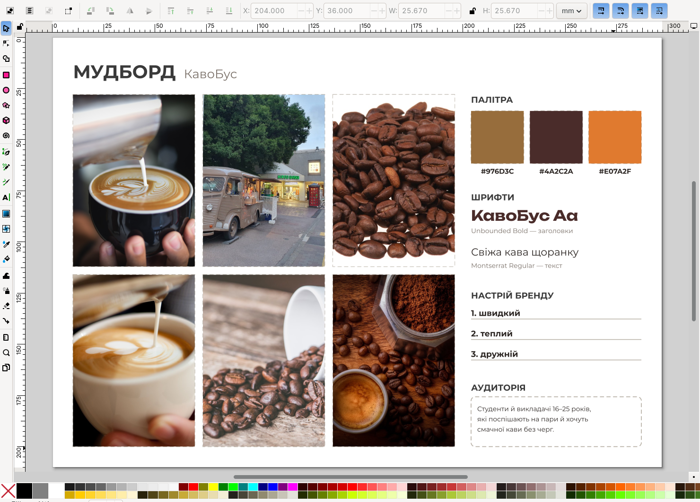

# 2.5. Мудборд в Inkscape

[← Знайомство з Inkscape](04-inkscape.md) · [До уроку](README.md) · [Урок 3: Логотип →](../03-lohotyp/README.md)

**Мудборд** (*moodboard*, дошка настрою) — колаж, що показує настрій бренду: фото, кольори, шрифти. Дизайнер узгоджує мудборд із клієнтом **до** того, як малювати логотип, щоб не переробляти роботу.

## Крок 1. Відкрийте шаблон

1. **File → Open…** (`Ctrl+O`).
2. Перейдіть у {{asset templates/}}, оберіть {{asset templates/mudbord-a4.svg short}} (1), натисніть **Open** (2).

3. Одразу **File → Save As…** (`Shift+Ctrl+S`): збережіть як `moodboard.svg` у своїй робочій теці.

Шаблон має два шари: **Розмітка** (заблокована: рамки й підписи) і **Мій мудборд** (поточний: сюди додаєте свої елементи).

## Крок 2. Імпортуйте фото

1. **File → Import…** (`Ctrl+I`).
2. Перейдіть у теку своєї теми: {{asset photos/01-kavobus/}} (1).
3. Клацніть фото (2): праворуч з’явиться попередній перегляд і розмір у пікселях (3). Натисніть **Open** (4).

4. У вікні **jpeg bitmap image import** залиште **Embed** (*Вбудувати*) (1) і натисніть **OK**.

| Варіант | Що відбувається |
|---|---|
| **Embed** (*Вбудувати*) | Фото копіюється всередину SVG-файлу. Файл більший, зате нічого не загубиться |
| **Link** (*Посилання*) | SVG лише посилається на файл фото. Якщо перенести SVG на інший ПК без фото, воно зникне |

Фото з’явиться величезним (1): його розмір у міліметрах обчислено з роздільної здатності файлу. Рядок стану (2) показує **Image 3000 × 2003: embedded**.

## Крок 3. Зменшіть фото

1. Перевірте, що **замок пропорцій** між **W** і **H** увімкнений.
2. Введіть **H** = `84` (висота рамки) і натисніть `Enter`. Ширина зміниться пропорційно.
3. Пересуньте фото на рамку «Зображення 1»: мишею або полями **X** / **Y**.

## Крок 4. Обріжте фото по рамці (Clip)

Фото ширше за рамку. Обріжемо його **обтравочним контуром** (clip): фото залишиться цілим, але буде видно лише частину всередині контуру.

1. Намалюйте прямокутник (`R`) точно поверх рамки «Зображення 1» (у шаблоні: **X** = `10`, **Y** = `28`, **W** = `59.33`, **H** = `84`; вимкніть замок пропорцій, щоб ввести W і H окремо).
2. Інструментом **Selector** (`S`) клацніть прямокутник, затисніть `Shift` і клацніть фото. Виділено 2 об’єкти (1). Прямокутник (2) має бути **зверху**.

3. **Object → Clip → Set Clip** (*Об’єкт → Обтравка → Встановити*), `Ctrl+M`.

Фото обрізано по рамці (1). Рядок стану (2) показує *clipped*.

> Не той фрагмент? **Object → Clip → Release Clip** (`Alt+M`) поверне все як було.

4. Повторіть кроки 2–4 для решти рамок. Шість фото — це орієнтир: можна менше, але не менше чотирьох.

## Крок 5. Палітра: беремо колір із фото

1. Намалюйте квадрат (`R`) поверх першого квадратика палітри (у шаблоні **X** = `204`, **Y** = `36`, **W** = **H** = `25.67`). Залиште його виділеним.
2. Оберіть **Dropper** (*Піпетка*), клавіша `D` (1).
3. Наведіть піпетку на фото, на місце потрібного кольору (3). Рядок стану (4) показує HEX-код під курсором.

4. **Клацніть**: квадрат (1) зафарбується цим кольором. HEX-код видно в полі **RGBA** (2) вікна **Fill and Stroke**.

| Дія піпеткою | Результат |
|---|---|
| Клацання | Колір → заливка виділеного об’єкта |
| `Shift` + клацання | Колір → обведення |
| Протягування | Середній колір області |

5. Додайте ще 2 квадрати палітри. Колір можна брати піпеткою або вводити HEX-код у поле **RGBA** (див. [урок 3.5](../03-lohotyp/05-zalyvka-obvedennia.md)).
6. Під кожним квадратом інструментом **Text** (`T`) підпишіть HEX-код, наприклад `#976D3C`.

## Крок 6. Шрифти, прикметники, аудиторія

1. Інструментом **Text** (`T`) наберіть приклад заголовка шрифтом заголовків і приклад тексту шрифтом тексту. Як змінити шрифт, див. [урок 3.7](../03-lohotyp/07-tekst.md).
2. Підпишіть назви шрифтів дрібним сірим текстом.
3. Впишіть 3 прикметники й опис аудиторії з брифу.
4. Замініть «Назва бренду» вгорі на свою назву.
5. Збережіть: `Ctrl+S`.

## Перевірте себе

- [ ] 4–6 фото, кожне обрізане по своїй рамці.
- [ ] 3 кольори з HEX-кодами.
- [ ] 2 шрифти з підписами, обидва з українськими літерами.
- [ ] 3 прикметники й аудиторія збігаються з брифом.
- [ ] Файл `moodboard.svg` збережено в робочій теці.

[← Знайомство з Inkscape](04-inkscape.md) · [До уроку](README.md) · [Урок 3: Логотип →](../03-lohotyp/README.md)
