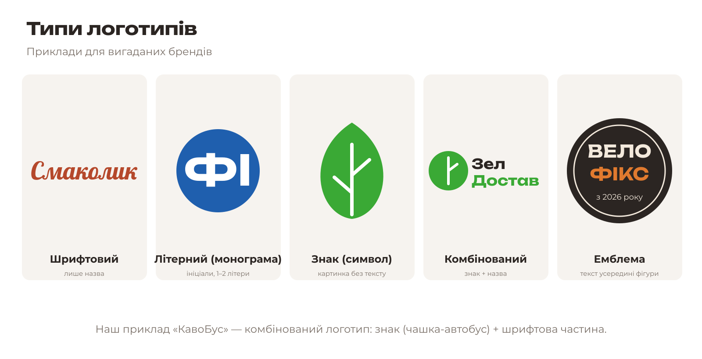
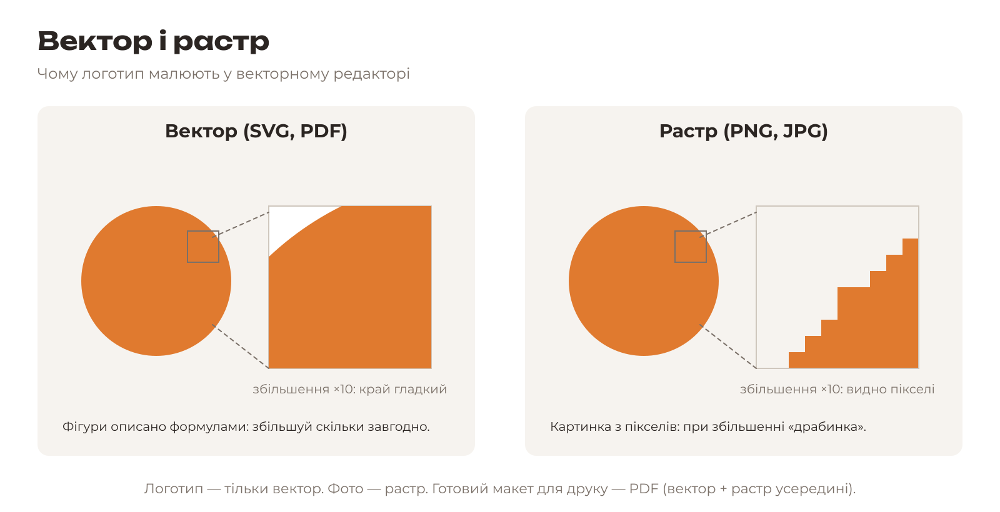
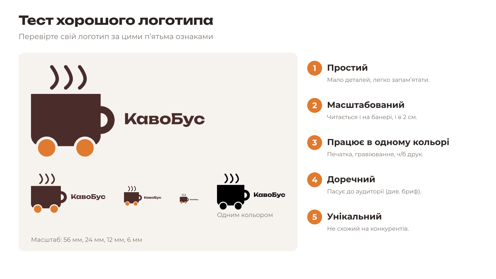

# 3.1. Теорія логотипа

[← До уроку](README.md) · [Далі: Новий документ →](02-novyi-dokument.md)

## Що таке логотип

**Логотип** — це графічний знак, за яким люди впізнають бренд. Він з’являється всюди: на вивісці, візитівці, стаканчику кави, сторінці в соцмережах. Тому логотип має добре виглядати і на величезному банері, і в куточку екрана телефону.

Логотип — лише частина **фірмового стилю**. До фірмового стилю також входять кольори, шрифти, стиль фото й ілюстрацій. Сьогодні ви створюєте все це разом: логотип (урок 3), візитівку (урок 4), ключовий візуал (урок 5), плакат і листівку (урок 6).

## Типи логотипів

| Тип | Що це | Коли обирати |
|---|---|---|
| **Шрифтовий** | Лише назва, набрана або намальована особливим шрифтом | Коротка, звучна назва |
| **Літерний (монограма)** | Ініціали або 1–2 літери | Довга назва, яку незручно писати повністю |
| **Знак (символ)** | Картинка без тексту | Відомі бренди; новому бренду ризиковано |
| **Комбінований** | Знак + назва | Найуніверсальніший варіант для нового бренду |
| **Емблема** | Текст усередині фігури (кола, щита) | Клуби, кав’ярні, ремесла, «вінтажний» настрій |

Наш приклад «КавоБус» — **комбінований** логотип: знак (чашка на колесах, тобто кава + автобус) і назва.

## Вектор і растр

- **Векторне зображення** складається з фігур, описаних математично: точки, лінії, криві, заливки. Його можна збільшувати без втрати якості. Формати: SVG, PDF, AI, EPS. Програми: Inkscape, CorelDRAW, Illustrator.
- **Растрове зображення** складається з пікселів (кольорових квадратиків). При збільшенні з’являється «драбинка». Формати: PNG, JPG, KRA. Програми: Krita, GIMP, Photoshop.

**Логотип завжди створюють у векторі.** З вектора легко отримати растр будь-якого розміру, але не навпаки.

## Ознаки хорошого логотипа

1. **Простий.** Мало деталей. Його можна намалювати по пам’яті.
2. **Масштабований.** Читається і на банері, і завширшки 2 см.
3. **Працює в одному кольорі.** Чорна версія має бути такою ж зрозумілою, як кольорова.
4. **Доречний.** Відповідає аудиторії та трьом прикметникам із брифу.
5. **Унікальний.** Не копія чужого логотипа.

## Від ескізу до вектора

Перш ніж будувати логотип, намалюйте **3 швидкі ескізи** — на папері або в програмі, як вам зручніше. Не прикрашайте: достатньо кількох ліній.

> **Ескізи в програмі.** В Inkscape створіть новий документ і малюйте від руки інструментом **Pencil** (*Олівець*, `P`), мишею або графічним планшетом. Три ескізи — поруч на одній сторінці. Збережіть файл як `logo/eskizy.svg`, щоб показати парі.

Покажіть ескізи парі й оберіть один напрям. Подумайте, з яких **простих фігур** він складається: прямокутники, кола, лінії. Саме так ми й будуватимемо логотип.

Ескіз «КавоБуса»: чашка (прямокутник із заокругленим низом) + ручка (кільце) + два колеса (кола) + пара (3 криві лінії) + назва праворуч.

## Перевірте себе

- [ ] Я можу назвати 5 типів логотипів і тип свого логотипа.
- [ ] Я знаю, чому логотип роблять у векторі.
- [ ] У мене є обраний ескіз, і я розумію, з яких фігур він складається.

[← До уроку](README.md) · [Далі: Новий документ →](02-novyi-dokument.md)
