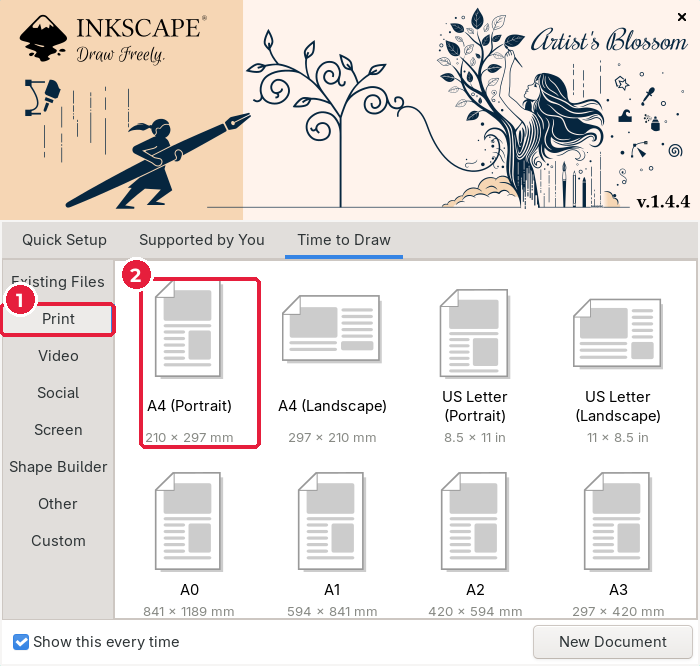
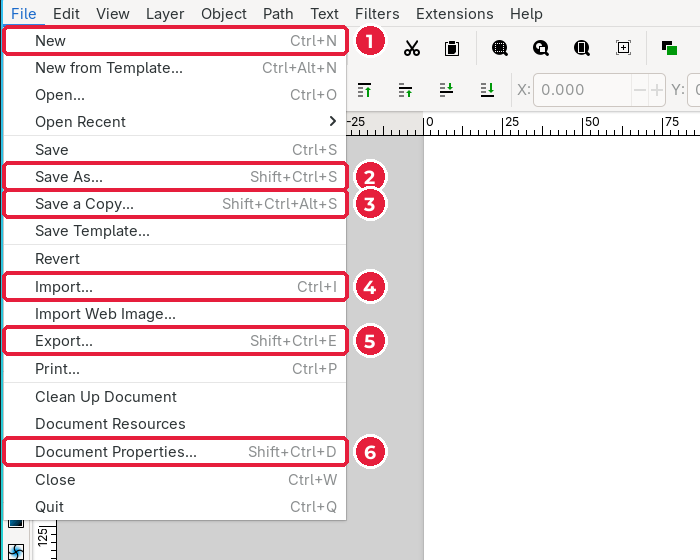
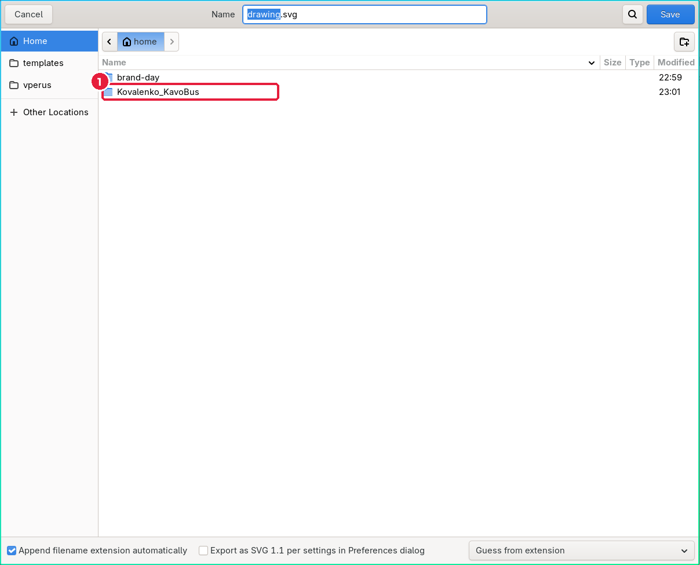
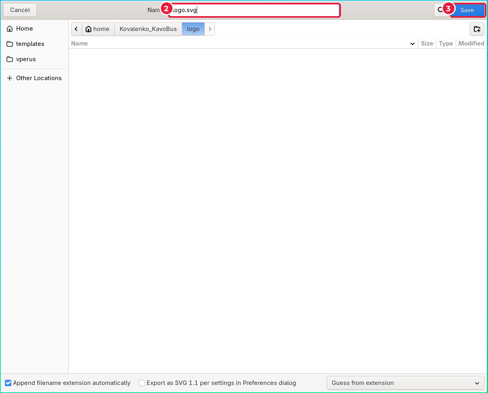
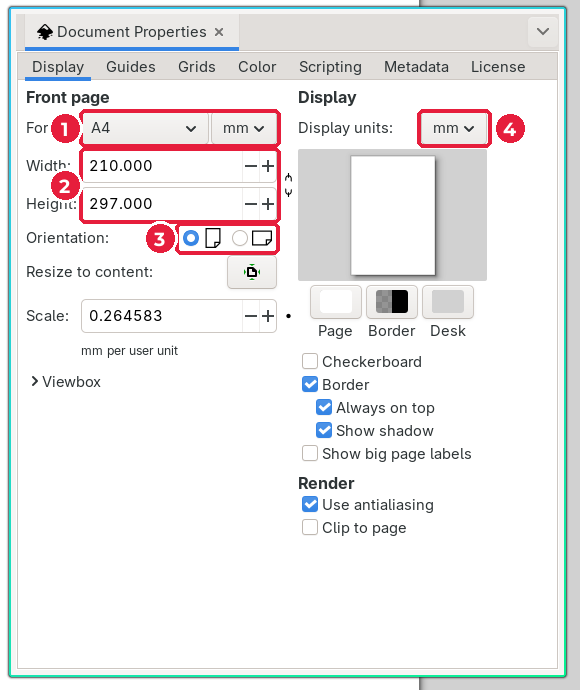

# 3.2. Новий документ

[← Теорія логотипа](01-teoriia-lohotypa.md) · [До уроку](README.md) · [Далі: Прості фігури →](03-prymityvy.md)

## Крок 1. Створіть документ A4

Запустіть Inkscape. Відкриється стартове вікно. Якщо ви бачите його вперше, спочатку пройдіть вкладку **Quick Setup** (див. урок 2, підурок «Знайомство з Inkscape»).

1. Перейдіть на вкладку **Time to Draw** і оберіть категорію **Print** (*Друк*).
2. Клацніть **A4 (Portrait)** (*A4, книжкова*). Документ створиться одразу.

> Якщо стартове вікно не з’явилося, оберіть **File → New** (*Файл → Створити*) або натисніть `Ctrl+N`.

Меню **File** (*Файл*) знадобиться на кожному уроці:

| № | Команда | Українською | Клавіші |
|---|---|---|---|
| 1 | New | Створити | `Ctrl+N` |
| 2 | Save As… | Зберегти як… | `Shift+Ctrl+S` |
| 3 | Save a Copy… | Зберегти копію… | `Shift+Ctrl+Alt+S` |
| 4 | Import… | Імпортувати… | `Ctrl+I` |
| 5 | Export… | Експортувати… | `Shift+Ctrl+E` |
| 6 | Document Properties… | Властивості документа… | `Shift+Ctrl+D` |

## Крок 2. Одразу збережіть файл

Звичка професіонала: **зберегти файл до того, як почали малювати**. Тоді `Ctrl+S` зберігатиме роботу кожні кілька хвилин, і нічого не загубиться.

1. Натисніть **File → Save As…** (`Shift+Ctrl+S`).
2. У вікні збереження двічі клацніть свою робочу теку.

3. Відкрийте теку `logo`, у полі **Name** (*Ім’я*) введіть `logo.svg` (2) і натисніть **Save** (*Зберегти*) (3).

Тепер у заголовку вікна написано `logo.svg - Inkscape`. Формат **Inkscape SVG** зберігає все: шари, налаштування, сторінки.

> Вікно збереження виглядає по-різному в Windows, macOS і Linux, але в усіх є поле імені файлу, список тек і кнопка збереження.

## Крок 3. Перевірте властивості документа

Відкрийте **File → Document Properties…** (`Shift+Ctrl+D`).

1. **Format** — розмір сторінки (A4).
2. **Width / Height** — ширина й висота: 210 × 297.
3. **Orientation** — орієнтація: книжкова чи альбомна.
4. **Display units** — одиниці вимірювання: оберіть **mm** (*міліметри*). Друкарні працюють у міліметрах.

Закрийте вікно хрестиком. Розмір сторінки для логотипа не дуже важливий: наприкінці ми підженемо сторінку під логотип (підурок 3.9).

## Перевірте себе

- [ ] Файл `logo.svg` лежить у теці `<прізвище>_<назва>/logo/`.
- [ ] Одиниці документа — міліметри.

[← Теорія логотипа](01-teoriia-lohotypa.md) · [До уроку](README.md) · [Далі: Прості фігури →](03-prymityvy.md)
