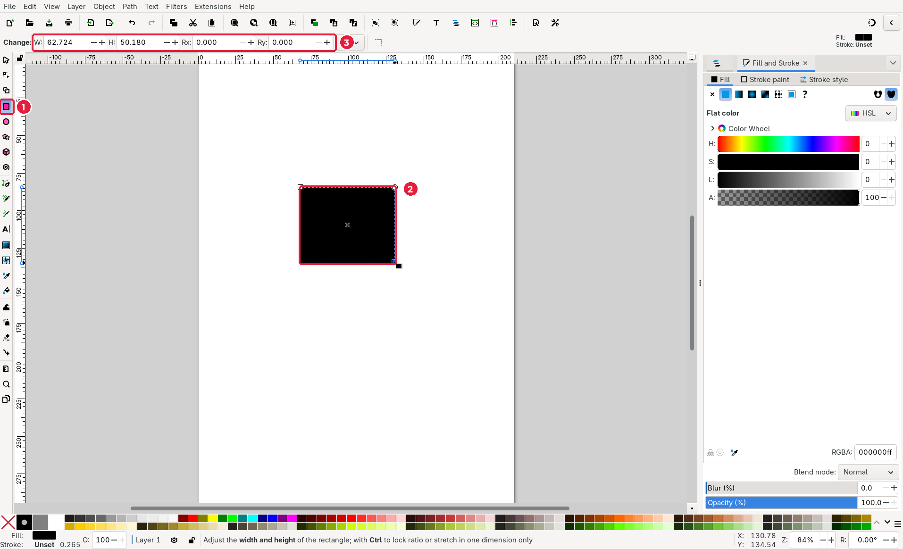
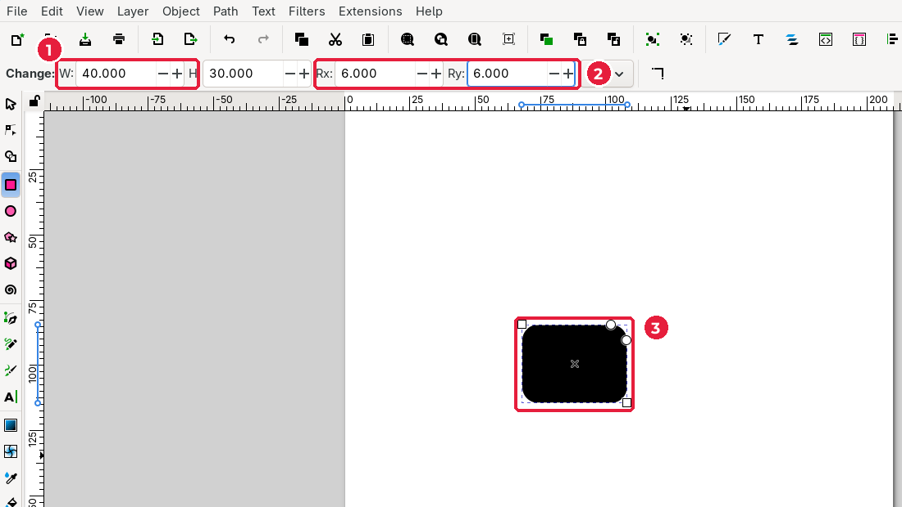
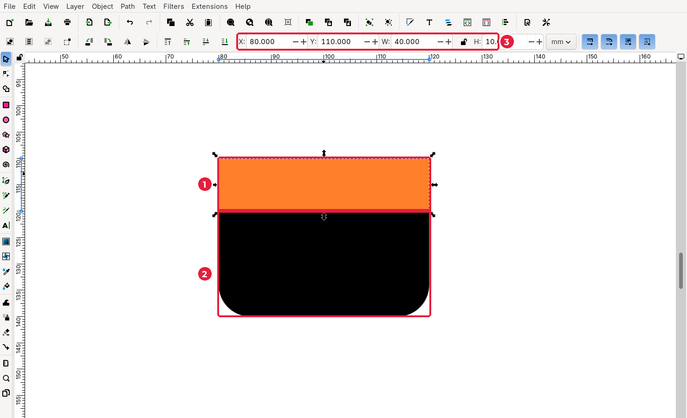
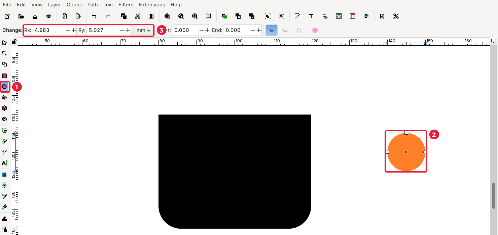

# 3.3. Прості фігури (примітиви)

[← Новий документ](02-novyi-dokument.md) · [До уроку](README.md) · [Далі: Логічні операції →](04-lohichni-operatsii.md)

**Примітиви** — це прості фігури, з яких складається майже будь-який логотип: прямокутник, еліпс, зірка, многокутник. Їх малюють спеціальними інструментами, а потім точно налаштовують числами.

## Крок 1. Намалюйте прямокутник

1. На панелі інструментів зліва оберіть **Rectangle** (*Прямокутник*), клавіша `R`.
2. Наведіть курсор на сторінку, натисніть ліву кнопку миші й, не відпускаючи, потягніть по діагоналі. Відпустіть кнопку: прямокутник готовий.
3. Подивіться на **панель параметрів інструмента** вгорі: там поля **W** (ширина), **H** (висота), **Rx**, **Ry** (заокруглення кутів).

> Новий об’єкт отримує стиль останнього намальованого. Тому перший прямокутник може бути чорним, а наступні — кольоровими. Колір ми налаштуємо пізніше (підурок 3.5).

## Крок 2. Задайте точний розмір і заокруглення

Малювати «на око» зручно, але розміри логотипа краще задавати числами.

1. У полі **W** введіть `40`, натисніть `Enter`. У полі **H** введіть `30`, `Enter`. Одиниці — **mm**.
2. У полях **Rx** і **Ry** (радіус заокруглення) введіть `6`. Кути стануть круглими.
3. Кругленькі маркери в кутах фігури теж змінюють заокруглення, якщо потягнути їх мишею.

## Крок 3. Перемістіть фігуру точно

1. Оберіть інструмент **Selector** (*Вибір*), клавіша `S`, і клацніть прямокутник.
2. На панелі вгорі з’являться поля **X**, **Y**, **W**, **H**. Введіть **X** = `80`, **Y** = `110` (кожне значення підтверджуйте `Enter`).
3. Щоб наблизити фігуру, введіть масштаб у поле **Z** у правому нижньому куті вікна (наприклад, `300`) або користуйтеся клавішами `+` і `-`.

| Клавіша | Масштаб |
|---|---|
| `+` / `-` | Наблизити / віддалити |
| `3` | Показати виділене |
| `4` | Показати весь малюнок |
| `5` | Показати всю сторінку |
| `Ctrl` + коліщатко миші | Масштаб у точці курсора |
| Середня кнопка миші (затиснути) | Пересувати полотно |

## Крок 4. Другий прямокутник: «підрізаємо» верхні кути

У чашки заокруглене лише дно, а верх прямий. Зробимо це за допомогою другого прямокутника.

1. Знову оберіть **Rectangle** (`R`) і намалюйте прямокутник.
2. На панелі інструмента поставте **Rx** = `0`, **Ry** = `0` (прямі кути).
3. Перейдіть на **Selector** (`S`), клацніть новий прямокутник і задайте **X** = `80`, **Y** = `110`, **W** = `40`, **H** = `10` (3).
4. Щоб краще бачити фігуру, клацніть будь-який колір на **палітрі** внизу вікна. Тепер видно, що верхній прямокутник (1) лежить поверх нижнього (2) і накриває заокруглені верхні кути.

У наступному підуроці ми об’єднаємо ці дві фігури в одну.

## Крок 5. Еліпс і коло

1. Оберіть **Ellipse / Arc** (*Еліпс / дуга*), клавіша `E`.
2. Потягніть мишею. Щоб вийшло рівне **коло**, тримайте `Ctrl` під час малювання.
3. Панель інструмента (3) містить радіуси **Rx**, **Ry** та **Start** / **End** для дуг і секторів.

Для ручки чашки потрібні два кола. Намалюйте їх і задайте розміри через **Selector**:

| Коло | X | Y | W | H |
|---|---|---|---|---|
| Зовнішнє | 112 | 117 | 16 | 16 |
| Внутрішнє | 116 | 121 | 8 | 8 |

Внутрішньому колу дайте білий колір на палітрі, щоб бачити обидва кола.

> **Зірка й многокутник** (`*`) теж корисні: зірка для «нагороди», многокутник для «гайки» в логотипі ремонту. Спробуйте самостійно: на панелі інструмента є кількість кутів, заокруглення й випадковість.

## Типові помилки

| Проблема | Причина | Рішення |
|---|---|---|
| Значення в полі не застосовується | Не натиснули `Enter` | Після кожного числа натискайте `Enter` |
| Клавіші (`3`, `5`) друкуються в поле | Курсор залишився в полі | Натисніть `Esc` або клацніть полотно |
| Об’єкт показує стрілки обертання | Клацнули виділений об’єкт удруге | Клацніть ще раз — повернуться стрілки масштабування |

## Перевірте себе

- [ ] Тіло чашки: заокруглений прямокутник 40 × 30 мм + прямокутник 40 × 10 мм зверху.
- [ ] Два кола для ручки лежать праворуч від тіла чашки.

[← Новий документ](02-novyi-dokument.md) · [До уроку](README.md) · [Далі: Логічні операції →](04-lohichni-operatsii.md)
