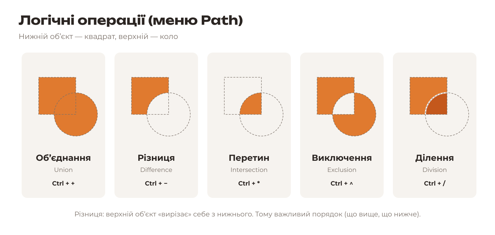
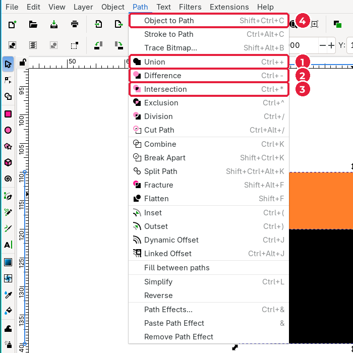
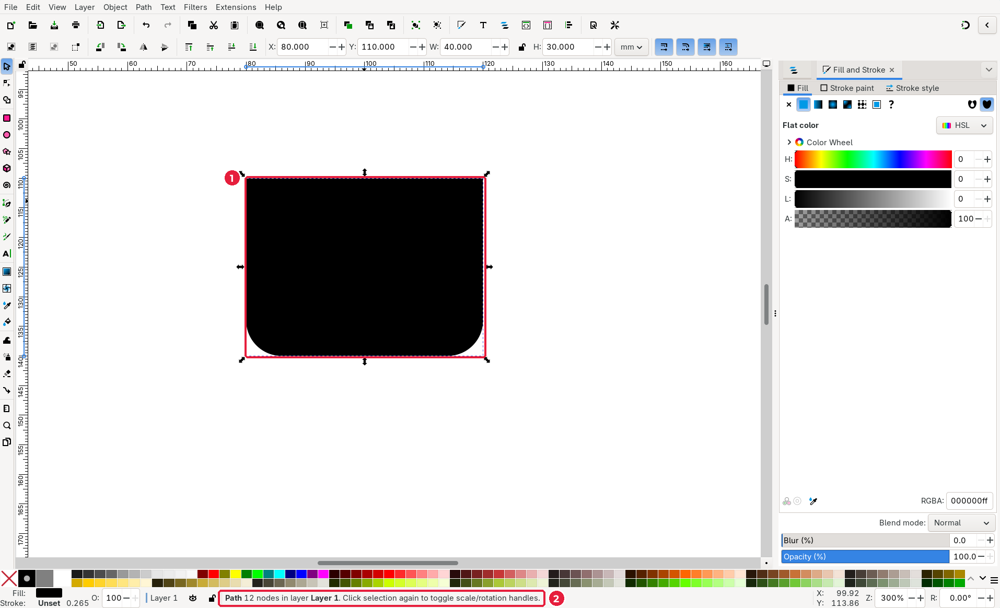
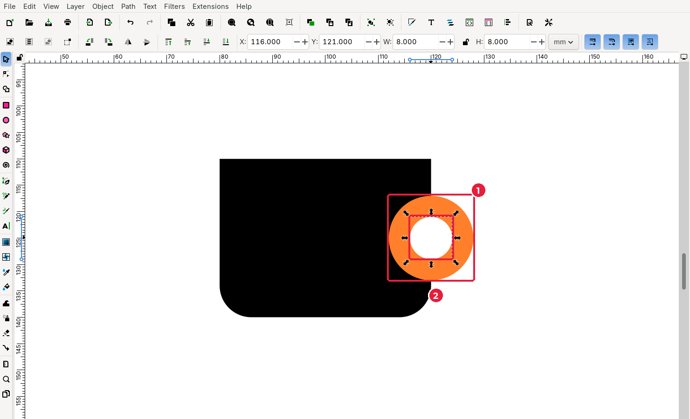
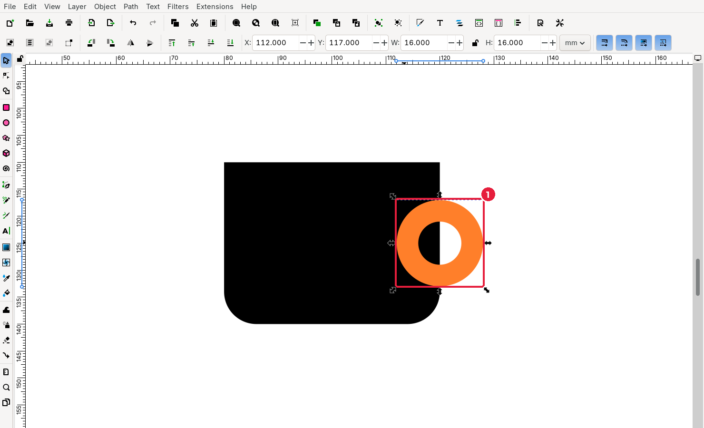

# 3.4. Логічні операції

[← Прості фігури](03-prymityvy.md) · [До уроку](README.md) · [Далі: Заливка й обведення →](05-zalyvka-obvedennia.md)

**Логічні (булеві) операції** створюють нову фігуру з двох або більше фігур. Так із прямокутників і кіл можна отримати майже будь-яку форму.

| Операція | Українською | Клавіші | Результат |
|---|---|---|---|
| **Union** | Об’єднання | `Ctrl++` | Усі фігури зливаються в одну |
| **Difference** | Різниця | `Ctrl+-` | Верхня фігура вирізається з нижньої |
| **Intersection** | Перетин | `Ctrl+*` | Залишається лише спільна частина |
| **Exclusion** | Виключення | `Ctrl+^` | Залишається все, крім спільної частини |
| **Division** | Ділення | `Ctrl+/` | Нижня фігура розрізається верхньою на частини |

Для **різниці** важливий порядок: вирізає **верхній** об’єкт (той, що намальований пізніше). Змінити порядок можна клавішами `Page Up` / `Page Down` або командами **Object → Raise** / **Lower** (*Об’єкт → Підняти / Опустити*).

## Крок 1. Виділіть два прямокутники

1. Оберіть **Selector** (`S`) і клацніть нижній прямокутник.
2. Затисніть `Shift` і клацніть верхній прямокутник. Тепер виділено обидва. У рядку стану внизу написано «2 objects selected».

> Інший спосіб: обвести обидві фігури рамкою, протягнувши мишею по порожньому місцю.

## Крок 2. Об’єднайте їх

Відкрийте меню **Path** (*Контур*).

1. **Union** (*Об’єднання*)
2. **Difference** (*Різниця*)
3. **Intersection** (*Перетин*)
4. **Object to Path** (*Об’єкт у контур*): знадобиться для тексту (підурок 3.7)

Клацніть **Union**. Дві фігури стали однією: прямий верх і заокруглене дно.

У рядку стану (2) тепер написано **Path 12 nodes**: це вже не прямокутник, а **контур** із 12 вузлів.

## Крок 3. Зробіть ручку-кільце

1. Виділіть зовнішнє коло (1), затисніть `Shift` і клацніть внутрішнє коло (2).
2. Оберіть **Path → Difference** (`Ctrl+-`). Внутрішнє коло «вирізало» дірку в зовнішньому.

## Крок 4. Приєднайте ручку до чашки

1. Клацніть кільце, затисніть `Shift` і клацніть тіло чашки.
2. **Path → Union** (`Ctrl++`). Тепер чашка й ручка — одна фігура.

## Що далі

Чашка готова за формою. У підуроці 3.9 ви ще раз використаєте **різницю**: виріжете «колісні арки», щоб логотип читався в одному кольорі.

## Перевірте себе

- [ ] Чашка з ручкою — одна фігура (рядок стану показує **Path**).
- [ ] Я знаю, яка фігура вирізає іншу при **Difference**.

[← Прості фігури](03-prymityvy.md) · [До уроку](README.md) · [Далі: Заливка й обведення →](05-zalyvka-obvedennia.md)
