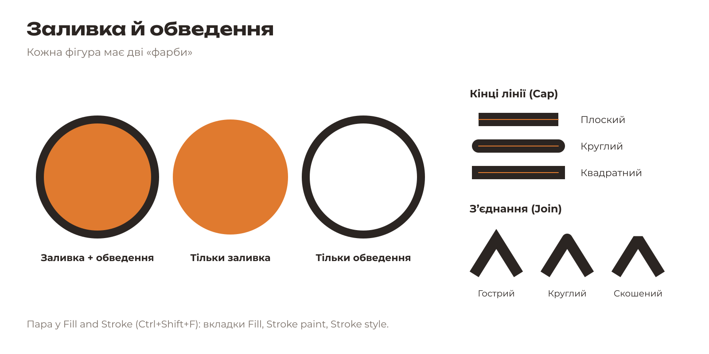
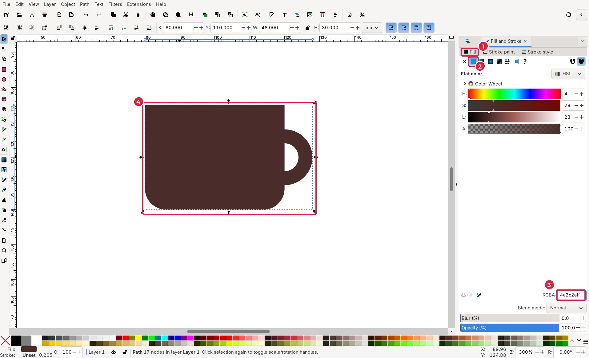
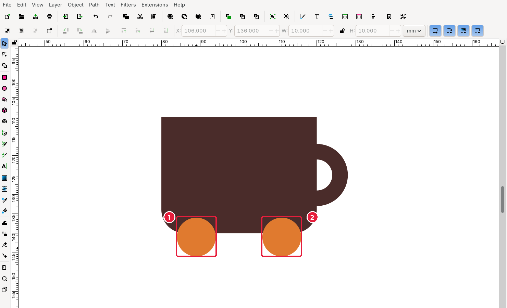
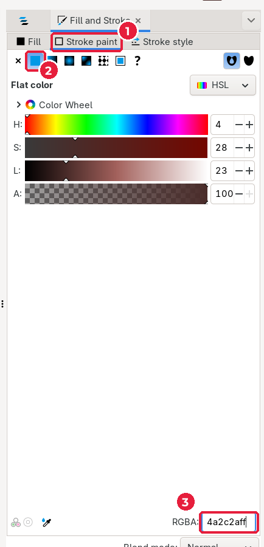
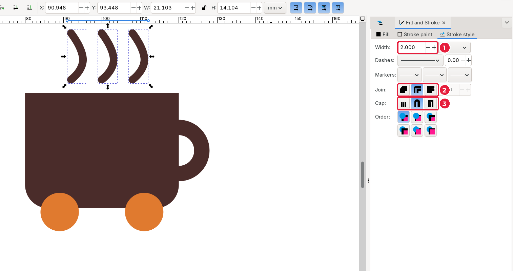

# 3.5. Колір: заливка й обведення

[← Логічні операції](04-lohichni-operatsii.md) · [До уроку](README.md) · [Далі: Криві Безьє →](06-kryvi-bezie.md)

Кожна фігура в Inkscape має дві «фарби»:

- **Fill** (*заливка*) — колір усередині фігури;
- **Stroke** (*обведення*) — колір лінії по контуру фігури, її товщина та стиль.

Усе налаштовується у вікні **Object → Fill and Stroke** (*Об’єкт → Заливка й обведення*), клавіші `Shift+Ctrl+F`. Зазвичай воно вже відкрите праворуч.

## Крок 1. Залийте чашку кольором бренду

Кольори беріть **з мудборду** в HEX-форматі (наприклад, `#4A2C2A`).

1. Виділіть чашку інструментом **Selector** (`S`) (4).
2. У вікні **Fill and Stroke** відкрийте вкладку **Fill** (1).
3. Натисніть кнопку **Flat color** (*Суцільний колір*) (2).
4. У полі **RGBA** (3) введіть код кольору без `#` і додайте `ff` наприкінці: `4a2c2aff`. Натисніть `Enter`.

> **RGBA** = HEX-код (6 символів) + прозорість (2 символи). `ff` означає повністю непрозорий колір, `00` — повністю прозорий.

## Крок 2. Колеса: колір і дублювання

1. Намалюйте коло (**Ellipse**, `E`, з `Ctrl`) і задайте через **Selector**: **X** = `84`, **Y** = `136`, **W** = `10`, **H** = `10`.
2. Залийте його акцентним кольором бренду: у полі **RGBA** введіть `e07a2fff`.
3. Натисніть **Edit → Duplicate** (*Правка → Дублювати*), `Ctrl+D`. Копія з’явиться точно поверх оригіналу.
4. Змініть у копії **X** на `106`. Друге колесо стало праворуч (2).

Дублювання (`Ctrl+D`) зручніше за малювання заново: копія має той самий розмір і колір.

## Крок 3. Обведення (для ліній пари)

У наступному підуроці ви намалюєте пару пером. Лінія пари — це **обведення без заливки**. Ось як його налаштувати, коли лінію вже намальовано:

1. На вкладці **Fill** натисніть **X** (*No paint*, без заливки).
2. Перейдіть на вкладку **Stroke paint** (*Колір обведення*) (1), натисніть **Flat color** (2) і введіть колір у **RGBA** (3): `4a2c2aff`.

3. Перейдіть на вкладку **Stroke style** (*Стиль обведення*).

4. **Width** (*Ширина*) (1): `2` мм.
5. **Join** (*З’єднання*) (2): круглі з’єднання.
6. **Cap** (*Кінці*) (3): круглі кінці. Так лінія виглядає м’якою, «паровою».

## Швидкий спосіб: палітра

Палітра внизу вікна:

- **клацання** кольору — змінює заливку виділеного об’єкта;
- **Shift + клацання** — змінює обведення;
- **хрестик** ліворуч — прибирає заливку (з `Shift` — обведення).

Для чернетки палітра зручна, але кольори бренду завжди вводьте точним HEX-кодом.

## Перевірте себе

- [ ] Чашка має колір бренду, колеса — акцентний колір.
- [ ] Я знаю, де заливка, а де обведення, і як прибрати кожне з них.

[← Логічні операції](04-lohichni-operatsii.md) · [До уроку](README.md) · [Далі: Криві Безьє →](06-kryvi-bezie.md)
