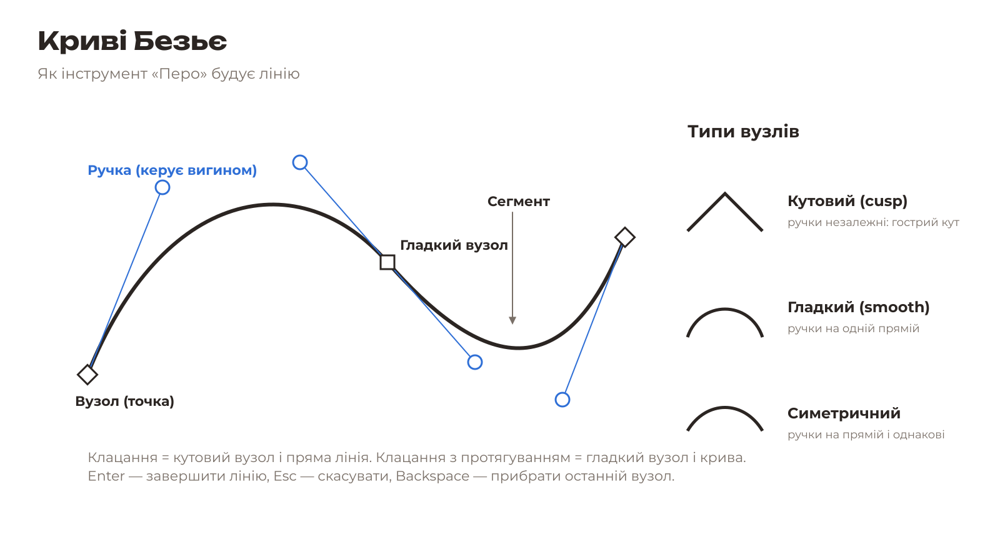
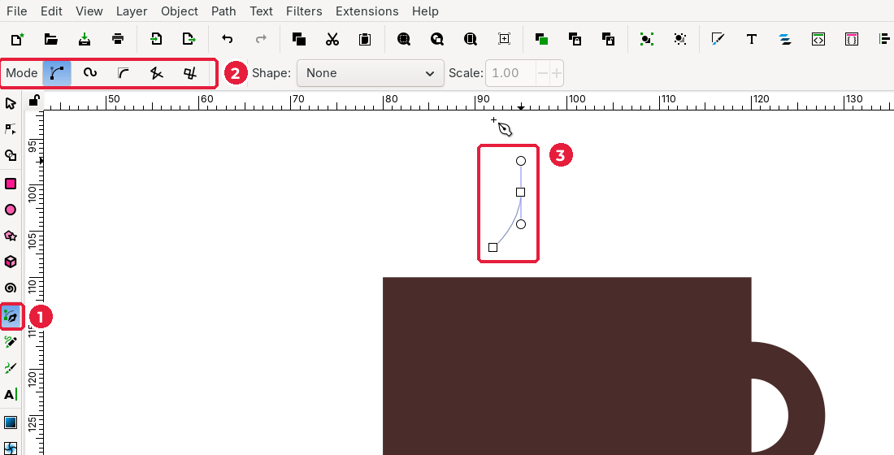
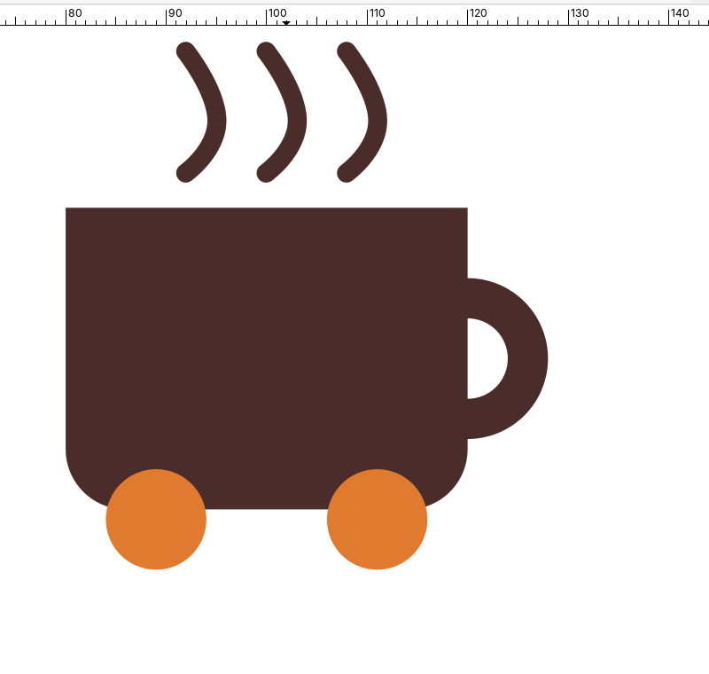
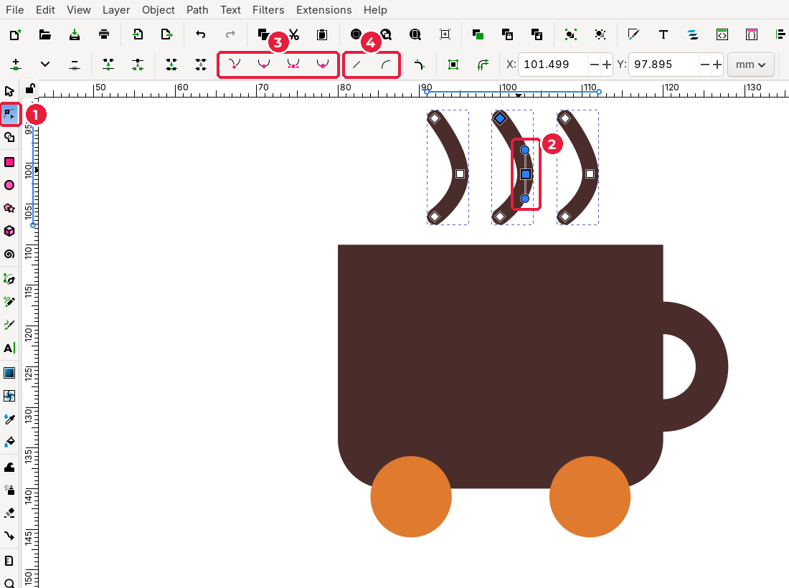
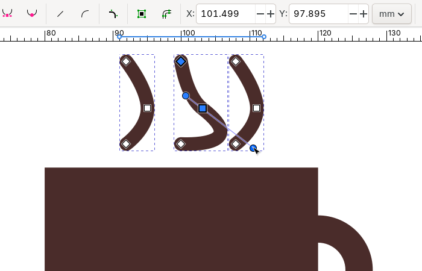

# 3.6. Криві Безьє: перо й вузли

[← Заливка й обведення](05-zalyvka-obvedennia.md) · [До уроку](README.md) · [Далі: Текст →](07-tekst.md)

## Теорія

Будь-який контур у векторній графіці складається з **вузлів** (точок) і **сегментів** (відрізків між ними). Сегмент буває прямим або кривим. Форму кривої задають **ручки** вузлів: чим довша ручка, тим сильніше вигин.

| Тип вузла | Як поводяться ручки | Де використовувати |
|---|---|---|
| **Кутовий** (cusp) | Незалежні | Гострі кути, зламані лінії |
| **Гладкий** (smooth) | На одній прямій | Плавні вигини |
| **Симетричний** | На одній прямій і однакової довжини | Ідеально рівні дуги |

## Крок 1. Намалюйте лінію пари пером

1. Оберіть **Pen (Bezier)** (*Перо*), клавіша `B` (1).
2. Перевірте режим на панелі інструмента (2): має бути увімкнений перший режим — **Regular Bezier path** (*звичайний контур Безьє*).
3. **Клацніть** над чашкою: це перший вузол.
4. Трохи вище **натисніть і протягніть** мишею вгору: так створюється гладкий вузол із ручками, і лінія вигинається (3).
5. **Клацніть** ще вище: це останній вузол.
6. Натисніть `Enter`, щоб завершити лінію.

| Дія з пером | Результат |
|---|---|
| Клацання | Кутовий вузол, прямий сегмент |
| Натиснути й протягнути | Гладкий вузол, кривий сегмент |
| `Enter` або правий клік | Завершити лінію |
| `Backspace` | Видалити останній вузол |
| `Esc` | Скасувати лінію |
| Клацання по першому вузлу | Замкнути контур |

Після завершення налаштуйте обведення, як описано в [підуроці 3.5](05-zalyvka-obvedennia.md#крок-3-обведення-для-ліній-пари): без заливки, колір бренду, ширина 2 мм, круглі кінці.

## Крок 2. Розмножте лінії

1. Оберіть **Selector** (`S`), клацніть лінію і задайте **X** = `91`, **Y** = `93.5`, **H** = `14`.
2. `Ctrl+D` і **X** = `99`.
3. `Ctrl+D` і **X** = `107`.

> Якщо після зміни висоти товщина лінії змінилася (наприклад, стала 1,9 мм), виділіть усі три лінії і знову введіть ширину `2` на вкладці **Stroke style**. Так буває, коли увімкнено масштабування товщини обведення разом з об’єктом.

## Крок 3. Редагування вузлів

Інструмент **Node** (*Вузли*), клавіша `N`, дозволяє змінити форму будь-якого контуру.

1. Оберіть **Node** (`N`) (1) і клацніть лінію: з’являться її вузли.
2. Клацніть вузол (2): він стане синім, з’являться його ручки (кружечки на тонких лініях).
3. Кнопки на панелі інструмента (3) змінюють тип вузла: кутовий, гладкий, симетричний, автогладкий.
4. Кнопки (4) роблять сегмент прямим або кривим.

Спробуйте потягнути ручку: лінія змінить вигин.

Не сподобалося — **Edit → Undo** (*Правка → Скасувати*), `Ctrl+Z`.

| Дія інструментом Node | Результат |
|---|---|
| Подвійне клацання по лінії | Додати вузол |
| `Delete` на виділеному вузлі | Видалити вузол |
| `Shift` + клацання | Виділити кілька вузлів |
| Перетягнути сегмент | Змінити вигин без ручок |

## Перевірте себе

- [ ] Над чашкою три однакові лінії пари з круглими кінцями.
- [ ] Я вмію змінити форму кривої інструментом **Node**.

[← Заливка й обведення](05-zalyvka-obvedennia.md) · [До уроку](README.md) · [Далі: Текст →](07-tekst.md)
