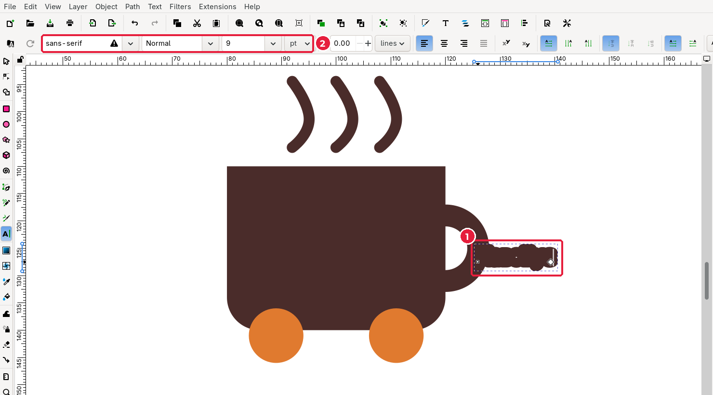
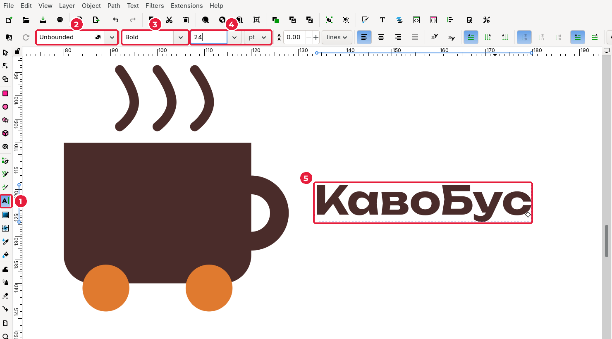
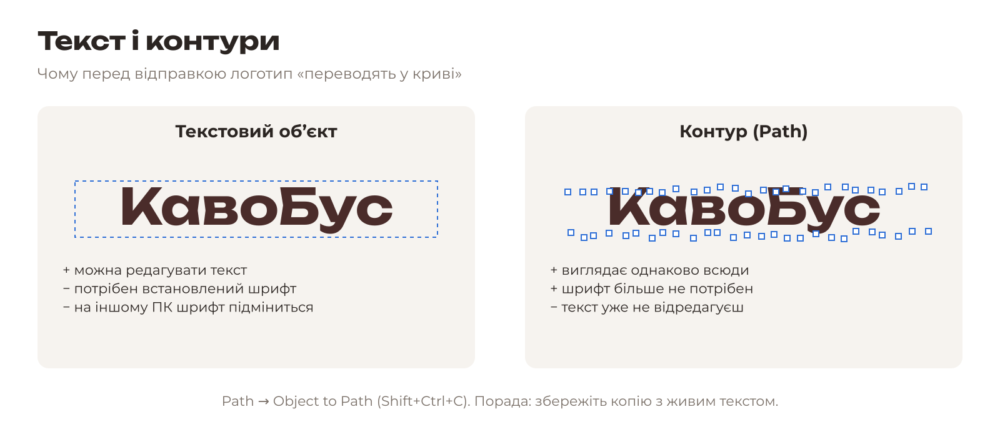
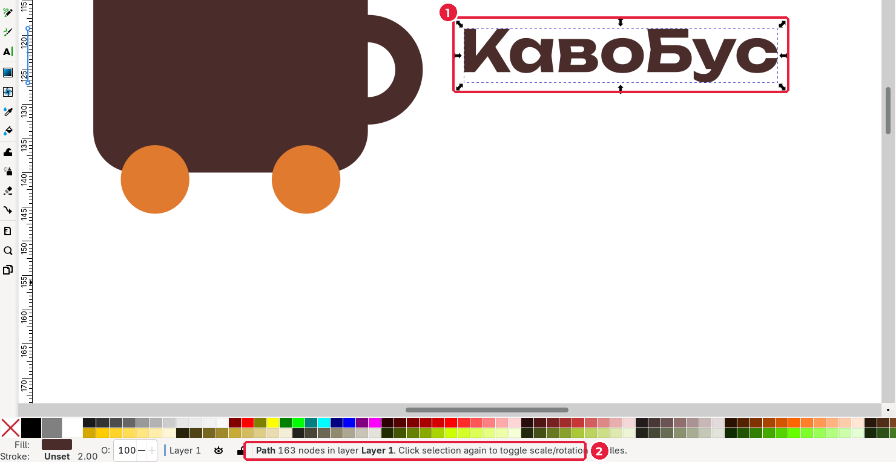

# 3.7. Текст і переведення в криві

[← Криві Безьє](06-kryvi-bezie.md) · [До уроку](README.md) · [Далі: Вирівнювання →](08-vyrivniuvannia.md)

## Крок 1. Наберіть назву

1. Оберіть **Text** (*Текст*), клавіша `T`.
2. Клацніть праворуч від знака й наберіть назву бренду.

Текст (1) може з’явитися дивним: товстим, розмитим, іншого кольору. Це тому, що він отримав стиль останнього об’єкта (лінії пари з обведенням 2 мм). Виправимо це за кілька кроків. На панелі інструмента (2) — налаштування шрифту.

## Крок 2. Оберіть шрифт

1. Виділіть увесь текст: `Ctrl+A` (поки курсор у тексті).
2. У полі **Font family** (*Гарнітура*) введіть назву шрифту з мудборду, наприклад `Unbounded`, і натисніть `Enter`.
3. У полі **Font style** (*Накреслення*) введіть або оберіть `Bold` (*Жирний*).
4. У полі **Font size** (*Кегль*) введіть `24`. Одиниці — **pt** (пункти).

| № | Поле | Українською |
|---|---|---|
| 1 | Text tool | Інструмент «Текст» |
| 2 | Font family | Гарнітура (назва шрифту) |
| 3 | Font style | Накреслення: Regular, Bold, Italic |
| 4 | Font size + units | Кегль і одиниці (pt) |

> **Кириличний шрифт.** Якщо замість літер з’являються квадратики або шрифт «перескакує» на інший, шрифт не має українських літер. Використовуйте шрифти з теки {{asset fonts/}}: вони всі підтримують Ґ, Є, І, Ї.

## Крок 3. Колір тексту

1. Оберіть **Selector** (`S`): текст залишиться виділеним.
2. На вкладці **Fill** натисніть **Flat color** і введіть колір бренду, наприклад `4a2c2aff`.
3. На вкладці **Stroke paint** натисніть **X**: обведення не потрібне.
4. Розташуйте текст праворуч від чашки, наприклад **X** = `134`.

**Міжлітерний інтервал** (кернінг) змінюють у режимі редагування тексту: поставте курсор між літерами й натисніть `Alt+←` або `Alt+→`.

## Крок 4. Переведіть текст у криві

Поки текст — це **текстовий об’єкт**, Inkscape малює його встановленим шрифтом. Якщо відкрити файл на комп’ютері без цього шрифту (у друкарні, на іншому ПК), шрифт зміниться на стандартний, і логотип зіпсується.

1. Виділіть текст інструментом **Selector**.
2. Оберіть **Path → Object to Path** (*Контур → Об’єкт у контур*), `Shift+Ctrl+C`.

У рядку стану (2) тепер написано **Path … nodes** або **Group of … paths**: літери стали фігурами. Тепер логотип виглядає однаково на будь-якому комп’ютері.

> Порада: перед переведенням у криві зробіть копію тексту (`Ctrl+D`) і сховайте її (**Object → Hide**), або збережіть окремий файл `logo-tekst.svg`. Так ви зможете виправити друкарську помилку.

## Перевірте себе

- [ ] Назва набрана шрифтом із мудборду й має колір бренду.
- [ ] Текст переведено в криві (рядок стану показує **Path**, а не **Text**).

[← Криві Безьє](06-kryvi-bezie.md) · [До уроку](README.md) · [Далі: Вирівнювання →](08-vyrivniuvannia.md)
