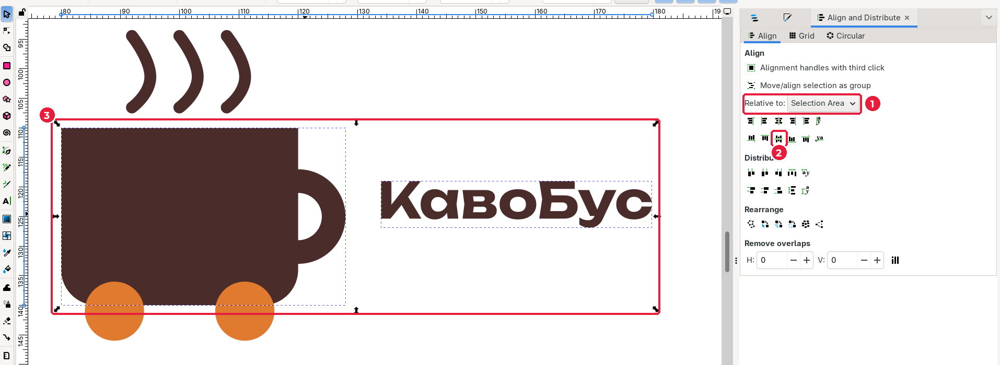
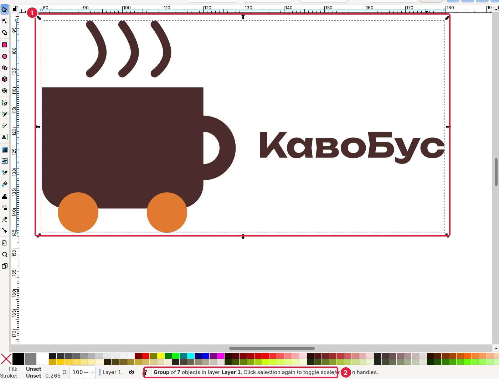
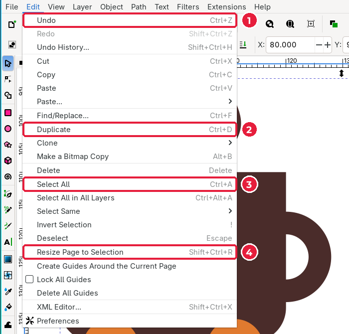

# 3.8. Вирівнювання й групування

[← Текст](07-tekst.md) · [До уроку](README.md) · [Далі: Перевірка та експорт →](09-eksport.md)

## Крок 1. Вирівняйте назву по центру знака

1. Інструментом **Selector** (`S`) клацніть назву, затисніть `Shift` і клацніть чашку.
2. Відкрийте **Object → Align and Distribute** (*Об’єкт → Вирівняти й розподілити*), `Shift+Ctrl+A`.

3. У списку **Relative to** (*Відносно*) (1) оберіть **Selection Area** (*Область виділення*) або **Biggest Item** (*Найбільший об’єкт*).
4. Натисніть кнопку **Center on horizontal axis** (*Центрувати на горизонтальній осі*) (2). Назва стане рівно по центру висоти чашки (3).

> Наведіть курсор на будь-яку кнопку у вікні вирівнювання: з’явиться підказка з її назвою.

## Крок 2. Згрупуйте логотип

1. Виділіть усі об’єкти: **Edit → Select All** (*Правка → Виділити все*), `Ctrl+A`.
2. Згрупуйте їх: **Object → Group** (*Об’єкт → Згрупувати*), `Ctrl+G`.

У рядку стану (2) написано **Group of 7 objects**. Тепер логотип переміщується й масштабується як одне ціле, і жодна деталь не «з’їде».

| Дія | Клавіші |
|---|---|
| Згрупувати | `Ctrl+G` |
| Розгрупувати | `Shift+Ctrl+G` |
| Редагувати об’єкт усередині групи, не розгруповуючи | `Ctrl` + клацання або подвійне клацання по групі |

3. Збережіть файл: `Ctrl+S`.

## Меню Edit: команди, які ви вже використали

| № | Команда | Українською | Клавіші |
|---|---|---|---|
| 1 | Undo | Скасувати | `Ctrl+Z` |
| 2 | Duplicate | Дублювати | `Ctrl+D` |
| 3 | Select All | Виділити все | `Ctrl+A` |
| 4 | Resize Page to Selection | Підігнати сторінку під виділене | `Shift+Ctrl+R` |

[← Текст](07-tekst.md) · [До уроку](README.md) · [Далі: Перевірка та експорт →](09-eksport.md)
