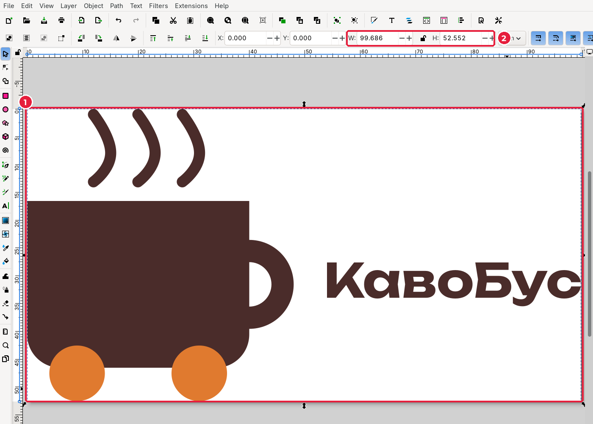
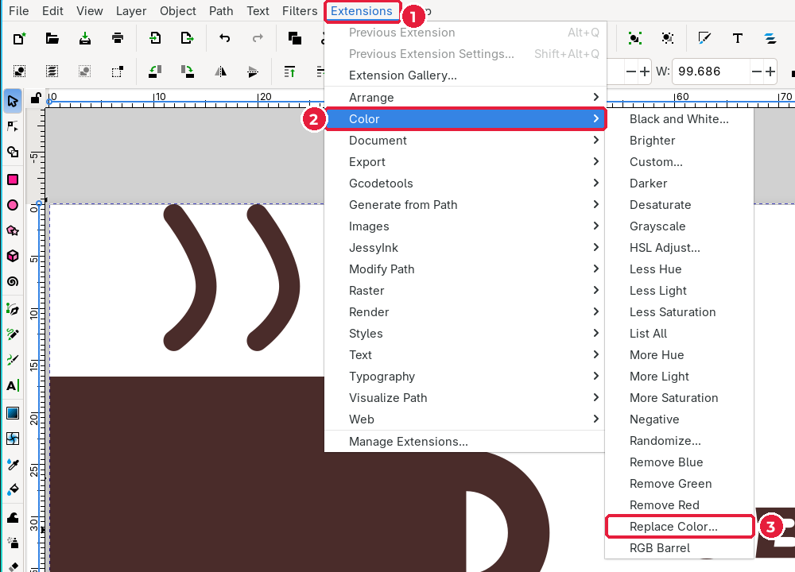
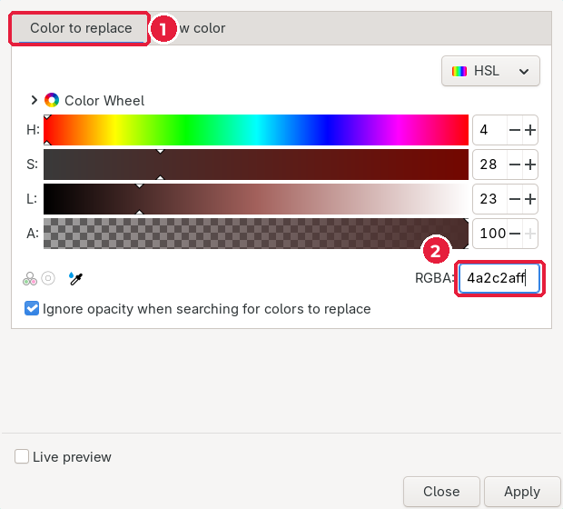
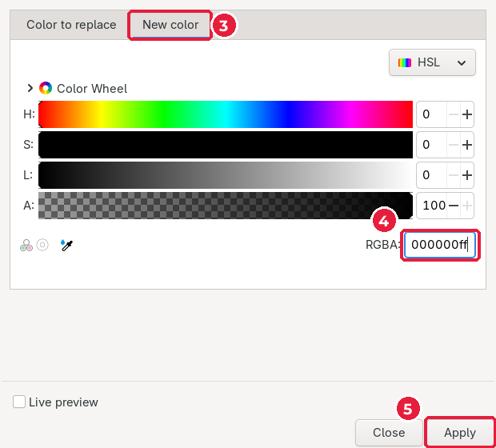
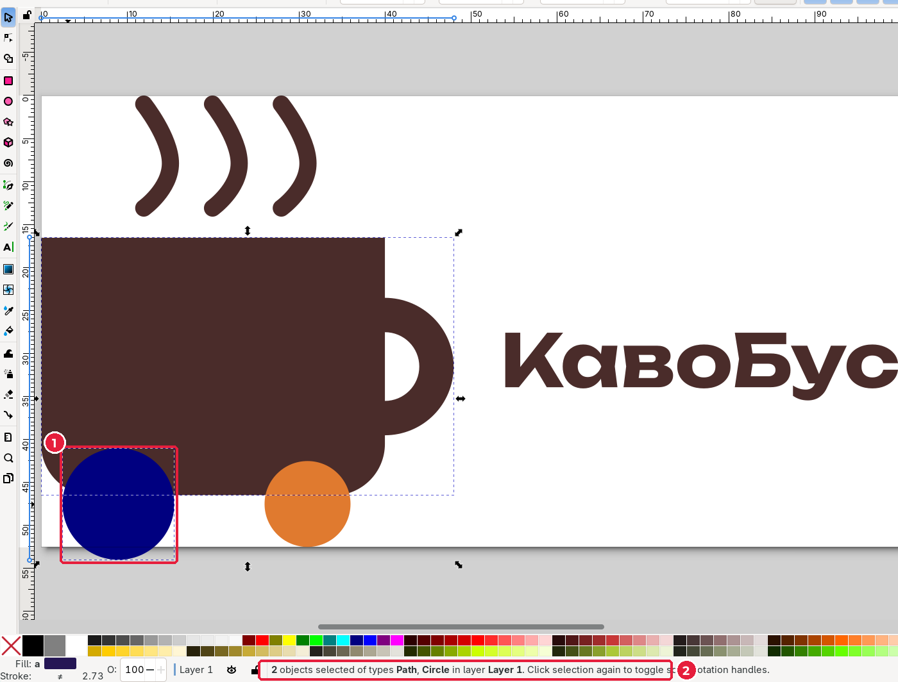
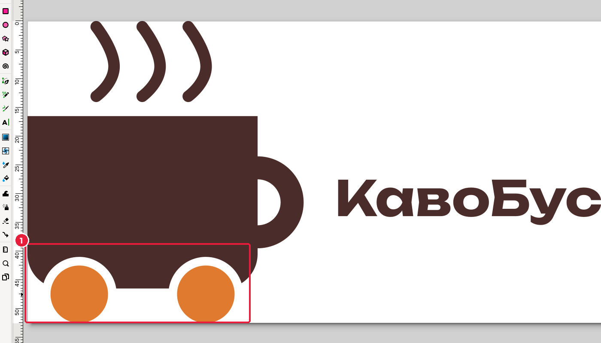
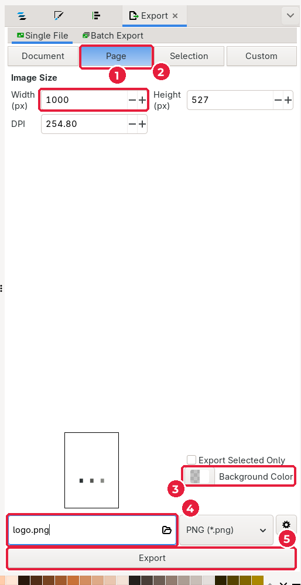
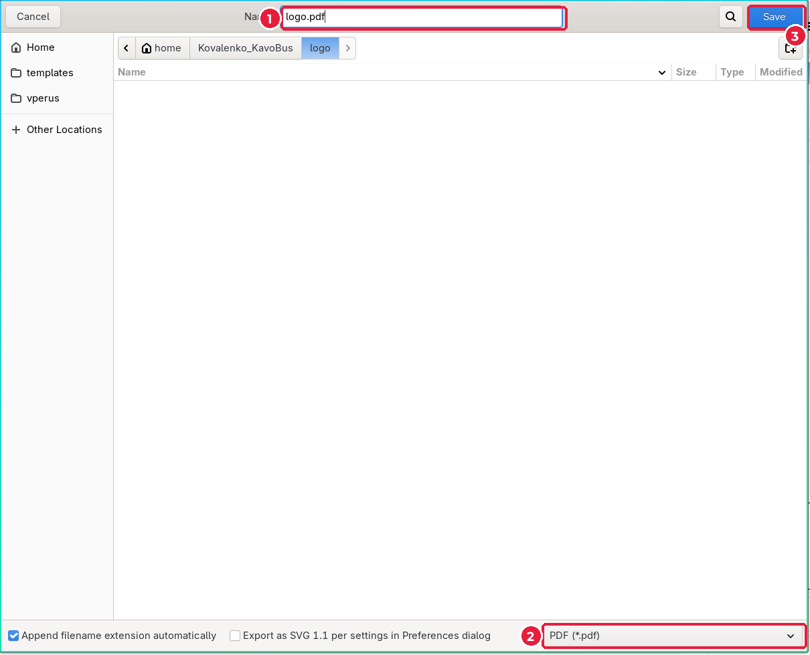
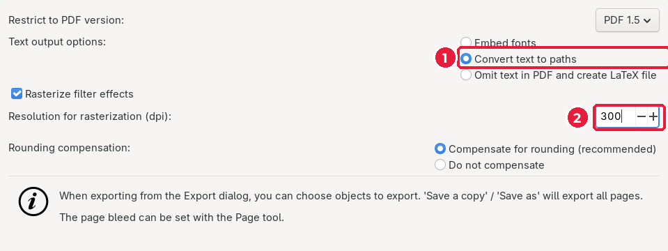
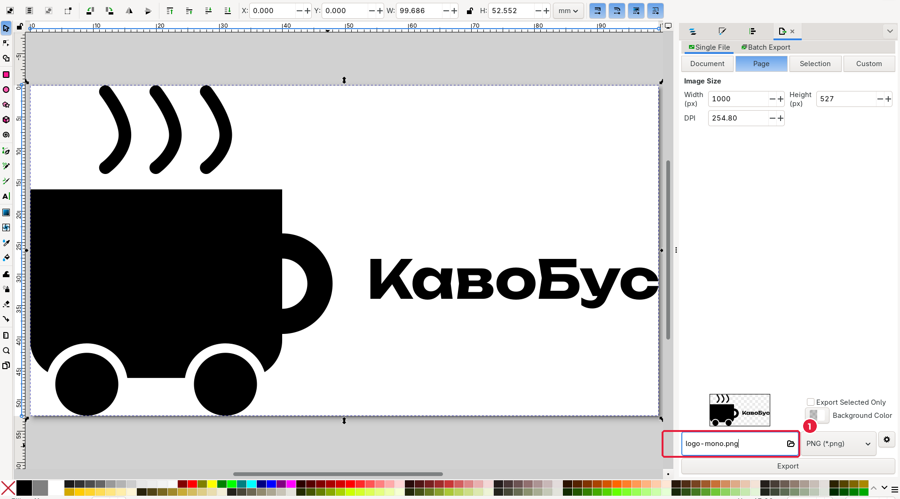

# 3.9. Перевірка та експорт

[← Вирівнювання](08-vyrivniuvannia.md) · [До уроку](README.md) · [Наступний урок: Візитівка →](../04-vizytivka/README.md)

## Крок 1. Підженіть сторінку під логотип

Зараз логотип лежить посеред аркуша A4. Для файлів логотипа сторінка має збігатися з його межами.

1. Виділіть групу логотипа (`S`, клацання).
2. **Edit → Resize Page to Selection** (*Правка → Підігнати сторінку під виділене*), `Shift+Ctrl+R`.
3. Натисніть `5`, щоб побачити всю сторінку.

Сторінка (1) тепер точно обрамлює логотип, а поля **W** і **H** (2) показують його розмір: близько 100 × 53 мм. Збережіть: `Ctrl+S`.

## Крок 2. Монохромний тест

Перш ніж експортувати, перевірте, чи працює логотип **в одному кольорі**. Для цього тимчасово замініть усі кольори на чорний.

1. Виділіть усе: `Ctrl+A`.
2. Відкрийте **Extensions → Color → Replace color…** (*Розширення → Колір → Замінити колір*).

3. На вкладці **Color to replace** (*Що замінити*) (1) введіть у **RGBA** (2) перший колір бренду: `4a2c2aff`.

4. На вкладці **New color** (*Новий колір*) (3) введіть `000000ff` (чорний) (4) і натисніть **Apply** (*Застосувати*) (5).

5. Повторіть для другого кольору (`e07a2fff`) і закрийте вікно (**Close**).

**Що показав тест «КавоБуса»:** колеса злилися з чашкою, і знак перестав читатися. Колір розрізняв деталі, а без кольору вони пропали. Виправимо це, а потім повернемо кольори.

## Крок 3. Виправлення: колісні арки

1. Скасуйте заміну кольорів: `Ctrl+Z` двічі.
2. Розгрупуйте логотип: `Shift+Ctrl+G`.
3. Намалюйте коло трохи більше за колесо (**W** = **H** = `13` мм) так, щоб його центр збігався з центром колеса. Дайте йому будь-який помітний колір (1).

4. Виділіть **тіло чашки**, затисніть `Shift` і клацніть нове коло (рядок стану (2): «2 objects selected»).
5. **Path → Difference** (`Ctrl+-`). Коло вирізало в чашці «арку» навколо колеса.
6. Повторіть для другого колеса.

Тепер між колесом і чашкою є білий проміжок: деталі розрізняються навіть в одному кольорі. Згрупуйте все знову (`Ctrl+A`, `Ctrl+G`) і збережіть (`Ctrl+S`).

> Це звичайна робота дизайнера: **тест → проблема → виправлення**. Логотип рідко виходить ідеальним з першої спроби.

## Крок 4. Експорт PNG

1. Відкрийте **File → Export…** (*Файл → Експорт*), `Shift+Ctrl+E`.

2. Оберіть **Page** (*Сторінка*) (1): експортується вся сторінка, тобто логотип.
3. У полі **Width** (*Ширина*) (2) введіть `1000` (пікселів). Висота підрахується сама.
4. **Background Color** (*Колір фону*) (3) залиште прозорим (картатий квадратик).
5. У полі імені файлу (4) введіть `logo.png`, формат **PNG**.
6. Натисніть **Export** (*Експортувати*) (5).

> Якщо файл уже існує, Inkscape запитає, чи замінити його. Натисніть **Replace** (*Замінити*).

## Крок 5. Збереження копії в PDF

PDF — основний формат для друку та для верстки в Scribus.

1. **File → Save a Copy…** (*Файл → Зберегти копію*), `Shift+Ctrl+Alt+S`.
2. Введіть ім’я `logo.pdf` (1). Тип файлу визначиться за розширенням (2). Натисніть **Save** (3).

3. У вікні параметрів PDF:

- **Text output options** (*Вивід тексту*): **Convert text to paths** (*Перетворити текст на контури*) (1). Це страховка, навіть якщо ви вже перевели текст у криві.
- **Resolution for rasterization** (*Роздільна здатність для растеризації*) (2): `300` dpi.
- Натисніть **OK**.

> Чому **Save a Copy**, а не **Save As**? Після «Зберегти як PDF» Inkscape продовжить працювати з PDF-файлом, і наступне `Ctrl+S` збереже PDF замість SVG. «Зберегти копію» створює PDF, а відкритим залишається ваш `logo.svg`.

## Крок 6. Монохромна версія

1. Повторіть заміну кольорів на чорний (крок 2).
2. У вікні **Export** змініть ім’я файлу на `logo-mono.png` і натисніть **Export**.

3. Скасуйте заміну кольорів (`Ctrl+Z`, `Ctrl+Z`) і збережіть `logo.svg` (`Ctrl+S`).

## Підсумок

| Файл | Як отримали |
|---|---|
| `logo.svg` | File → Save As (крок 2 підуроку 3.2), далі `Ctrl+S` |
| `logo.png` | File → Export, Page, 1000 px |
| `logo.pdf` | File → Save a Copy, PDF, текст у контури |
| `logo-mono.png` | Replace color → чорний, Export, Undo |

## Перевірте себе (чекліст уроку)

- [ ] Логотип векторний і згрупований.
- [ ] Текст переведено в контури.
- [ ] Логотип читається завширшки 2 см (подивіться в масштабі 100 % (`1`) або роздрукуйте на чернетці).
- [ ] Монохромна версія зрозуміла.
- [ ] У теці `logo/` є `logo.svg`, `logo.pdf`, `logo.png`, `logo-mono.png`.

[← Вирівнювання](08-vyrivniuvannia.md) · [До уроку](README.md) · [Наступний урок: Візитівка →](../04-vizytivka/README.md)
