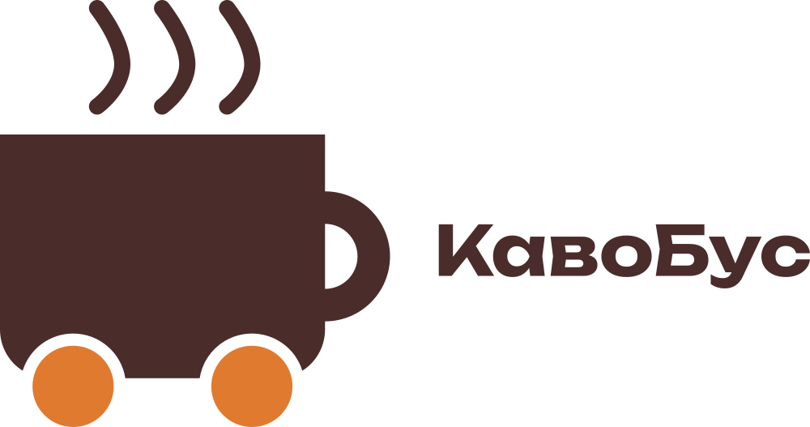

# Урок 3. Логотип у векторі (Inkscape)

**Програма:** Inkscape 1.4

На цьому уроці ви створите логотип свого стартапу: знак із простих фігур і назву, переведену в криві. Усі кроки показано на прикладі бренду «КавоБус» (кава з фургона біля коледжу). Ви повторюєте ті самі дії, але зі своїм брендом, кольорами й шрифтами з мудборду.

## Що потрібно перед початком

- Затверджений бриф і мудборд (урок 2): 3 кольори в HEX і 2 шрифти.
- 3 ескізи логотипа (на папері або в програмі), з яких ви обрали один.
- Робоча тека `<прізвище>_<назва-стартапу>/logo/`.

## Підуроки

| № | Тема | Що робимо |
|---|---|---|
| 3.1 | [Теорія логотипа](01-teoriia-lohotypa.md) | Типи логотипів, вектор і растр, ознаки хорошого логотипа |
| 3.2 | [Новий документ](02-novyi-dokument.md) | Створюємо, налаштовуємо й одразу зберігаємо файл |
| 3.3 | [Прості фігури](03-prymityvy.md) | Прямокутник, заокруглення, еліпс, точні розміри |
| 3.4 | [Логічні операції](04-lohichni-operatsii.md) | Об’єднання та різниця: збираємо чашку з ручкою |
| 3.5 | [Колір: заливка й обведення](05-zalyvka-obvedennia.md) | Кольори бренду за HEX-кодом, товщина та кінці лінії |
| 3.6 | [Криві Безьє](06-kryvi-bezie.md) | Перо й вузли: малюємо пару над чашкою |
| 3.7 | [Текст і переведення в криві](07-tekst.md) | Шрифтова частина логотипа |
| 3.8 | [Вирівнювання й групування](08-vyrivniuvannia.md) | Збираємо знак і назву в один об’єкт |
| 3.9 | [Перевірка та експорт](09-eksport.md) | Монохромний тест, SVG, PDF, PNG |

## Результат уроку

У теці `logo/` мають лежати чотири файли:

| Файл | Навіщо |
|---|---|
| `logo.svg` | Вихідний файл: його відкриваємо й редагуємо в Inkscape |
| `logo.pdf` | Для друку та верстки в Scribus |
| `logo.png` | 1000 px, прозорий фон: для вебу, презентації, мокапів |
| `logo-mono.png` | Чорна версія: для печаток, ч/б друку, гравіювання |

## Критерії оцінювання

- Логотип векторний, читається в малому розмірі, текст переведено в контури: **0–2 бали**.
- Файли названо та впорядковано згідно зі структурою теки: **0–1 бал**.

> Підказка для всіх уроків: на macOS замість `Ctrl` натискайте `Cmd`, а замість `Alt` — `Option`. Меню та інструменти однакові в Windows, Linux і macOS.
