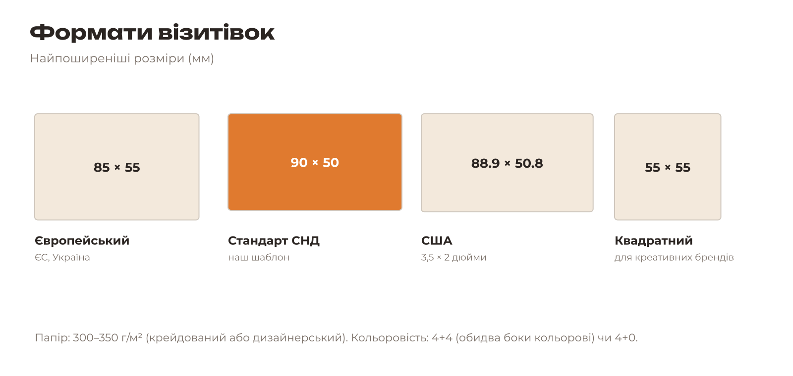
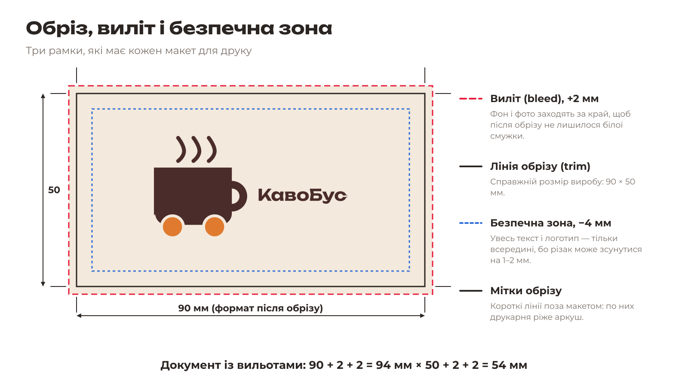
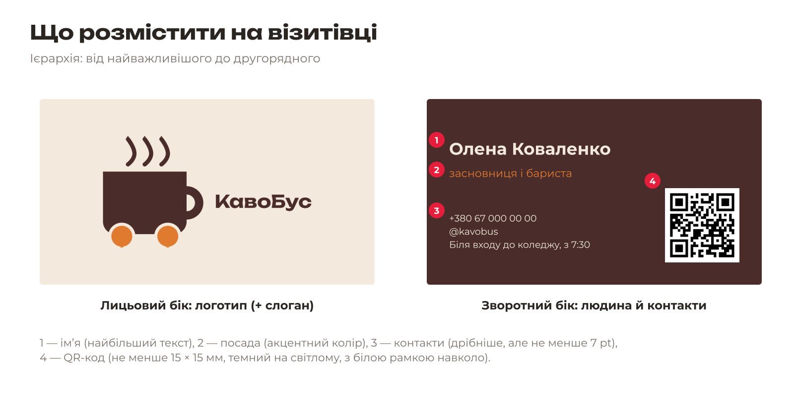
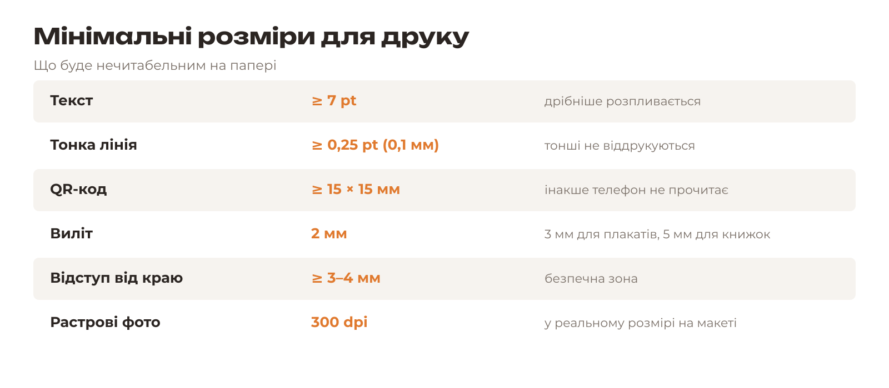
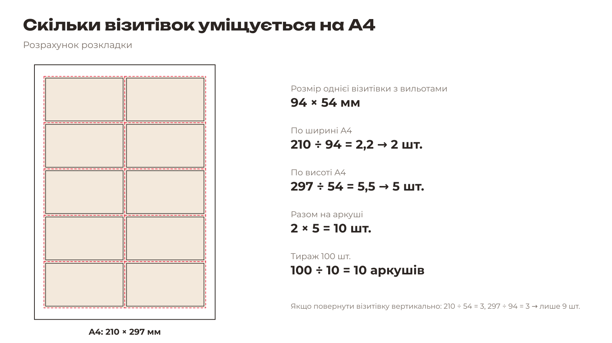

# 4.1. Теорія: візитівка для друку

[← До уроку](README.md) · [Далі: Шаблон, сторінки й шари →](02-shablon.md)

## Формати

В Україні найчастіше друкують візитівки **90 × 50 мм** або європейські **85 × 55 мм**. Наш шаблон — 90 × 50 мм. Перед замовленням завжди уточнюйте формат у своїй друкарні.

## Обріз, виліт і безпечна зона

Друкарня друкує візитівки не по одній, а **по багато на великому аркуші**, а потім ріже аркуш на гільйотині. Ніж гільйотини може зсунутися на 1–2 мм. Щоб це не зіпсувало виріб, макет має три рамки.

| Рамка | Розмір | Правило |
|---|---|---|
| **Виліт** (bleed) | +2 мм з кожного боку | Фон і фото, що доходять до краю, тягнемо **за** лінію обрізу до кінця вильоту |
| **Лінія обрізу** (trim) | 90 × 50 мм | Реальний розмір готової візитівки |
| **Безпечна зона** (safe zone) | −4 мм від краю | Текст, логотип, QR-код — **тільки всередині** |

**Розрахунок:** документ із вильотами має розмір 90 + 2 + 2 = **94 мм** на 50 + 2 + 2 = **54 мм**.

## Що розмістити на візитівці

- **Лицьовий бік** — бренд: логотип, за бажанням слоган. Більше нічого: візитівка має «дихати».
- **Зворотний бік** — людина: ім’я (найбільше), посада, контакти, QR-код.

Ієрархія тексту створюється **розміром, жирністю й кольором**: ім’я — великий жирний шрифт, посада — акцентний колір, контакти — дрібний звичайний шрифт.

## Мінімальні розміри

## Колір: RGB і CMYK

Пам’ятайте з уроку 2: екран показує кольори в **RGB**, а друкарня друкує в **CMYK**. Яскраві кольори екрана (неоновий зелений, яскраво-синій) на папері стають тьмянішими. Inkscape працює в RGB, тому в уроці 7 ви перевірите кольори в режимі кольоропроби (soft proof) у Scribus.

## Розрахунок розкладки

**Завдання.** Порахуйте:

1. Скільки візитівок 94 × 54 мм поміститься на аркуші A4 (210 × 297 мм)?
2. Скільки аркушів A4 потрібно для тиражу 200 візитівок?
3. Скільки поміститься на аркуші A3 (297 × 420 мм)?

Відповіді

1. 210 ÷ 94 = 2 (по ширині), 297 ÷ 54 = 5 (по висоті) → **10 шт.**
2. 200 ÷ 10 = **20 аркушів**.
3. 297 ÷ 94 = 3, 420 ÷ 54 = 7 → **21 шт.**

[← До уроку](README.md) · [Далі: Шаблон, сторінки й шари →](02-shablon.md)
