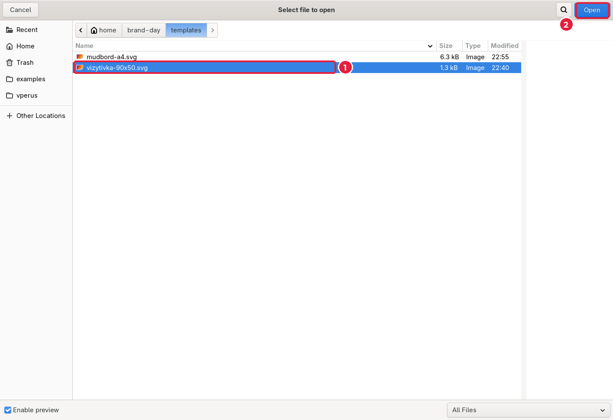
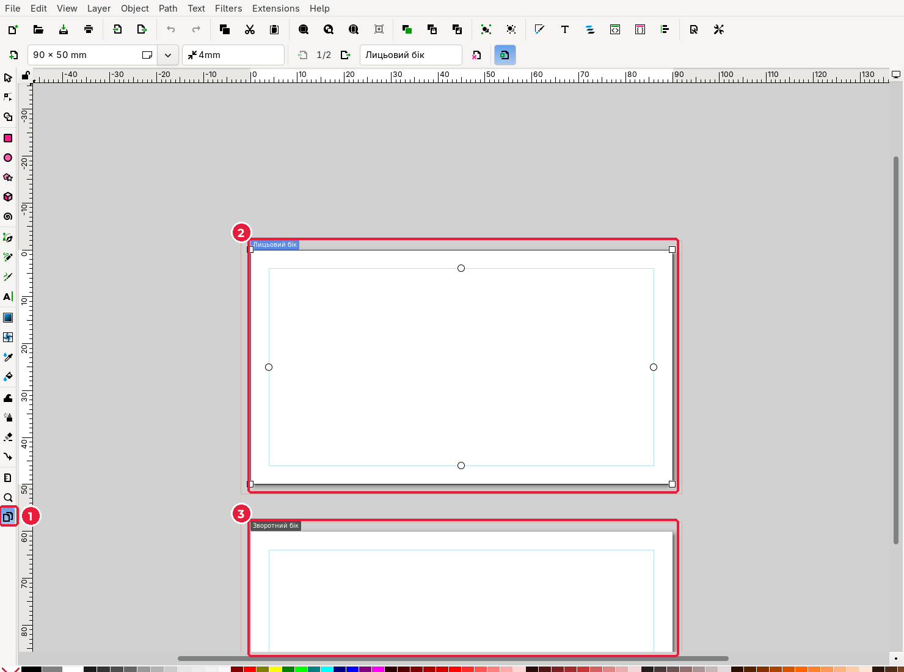
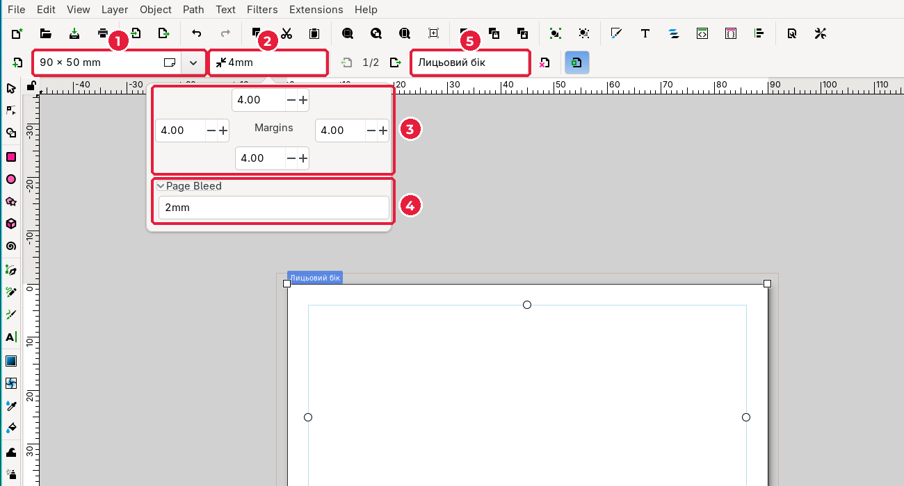
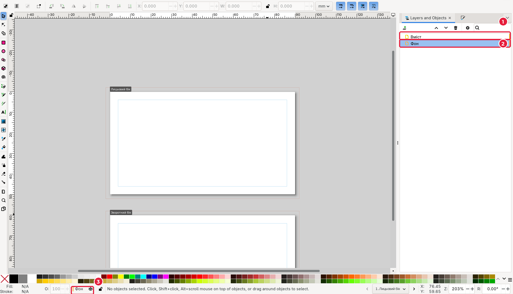

# 4.2. Шаблон, сторінки й шари

[← Теорія](01-teoriia.md) · [До уроку](README.md) · [Далі: Фон і логотип →](03-fon-lohotyp.md)

## Крок 1. Відкрийте шаблон

1. **File → Open…** (*Файл → Відкрити*), `Ctrl+O`.
2. Перейдіть до теки {{asset templates/}}, оберіть {{asset templates/vizytivka-90x50.svg short}} (1) і натисніть **Open** (*Відкрити*) (2).

## Крок 2. Одразу збережіть як свій файл

Шаблон не можна змінювати: ним користуються всі. Тому відразу збережіть копію у своїй теці.

1. **File → Save As…** (`Shift+Ctrl+S`).
2. Перейдіть у теку `<прізвище>_<назва>/card/`, введіть ім’я `card.svg` і натисніть **Save**.

## Крок 3. Дві сторінки в одному файлі

Inkscape 1.4 підтримує **кілька сторінок** в одному документі. У шаблоні їх дві: «Лицьовий бік» і «Зворотний бік».

1. Оберіть інструмент **Pages** (*Сторінки*): остання кнопка на панелі інструментів ліворуч (1). Видно обидві сторінки (2, 3).
2. Натисніть `-` кілька разів, щоб побачити обидві сторінки повністю.

Перемикатися між сторінками зручно кнопками зі стрілками **в нижньому правому куті** вікна (поруч із назвою поточної сторінки). Клавіша `5` показує поточну сторінку на весь екран.

## Крок 4. Поля й вильоти

Клацніть першу сторінку інструментом **Pages** і подивіться на панель інструмента вгорі.

| № | Поле | Значення в шаблоні |
|---|---|---|
| 1 | Розмір сторінки | 90 × 50 mm |
| 2 | **Margins** (*поля*) | 4 мм: це безпечна зона, її показано тонкою синьою рамкою |
| 3 | Поля з кожного боку | 4.00 |
| 4 | **Page Bleed** (*виліт*) | 2 мм: тонка рамка **поза** сторінкою |
| 5 | Назва сторінки | Лицьовий бік |

Усе вже налаштовано, нічого змінювати не потрібно. Якщо ви колись створюватимете візитівку з нуля, саме тут задаються поля й виліт.

## Крок 5. Шари

**Шар** — це прозора «плівка», на якій лежать об’єкти. Шари допомагають відокремити фон від тексту, щоб випадково не зсунути фон.

1. Оберіть інструмент **Selector** (`S`).
2. Відкрийте **Layer → Layers and Objects…** (*Шар → Шари й об’єкти*), `Shift+Ctrl+L`.

У шаблоні два шари:

- **Вміст** (1) — верхній шар для логотипа, тексту, QR-коду;
- **Фон** (2) — нижній шар для кольорових прямокутників фону.

3. Клацніть шар **Фон**. Його назва з’явиться в рядку стану внизу (3): нові об’єкти малюватимуться саме на ньому.

[← Теорія](01-teoriia.md) · [До уроку](README.md) · [Далі: Фон і логотип →](03-fon-lohotyp.md)
