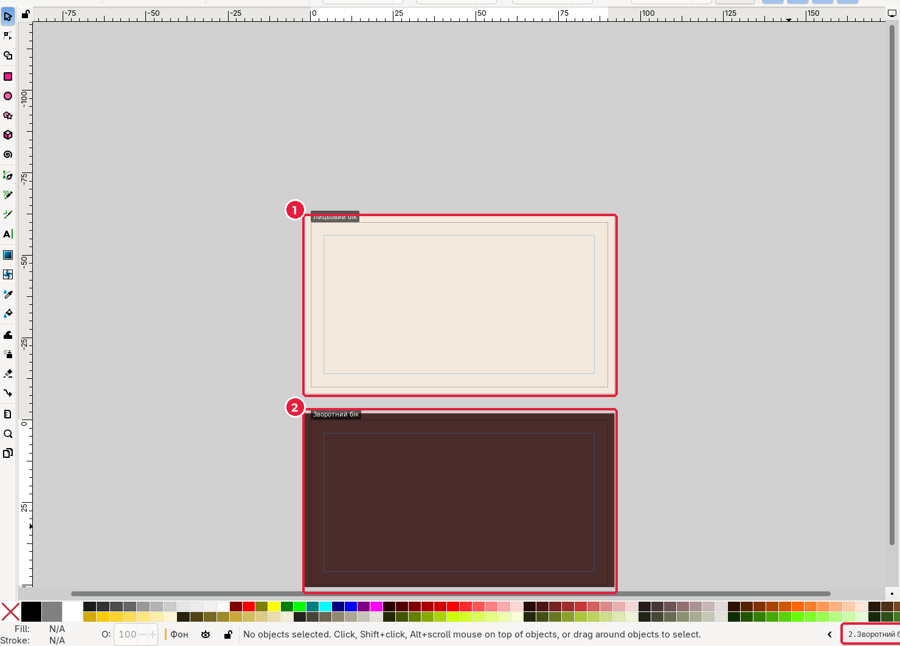
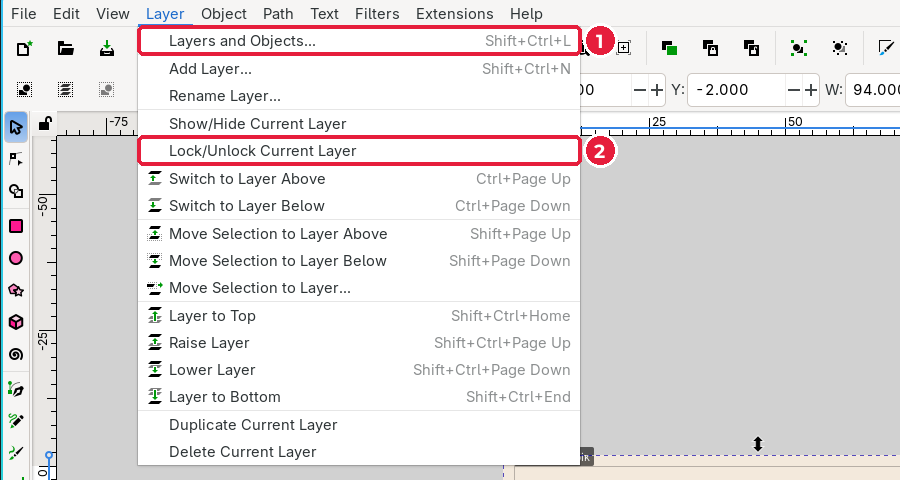
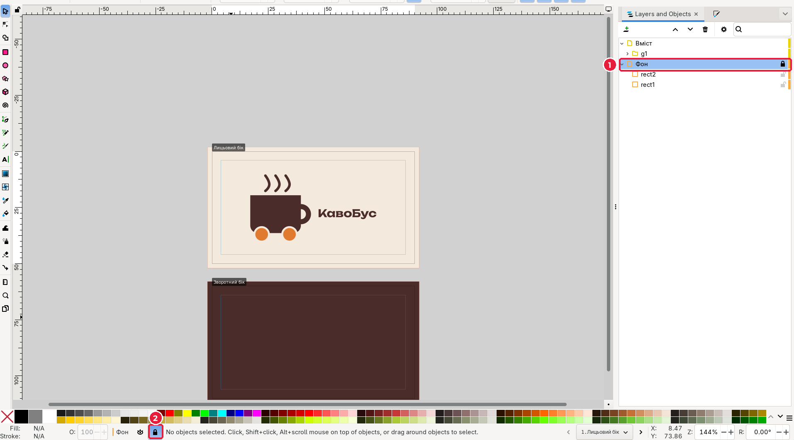
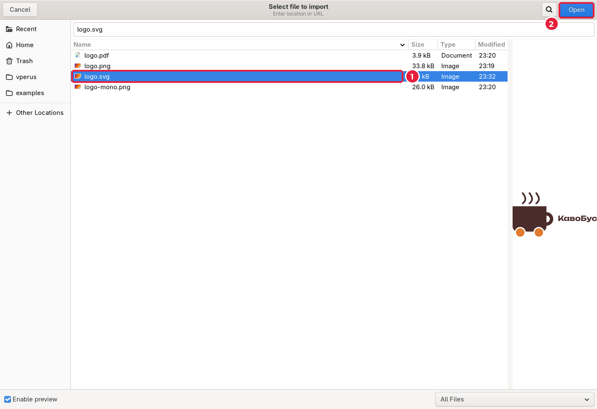
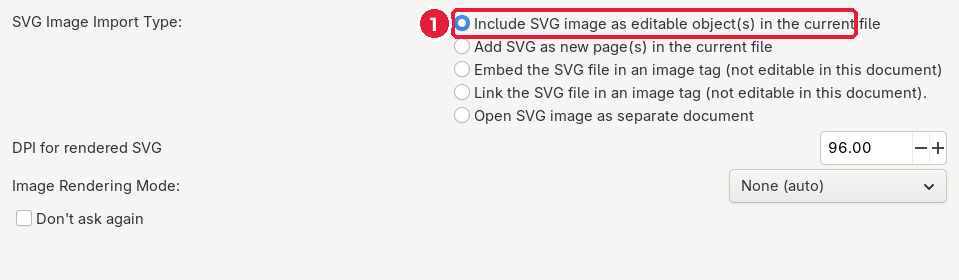
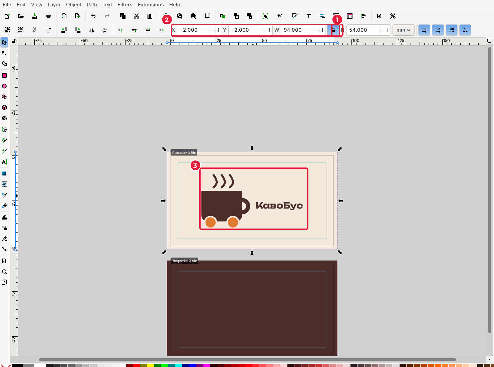

# 4.3. Фон і логотип

[← Шаблон](02-shablon.md) · [До уроку](README.md) · [Далі: Текст і QR-код →](04-tekst-qr.md)

## Крок 1. Фон лицьового боку з вильотами

Поточний шар — **Фон**.

1. Оберіть **Rectangle** (`R`) і намалюйте будь-який прямокутник на першій сторінці. На панелі інструмента поставте **Rx** = `0`, **Ry** = `0`.
2. Оберіть **Selector** (`S`), клацніть прямокутник і задайте:

| Поле | Значення | Чому |
|---|---|---|
| **X** | `-2` | на 2 мм лівіше за край сторінки (виліт) |
| **Y** | `-2` | на 2 мм вище за край (виліт) |
| **W** | `94` | 90 + 2 + 2 |
| **H** | `54` | 50 + 2 + 2 |

3. Залийте фон кольором бренду: **Fill and Stroke** (`Shift+Ctrl+F`) → **Fill** → **Flat color** → **RGBA**, наприклад `f3e9dcff` (світлий кремовий). Обведення приберіть (**Stroke paint** → **X**).

> Поля **X** і **Y** у Inkscape 1.4 відраховуються від **поточної сторінки** (та, назва якої в правому нижньому куті вікна). Якщо об’єкт «зник», натисніть `4` (показати весь малюнок) і пошукайте його.

## Крок 2. Фон зворотного боку

1. Не знімаючи виділення, натисніть `Ctrl+D` (дублювати).
2. Змініть **Y** на `58`: 60 мм (де починається друга сторінка) мінус 2 мм вильоту.
3. Змініть колір заливки на другий колір бренду, наприклад `4a2c2aff` (темно-коричневий).

Фон кожної сторінки (1, 2) трохи виходить за її краї: це і є виліт. У рядку стану (3) видно поточну сторінку.

## Крок 3. Заблокуйте шар фону

Щоб випадково не зсунути фон, коли розміщуватимете текст, заблокуйте шар.

1. У вікні **Layers and Objects** клацніть шар **Фон**.
2. Відкрийте меню **Layer** (*Шар*) і оберіть **Lock/Unlock Current Layer** (*Заблокувати/розблокувати поточний шар*) (2).

Біля шару з’явиться замок (1), а в рядку стану — значок замка (2). Клацання по фону більше його не виділяє.

4. Клацніть шар **Вміст**, щоб далі працювати на ньому.

> Якщо панель шарів широка, біля кожного шару при наведенні з’являються значки ока (показати/сховати) і замка: можна клацати прямо на них.

## Крок 4. Імпортуйте логотип

1. Перейдіть на першу сторінку (стрілки в нижньому правому куті).
2. **File → Import…** (*Файл → Імпортувати*), `Ctrl+I`.
3. Перейдіть у теку `logo/`, оберіть `logo.svg` (1) і натисніть **Open** (2). Праворуч видно попередній перегляд файлу.

4. У вікні **SVG Input** оберіть **Include SVG image as editable object(s) in the current file** (*Вставити як редаговані об’єкти*) (1) і натисніть **OK**.

> Чому саме SVG, а не PNG? SVG залишається вектором: логотип буде чітким при будь-якому розмірі друку.

## Крок 5. Розмістіть логотип

Імпортований логотип з’являється там, де стоїть курсор, і може бути завеликим.

1. Увімкніть **замок пропорцій** (1) між полями **W** і **H**: тоді логотип не розтягнеться.
2. Задайте **W** = `56`, **X** = `17`, **Y** = `10.25` (2). Логотип (3) стане по центру сторінки.

**Як порахувати центр:** X = (90 − 56) ÷ 2 = 17. Висота логотипа після масштабування ≈ 29,5 мм, тому Y = (50 − 29,5) ÷ 2 ≈ 10,25.

> Простіше: виділіть логотип, відкрийте **Align and Distribute** (`Shift+Ctrl+A`), у полі **Relative to** оберіть **Page** (*Сторінка*) і натисніть дві кнопки центрування.

Збережіть: `Ctrl+S`.

[← Шаблон](02-shablon.md) · [До уроку](README.md) · [Далі: Текст і QR-код →](04-tekst-qr.md)
