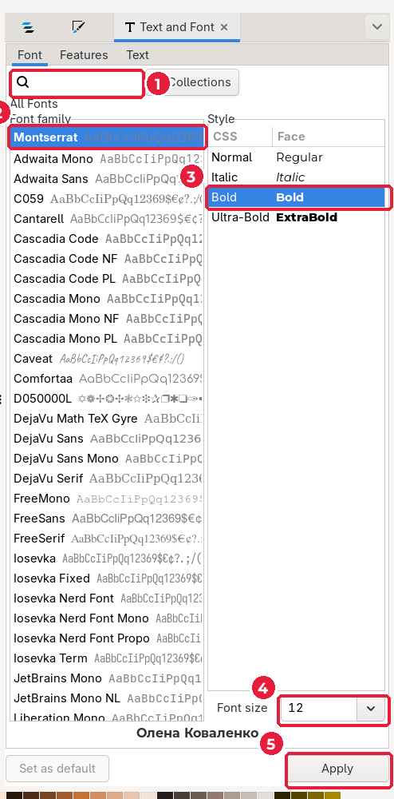
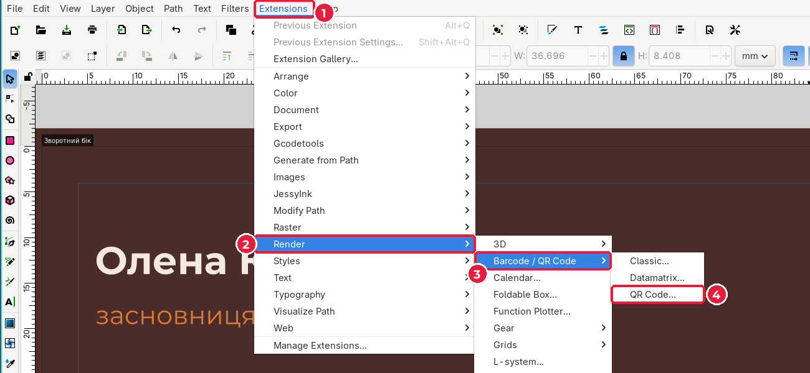
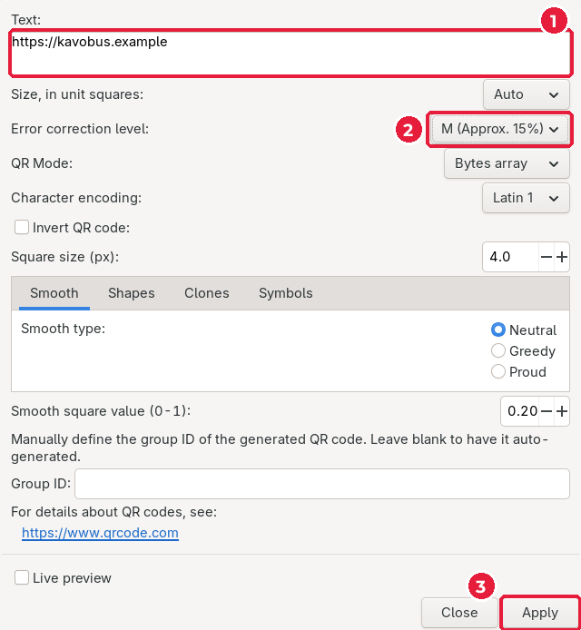
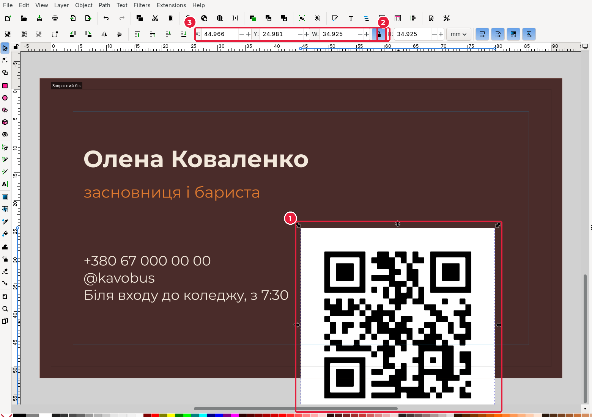
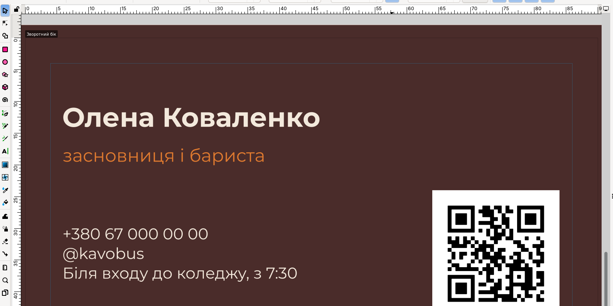

# 4.4. Текст і QR-код

[← Фон і логотип](03-fon-lohotyp.md) · [До уроку](README.md) · [Далі: PDF для друку →](05-pdf.md)

Перейдіть на другу сторінку (стрілка в нижньому правому куті) і натисніть `5`. Поточний шар — **Вміст**.

## Крок 1. Ім’я

1. Оберіть **Text** (`T`), клацніть ліворуч угорі сторінки й наберіть ім’я.
2. Оберіть **Selector** (`S`): текст залишиться виділеним.
3. Відкрийте **Text → Text and Font…** (*Текст → Текст і шрифт*), `Shift+Ctrl+T`.

| № | Елемент | Що робити |
|---|---|---|
| 1 | Пошук | Почніть вводити назву шрифту, щоб швидко знайти його |
| 2 | **Font family** (*Гарнітура*) | Клацніть шрифт тексту з мудборду, наприклад **Montserrat** |
| 3 | **Style** (*Накреслення*) | **Bold** (*Жирний*) |
| 4 | **Font size** (*Кегль*) | `12` |
| 5 | **Apply** (*Застосувати*) | Обов’язково натисніть! |

> Увага: після вибору гарнітури список накреслень оновлюється. Спочатку оберіть гарнітуру, потім накреслення.

4. У **Fill and Stroke** задайте колір тексту: `f3e9dcff` (світлий на темному фоні). Обведення — **X** (немає).
5. Задайте **X** = `6`, **Y** = `11`: текст має бути в безпечній зоні (не ближче 4 мм до краю).

## Крок 2. Посада

1. Виділіть ім’я і натисніть `Ctrl+D`. Задайте **Y** = `16.5`.
2. Оберіть **Text** (`T`), клацніть у дубльований текст, виділіть усе (`Ctrl+A`) і наберіть посаду.
3. На панелі тексту задайте кегль `8` і накреслення **Regular**.
4. Колір — акцентний: `e07a2fff`.

## Крок 3. Контакти

1. Знову дублюйте текст посади (`Ctrl+D`), задайте **Y** = `30`.
2. У режимі тексту замініть вміст на три рядки контактів. Новий рядок — клавіша `Enter`.
3. Кегль `7`, колір `f3e9dcff`.

> Кегль 7 pt — мінімум для друку. Дрібніший текст на візитівці буде нечитабельним.

**Що писати в контактах:** телефон, нік у соцмережі, адреса або години роботи. Для вигаданого бренду використовуйте вигадані дані: телефон `+380 00 000 00 00`, сайт `назва.example`.

## Крок 4. QR-код

QR-код веде клієнта на сайт або сторінку бренду. Inkscape створює його сам, без онлайн-генераторів.

1. Відкрийте **Extensions → Render → Barcode / QR Code → QR Code…** (*Розширення → Відтворення → Штрих-код → QR-код*).

2. У вікні **QR Code**:

- **Text** (1): адреса, на яку веде код, наприклад `https://kavobus.example`.
- **Error correction level** (*Рівень корекції помилок*) (2): **M (Approx. 15%)**. Код читатиметься навіть із невеликою подряпиною.
- Натисніть **Apply** (3), потім **Close**.

3. QR-код з’явиться великим, із білою рамкою. Виділіть його (**Selector**) і, увімкнувши замок пропорцій, задайте **W** = `20`, **X** = `64`, **Y** = `24`.

Перевірка: 64 + 20 = 84 мм < 86 мм (90 − 4), 24 + 20 = 44 мм < 46 мм. QR-код у безпечній зоні.

4. **Перевірте QR-код телефоном**, навівши камеру на екран. Якщо не читається — збільшіть його або виберіть вищий рівень корекції.

> Біла рамка навколо QR-коду (тиха зона) обов’язкова: без неї телефон може не розпізнати код. Самі квадрати мають бути **темними на світлому**, а не навпаки.

Збережіть: `Ctrl+S`.

[← Фон і логотип](03-fon-lohotyp.md) · [До уроку](README.md) · [Далі: PDF для друку →](05-pdf.md)
