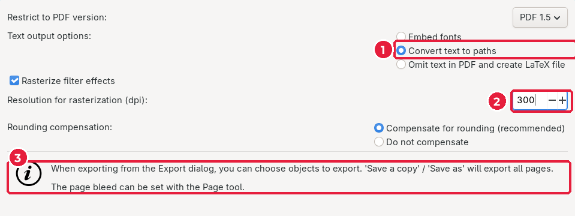

# 4.5. Збереження PDF для друку

[← Текст і QR-код](04-tekst-qr.md) · [До уроку](README.md) · [Наступний урок: Ключовий візуал (Krita) →](../05-kliuchovyi-vizual/README.md)

## Крок 1. Збережіть копію в PDF

1. **File → Save a Copy…** (`Shift+Ctrl+Alt+S`).
2. Ім’я файлу: `card-print.pdf`, тека `card/`. Натисніть **Save**.
3. У вікні параметрів PDF:

- (1) **Convert text to paths**: текст перетвориться на криві, друкарні не потрібні ваші шрифти.
- (2) **Resolution for rasterization**: `300` dpi.
- (3) Підказка Inkscape: **Save a Copy** зберігає **усі сторінки**, а виліт береться з налаштувань сторінки (інструмент **Pages**). Тому PDF матиме дві сторінки по 94 × 54 мм.
- Натисніть **OK**.

## Крок 2. Перевірте PDF

Відкрийте `card-print.pdf` будь-якою програмою для перегляду PDF (браузером, Okular, SumatraPDF, Preview на macOS).

| Перевірка | Як має бути |
|---|---|
| Кількість сторінок | 2 |
| Фон | доходить до самого краю сторінки (з вильотом) |
| Текст і QR-код | не ближче 4 мм до лінії обрізу |
| Шрифти | у властивостях документа (**Властивості → Шрифти**) список порожній: текст у кривих |
| QR-код | читається телефоном з екрана |

| Лицьовий бік | Зворотний бік |
|---|---|
|  |  |

## Чекліст уроку

- [ ] Фон обох боків виходить за край сторінки на 2 мм.
- [ ] Логотип, текст і QR-код — у безпечній зоні.
- [ ] Кегль не менше 7 pt.
- [ ] QR-код не менше 15 × 15 мм і читається телефоном.
- [ ] У теці `card/` є `card.svg` і `card-print.pdf`.

[← Текст і QR-код](04-tekst-qr.md) · [До уроку](README.md) · [Наступний урок: Ключовий візуал (Krita) →](../05-kliuchovyi-vizual/README.md)
