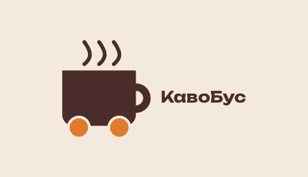

# Урок 4. Візитівка (Inkscape)

**Програма:** Inkscape 1.4

На цьому уроці ви зробите двосторонню візитівку 90 × 50 мм за готовим шаблоном: лицьовий бік із логотипом і зворотний бік з ім’ям, контактами та QR-кодом. Візитівку буде одразу підготовлено до друку: з вильотами, безпечною зоною і PDF-файлом.

| Лицьовий бік | Зворотний бік |
|---|---|
|  |  |

## Що потрібно перед початком

- Готовий логотип `logo/logo.svg` (урок 3).
- Шаблон {{asset templates/vizytivka-90x50.svg}}.
- Кольори й шрифти з мудборду.

## Підуроки

| № | Тема | Що робимо |
|---|---|---|
| 4.1 | [Теорія: візитівка для друку](01-teoriia.md) | Формати, виліт, безпечна зона, мінімальні розміри, розрахунок розкладки |
| 4.2 | [Шаблон, сторінки й шари](02-shablon.md) | Відкриваємо шаблон, сторінки, поля, вильоти, шари |
| 4.3 | [Фон і логотип](03-fon-lohotyp.md) | Фон із вильотами, імпорт логотипа, блокування шару |
| 4.4 | [Текст і QR-код](04-tekst-qr.md) | Ім’я, посада, контакти, QR-код |
| 4.5 | [Збереження PDF для друку](05-pdf.md) | PDF із вильотами й текстом у кривих, перевірка |

## Результат уроку

У теці `card/`:

| Файл | Навіщо |
|---|---|
| `card.svg` | Вихідний файл для редагування |
| `card-print.pdf` | 2 сторінки 94 × 54 мм (з вильотами), текст у кривих: для друкарні та розкладки в уроці 7 |

## Критерії оцінювання

- Візитівка правильного розміру з вильотом і безпечною зоною, розкладена на A4 з мітками обрізу: **0–2 бали**. Розкладку ви зробите в уроці 7 (препрес).

> На macOS замість `Ctrl` натискайте `Cmd`, а замість `Alt` — `Option`.
