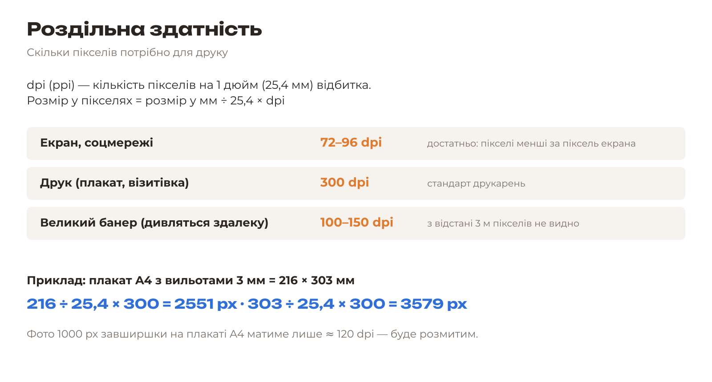
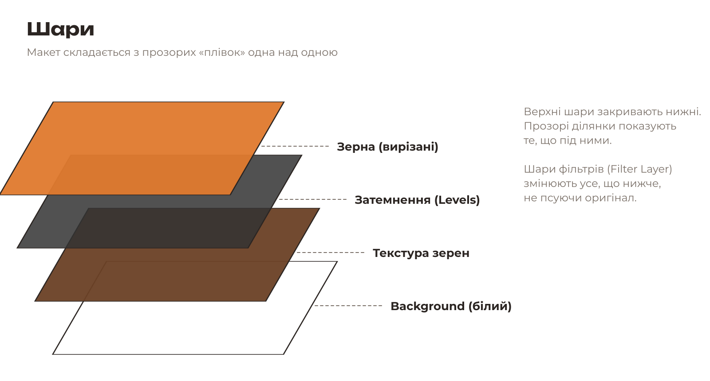

# 5.1. Теорія: растр, роздільна здатність, авторське право

[← До уроку](README.md) · [Далі: Знайомство з Krita →](02-krita-dokument.md)

## Растрове зображення

Фотографія — це **растр**: сітка кольорових квадратиків-пікселів. Чим більше пікселів, тим більше деталей і тим більший відбиток можна надрукувати без розмиття. Пригадайте порівняння вектора й растру з [уроку 3.1](../03-lohotyp/01-teoriia-lohotypa.md#вектор-і-растр).

## Роздільна здатність

**Запам’ятайте:** для друку — **300 dpi** у реальному розмірі. Збільшити кількість пікселів «з нічого» не можна: якщо розтягнути маленьке фото, воно стане розмитим. Тому для ключового візуалу беріть фото якомога більшого розміру (у {{asset photos/}} усі фото мають 2000–3000 px).

## Шари

У растровому редакторі кожен елемент колажу лежить на **окремому шарі**. Так кожен можна рухати, змінювати й вимикати незалежно. Формат **KRA** (Krita) зберігає всі шари; **PNG** і **JPG** — лише фінальну «склеєну» картинку.

| Формат | Шари | Прозорість | Стиснення | Для чого |
|---|---|---|---|---|
| **KRA** | так | так | без втрат | робочий файл Krita |
| **PNG** | ні | так | без втрат | вирізані об’єкти, фінальний макет |
| **JPG** | ні | ні | з втратами | фото, веб; менший розмір файлу |

## Неруйнівне редагування

Професіонали намагаються **не змінювати оригінальні пікселі**. Замість цього вони додають:

- **шари фільтрів** (Filter Layer) — змінюють колір/яскравість усього, що нижче;
- **маски прозорості** (Transparency Mask) — ховають частину шару, не видаляючи її.

Якщо результат не сподобається, шар фільтра можна вимкнути або налаштувати заново.

## Авторське право

- Фото в інтернеті **належать авторам**, навіть якщо під ними немає знака ©. «Взяти картинку з Google» для реклами — порушення авторського права.
- Фото з ліцензією **CC0** (суспільне надбання) можна використовувати без дозволу й навіть комерційно. Усі фото в {{asset photos/}} мають ліцензію CC0, джерела вказано в {{asset photos/CREDITS.md short}}.
- Власні фото (зняті вами на телефон) — найкращий варіант: вони унікальні.

## Перевірте себе

- [ ] Я можу розрахувати потрібний розмір у пікселях для друку 300 dpi.
- [ ] Я знаю різницю між KRA, PNG і JPG.

[← До уроку](README.md) · [Далі: Знайомство з Krita →](02-krita-dokument.md)
