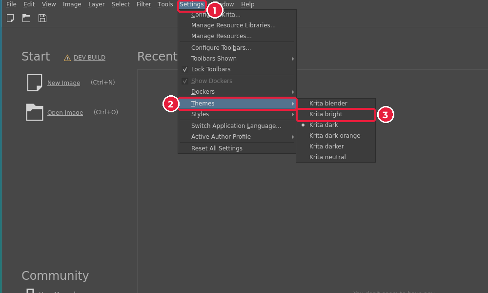
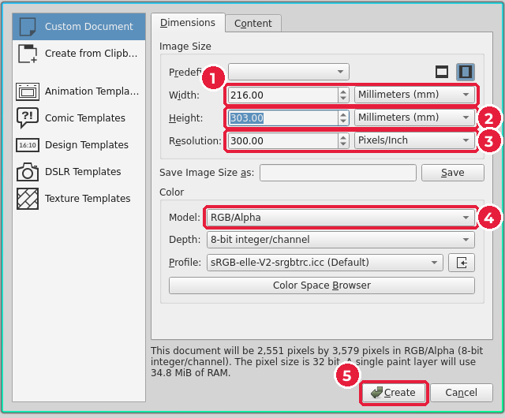
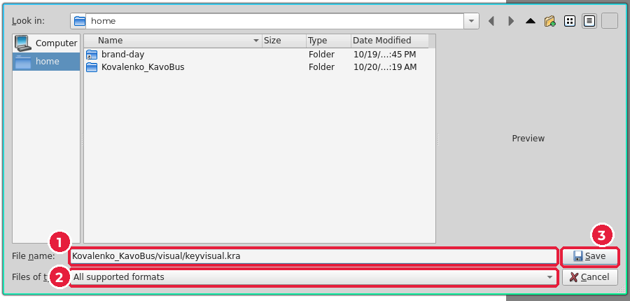
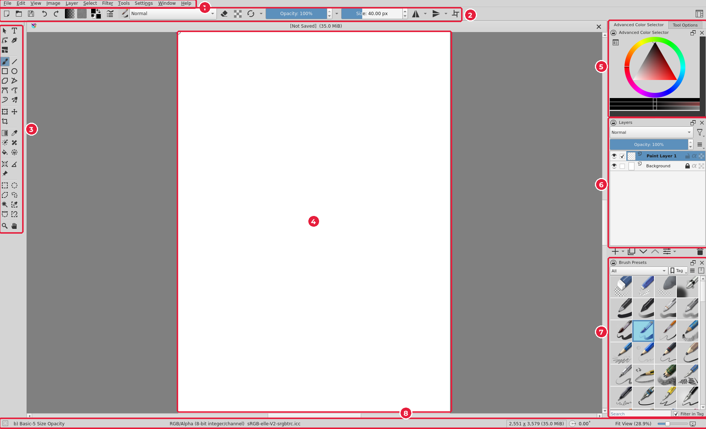

# 5.2. Знайомство з Krita і новий документ

[← Теорія](01-teoriia.md) · [До уроку](README.md) · [Далі: Фон →](03-fon.md)

**Krita** — безкоштовний растровий редактор з відкритим кодом для Windows, macOS і Linux (krita.org). Його створили для цифрового малювання, але він уміє все потрібне для колажу й ретуші.

## Крок 1. Світла тема (за бажанням)

За замовчуванням Krita темна. Для навчання світла тема зручніша: **Settings → Themes → Krita bright** (*Налаштування → Теми → Krita світла*).

## Крок 2. Новий документ для друку

1. **File → New…** (*Файл → Створити*), `Ctrl+N`.
2. Ліворуч оберіть **Custom Document** (*Власний документ*).

| № | Поле | Значення | Чому |
|---|---|---|---|
| 1 | **Width** (*Ширина*) | `216`, одиниці **Millimeters (mm)** | A4 (210) + виліт 3 мм з кожного боку |
| 2 | **Height** (*Висота*) | `303` мм | 297 + 3 + 3 |
| 3 | **Resolution** (*Роздільна здатність*) | `300` Pixels/Inch | стандарт друку |
| 4 | **Model** (*Колірна модель*) | RGB/Alpha | працюємо в RGB, перевіримо CMYK пізніше (урок 7) |
| 5 | **Create** (*Створити*) | | |

> Спочатку змініть **одиниці** (список праворуч від поля) на **Millimeters**, потім введіть число. Унизу вікна Krita покаже розмір у пікселях: 2551 × 3579.

## Крок 3. Збережіть файл

**File → Save As…** (`Ctrl+Shift+S`). Перейдіть у теку `visual/`, введіть ім’я `keyvisual.kra` (1), тип файлу залиште **All supported formats** (2), натисніть **Save** (3).

## Інтерфейс Krita

| № | Частина | Що там |
|---|---|---|
| 1 | **Меню** | File, Edit, View, Image, Layer, Select, Filter, Tools, Settings, Window, Help |
| 2 | **Панель інструмента** | Режим накладання, непрозорість, розмір пензля |
| 3 | **Панель інструментів** | Пензлі, фігури, трансформація, виділення, заливка, піпетка |
| 4 | **Полотно** | Ваше зображення |
| 5 | **Вибір кольору / Tool Options** | Колірне коло; вкладка **Tool Options** — параметри поточного інструмента |
| 6 | **Layers** (*Шари*) | Список шарів: око — видимість, перетягування — порядок |
| 7 | **Brush Presets** | Набори пензлів |
| 8 | **Рядок стану** | Колірна модель, профіль, розмір, масштаб |

| Клавіші | Дія |
|---|---|
| `Ctrl+S` | Зберегти |
| `Ctrl+Z` / `Ctrl+Shift+Z` | Скасувати / повторити |
| `Ctrl+T` | Трансформувати шар |
| `T` | Інструмент переміщення |
| `Ctrl+Shift+A` | Зняти виділення |
| Пробіл (затиснути) + рух мишею | Пересувати полотно |
| `Ctrl` + пробіл + рух мишею | Масштаб |

[← Теорія](01-teoriia.md) · [До уроку](README.md) · [Далі: Фон →](03-fon.md)
