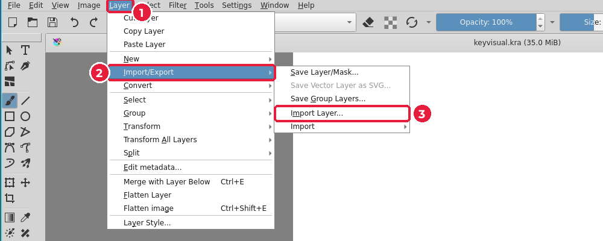
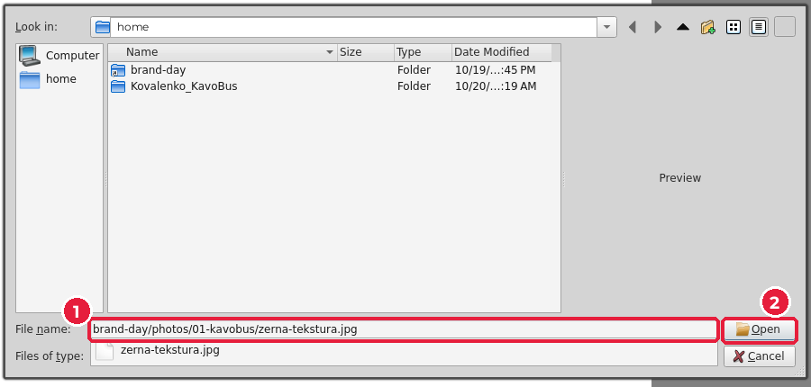
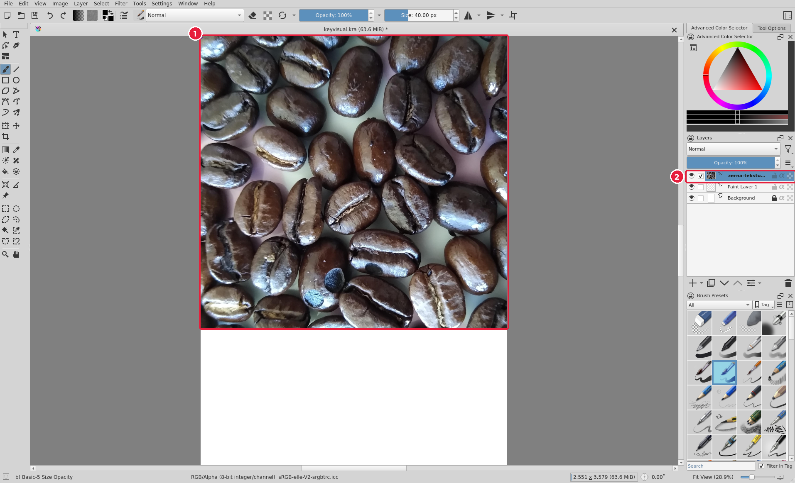
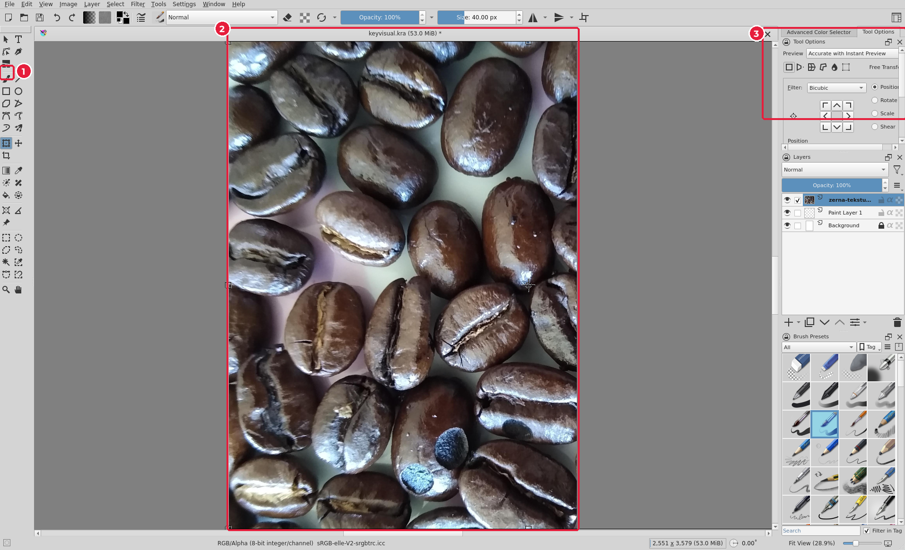
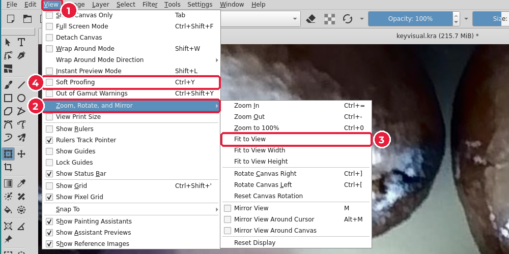

# 5.3. Фон: імпорт шару й трансформація

[← Знайомство з Krita](02-krita-dokument.md) · [До уроку](README.md) · [Далі: Кольорокорекція →](04-korektsiia.md)

## Крок 1. Імпортуйте фото як шар

1. **Layer → Import/Export → Import Layer…** (*Шар → Імпорт/експорт → Імпортувати шар*).

2. Перейдіть у теку фото своєї теми, наприклад {{asset photos/01-kavobus/}}, оберіть фото для фону (1) і натисніть **Open** (2).

Фото з’явиться новим шаром (2) у верхньому лівому куті полотна (1). Якщо воно менше за полотно, внизу лишиться біла смуга.

> **Чим відрізняється від File → Open?** «Відкрити» створює новий окремий документ. «Імпортувати шар» додає фото **у поточний** документ як новий шар.

## Крок 2. Масштабуйте шар трансформацією

1. Натисніть `Ctrl+T` або оберіть **Transform Tool** (*Трансформація*) на панелі (1).
2. Навколо шару з’являться маркери. Потягніть **кутовий** маркер, тримаючи `Shift`, щоб зберегти пропорції, доки фото не закриє все полотно (2).
3. Параметри трансформації видно на вкладці **Tool Options** (3).
4. Натисніть `Enter`, щоб застосувати.

| Дія в трансформації | Результат |
|---|---|
| Тягнути кутовий маркер + `Shift` | Масштаб зі збереженням пропорцій |
| Тягнути всередині рамки | Перемістити |
| Тягнути поза рамкою | Обернути |
| `Enter` | Застосувати |
| `Esc` | Скасувати |

> Збільшення растру погіршує якість. Збільшуйте фото не більше ніж у 1,5 раза; якщо потрібно більше — оберіть інше, більше фото.

## Крок 3. Як показати все полотно

Після трансформації масштаб перегляду може змінитися. **View → Zoom, Rotate, and Mirror → Fit to View** (*Вигляд → Масштаб… → Вмістити у вікно*) (3).

[← Знайомство з Krita](02-krita-dokument.md) · [До уроку](README.md) · [Далі: Кольорокорекція →](04-korektsiia.md)
