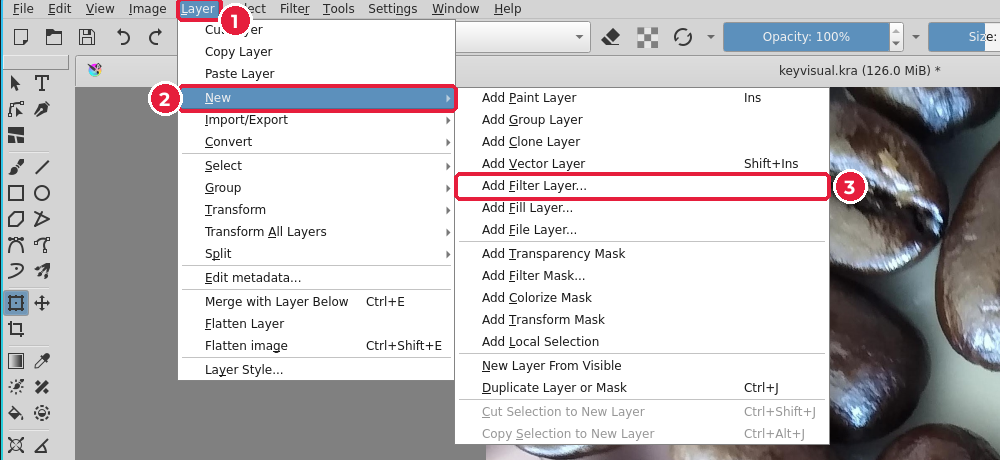
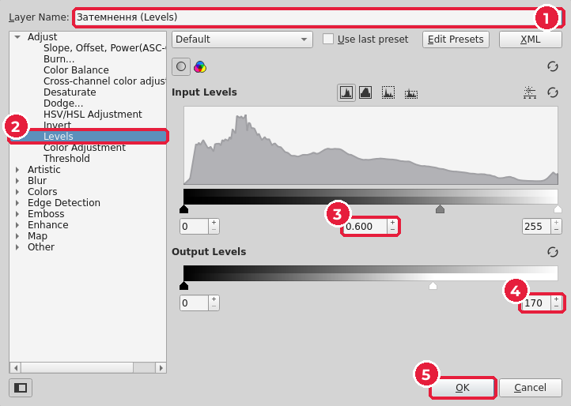

# 5.4. Кольорокорекція шаром фільтра

[← Фон](03-fon.md) · [До уроку](README.md) · [Далі: Ретуш →](05-retush.md)

## Навіщо

Фон не повинен «перекрикувати» головний об’єкт і текст. Зазвичай його **затемнюють** або **освітлюють** і наближають до кольорів бренду. Зробимо це **шаром фільтра**: оригінальне фото не зміниться.

## Рівні (Levels)

Фільтр **Levels** (*Рівні*) показує **гістограму** — графік, скільки в зображенні темних (ліворуч) і світлих (праворуч) пікселів — і дає три повзунки:

| Повзунок | Дія |
|---|---|
| Чорний (ліворуч) | Пікселі, темніші за нього, стають чорними: більше контрасту |
| Сірий (середина, **гамма**) | Менше 1 — середні тони темнішають; більше 1 — світлішають |
| Білий (праворуч) | Пікселі, світліші за нього, стають білими |

**Output Levels** (*Вихідні рівні*) обмежують діапазон: якщо білий вихід поставити на 170, найсвітліший піксель стане сірим — зображення приглушиться.

## Крок 1. Додайте шар фільтра

1. У панелі **Layers** клацніть шар фону, щоб новий шар з’явився над ним.
2. **Layer → New → Add Filter Layer…** (*Шар → Створити → Додати шар фільтра*).

## Крок 2. Налаштуйте Levels

1. **Layer Name** (*Назва шару*): `Затемнення (Levels)` — давайте шарам зрозумілі назви.
2. Ліворуч оберіть **Adjust → Levels** (*Коригування → Рівні*).
3. Гамма (середнє поле Input Levels): `0.6` — середні тони темнішають.
4. Білий Output Levels: `170` — фон стає приглушеним.
5. **OK**.

Шар фільтра з’явиться над фоном. Клацніть **око** біля нього, щоб порівняти «до» і «після». Двічі клацніть по шару, щоб змінити налаштування.

## Інші корисні фільтри (Filter → Adjust)

| Фільтр | Для чого |
|---|---|
| **Curves** (*Криві*) | Тонкіша версія Levels: керуєте кожною точкою яскравості |
| **HSV/HSL Adjustment** | Змінити відтінок, насиченість, яскравість |
| **Color Balance** (*Колірний баланс*) | Зробити фото теплішим/холоднішим |
| **Desaturate** (*Знебарвити*) | Чорно-біле фото |

> Підбирайте корекцію під **палітру бренду**: «КавоБус» — теплі коричневі тони, тому фон затемнено й залишено теплим.

[← Фон](03-fon.md) · [До уроку](README.md) · [Далі: Ретуш →](05-retush.md)
