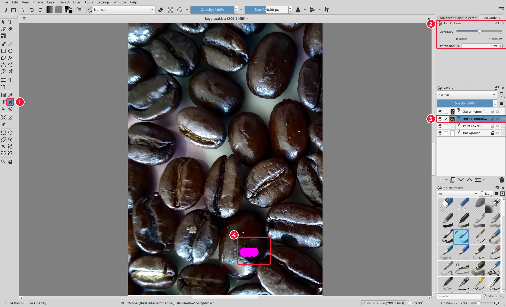
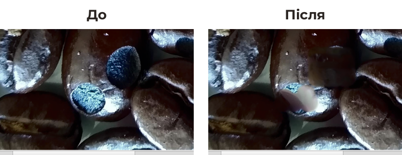

# 5.5. Ретуш: розумна латка

[← Кольорокорекція](04-korektsiia.md) · [До уроку](README.md) · [Далі: Вирізання →](06-vyrizannia.md)

**Ретуш** — прибирання дрібних дефектів: пилу, подряпин, плям, бліків. На фото зерен є два світлі плямисті зерна, що вибиваються із загальної картини. Приберемо їх.

## Крок 1. Оберіть шар і інструмент

1. У панелі **Layers** (3) клацніть шар **фото** (не шар фільтра!): ретушувати можна лише пікселі.
2. Оберіть **Smart Patch Tool** (*Розумна латка*) (1).
3. На вкладці **Tool Options** (2) **Accuracy** (*Точність*) залиште за замовчуванням. Розмір пензля (вгорі, **Size**) — трохи більший за пляму, наприклад `120 px`.

## Крок 2. Замалюйте дефект

1. Проведіть пензлем по плямі (4): ділянка зафарбується рожевим.
2. Відпустіть кнопку миші. Krita проаналізує навколишні пікселі й «домалює» ділянку. Це триває кілька секунд — дочекайтеся, поки зникне віконце **Waiting for image operation**.

> Великі плями ретушуйте **кількома короткими мазками**, а не одним великим. Не вийшло — `Ctrl+Z` і спробуйте ще раз.

## Інші інструменти ретуші

| Інструмент | Як працює | Коли |
|---|---|---|
| **Smart Patch** | Сам підбирає текстуру з околиць | Невеликі плями на складній текстурі |
| **Clone Tool** (*Клонування*, `Ctrl` + клацання — джерело) | Копіює пікселі з вибраного місця | Коли потрібен точний контроль |
| **Blur brush** (*Пензель розмиття*) | Згладжує ділянку | Шкіра, фон, шум |

[← Кольорокорекція](04-korektsiia.md) · [До уроку](README.md) · [Далі: Вирізання →](06-vyrizannia.md)
