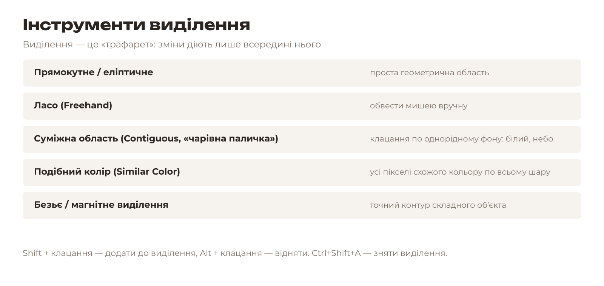
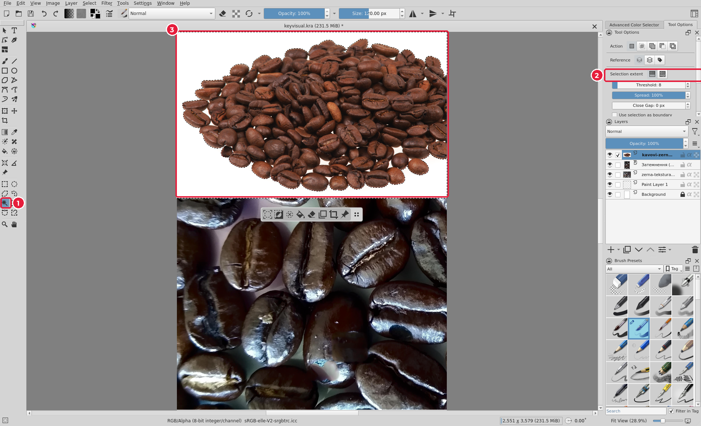
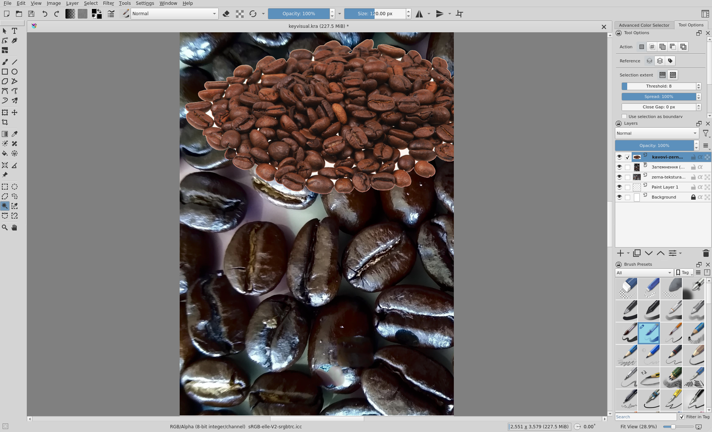
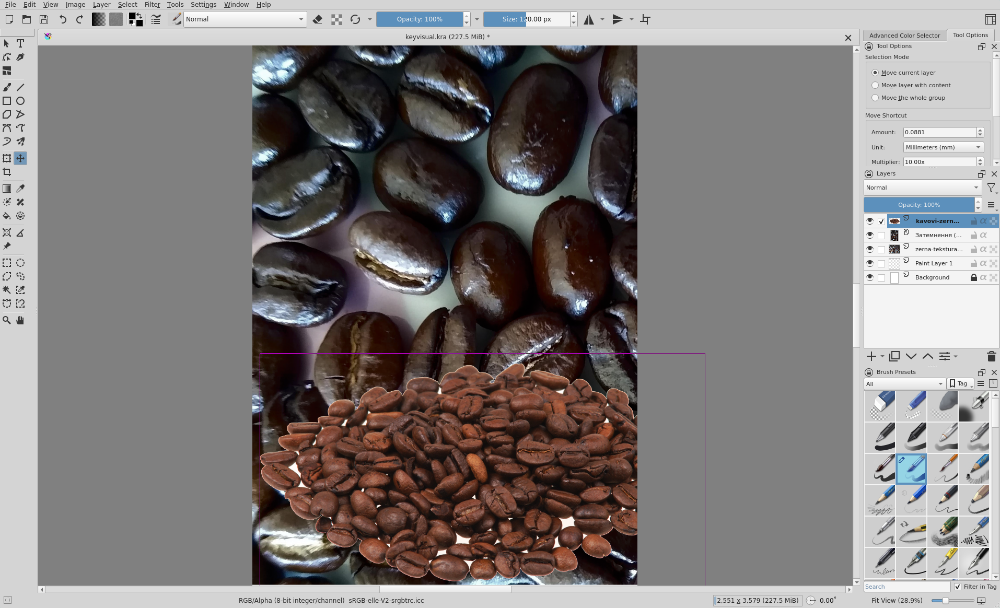

# 5.6. Вирізаний об’єкт: виділення

[← Ретуш](05-retush.md) · [До уроку](README.md) · [Далі: Збереження й експорт →](07-eksport.md)

## Теорія: виділення

**Виділення** обмежує дію інструментів: поки щось виділено, малювання, фільтри й видалення працюють лише всередині. Межу виділення показує «біжучий пунктир».

Найпростіше вирізати об’єкт, знятий на **однорідному фоні** (білому, сірому, небі): клацаємо «чарівною паличкою» по фону й видаляємо його.

## Крок 1. Імпортуйте фото об’єкта

1. Клацніть **верхній** шар у панелі **Layers** (новий шар з’явиться над ним).
2. **Layer → Import/Export → Import Layer…** і оберіть фото об’єкта на білому фоні. У прикладі — {{asset photos/01-kavobus/kavovi-zerna-na-bilomu.jpg short}}.

## Крок 2. Виділіть фон

1. Оберіть **Contiguous Selection Tool** (*Виділення суміжної області*, «чарівна паличка») (1).
2. На вкладці **Tool Options** параметр **Threshold** (*Поріг*) (2) визначає, наскільки схожими мають бути кольори. Для чистого білого фону підходить `8`; якщо виділяється замало — збільшіть до 20–40.
3. Клацніть по білому фону (3). Навколо об’єкта з’явиться пунктир.

> Білі ділянки **між** деталями об’єкта (наприклад, між зернами) не з’єднані із зовнішнім фоном. Додайте їх: `Shift` + клацання по кожній.

## Крок 3. Видаліть фон

1. Натисніть `Delete`: білий фон стане прозорим, і крізь нього видно нижні шари.
2. Зніміть виділення: `Ctrl+Shift+A` (**Select → Deselect**, *Виділення → Зняти*).

> **Неруйнівний варіант:** замість `Delete` інвертуйте виділення (`Ctrl+Shift+I`) і додайте **Layer → New → Add Transparency Mask** (*Маска прозорості*). Фон сховається, але не зникне: маску можна підправити пензлем (чорний — ховає, білий — показує).

## Крок 4. Розмістіть об’єкт

1. Оберіть **Move Tool** (*Переміщення*), клавіша `T`.
2. Перетягніть шар об’єкта на потрібне місце. Залиште вільне місце для заголовка плаката (у прикладі — верхня половина).

## Композиція

- Головний об’єкт — **один** і великий.
- Залиште **вільну зону** для заголовка, бажано на спокійному, однорідному фоні.
- **Правило третин:** розташовуйте важливі елементи на лініях, що ділять кадр на три частини, а не точно по центру.

[← Ретуш](05-retush.md) · [До уроку](README.md) · [Далі: Збереження й експорт →](07-eksport.md)
