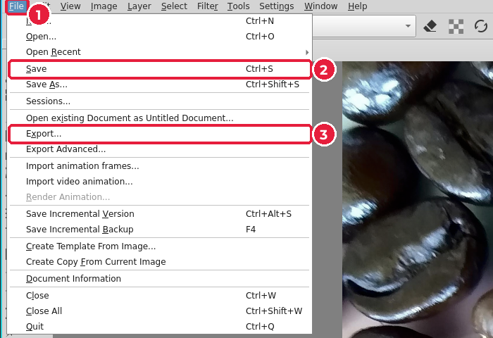
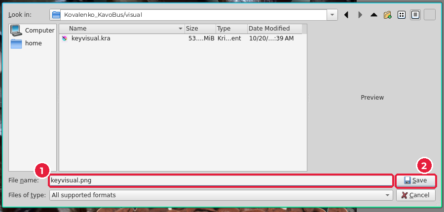
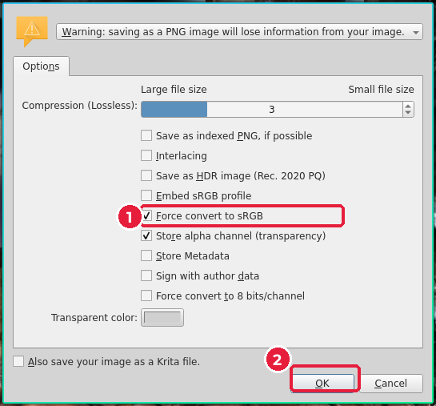

# 5.7. Збереження й експорт

[← Вирізання](06-vyrizannia.md) · [До уроку](README.md) · [Урок 6: Плакат і листівка →](../06-verstka/README.md)

## Крок 1. Збережіть KRA

`Ctrl+S`. Файл `keyvisual.kra` зберігає всі шари — це ваш робочий файл.

## Крок 2. Експортуйте PNG

1. **File → Export…** (*Файл → Експорт*) (3). Не плутайте з **Save As**: експорт створює копію в іншому форматі, а відкритим залишається KRA.

2. Ім’я файлу: `keyvisual.png` (1), **Save** (2).

3. У вікні параметрів PNG залиште **Store alpha channel (transparency)** (1) і натисніть **OK** (2).

Krita попередить, що PNG втратить шари: це нормально, шари залишаються у KRA.

## Чекліст уроку

- [ ] Розмір документа 216 × 303 мм, 300 dpi (2551 × 3579 px).
- [ ] Фон закриває все полотно разом із вильотами.
- [ ] Є шар фільтра з кольорокорекцією.
- [ ] Дефекти фото прибрано.
- [ ] Головний об’єкт вирізано акуратно, без білих ореолів.
- [ ] Є вільна зона для заголовка.
- [ ] У теці `visual/` є `keyvisual.kra` і `keyvisual.png`.
- [ ] Використано лише CC0-фото або власні.

[← Вирізання](06-vyrizannia.md) · [До уроку](README.md) · [Урок 6: Плакат і листівка →](../06-verstka/README.md)
