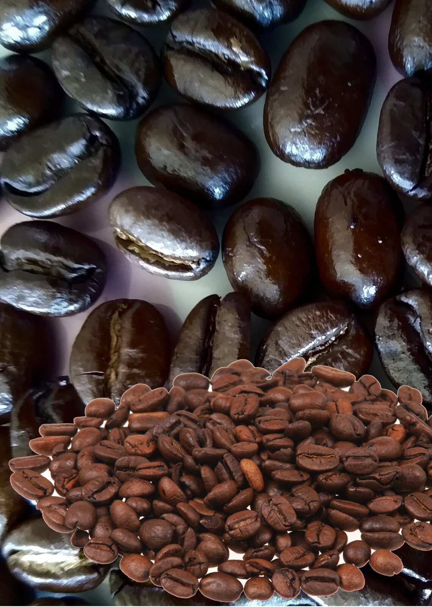

# Урок 5. Ключовий візуал (Krita)

**Програма:** Krita 6

**Ключовий візуал** — головне зображення рекламної кампанії: його бачать на плакаті, у соцмережах, на листівці. На цьому уроці ви складете колаж із фото: фон, кольорокорекція, ретуш, вирізаний об’єкт — і збережете його для друку з роздільною здатністю 300 dpi.

## Підуроки

| № | Тема |
|---|---|
| 5.1 | [Теорія: растр, роздільна здатність, авторське право](01-teoriia.md) |
| 5.2 | [Знайомство з Krita і новий документ](02-krita-dokument.md) |
| 5.3 | [Фон: імпорт шару й трансформація](03-fon.md) |
| 5.4 | [Кольорокорекція шаром фільтра](04-korektsiia.md) |
| 5.5 | [Ретуш: розумна латка](05-retush.md) |
| 5.6 | [Вирізаний об’єкт: виділення](06-vyrizannia.md) |
| 5.7 | [Збереження й експорт](07-eksport.md) |

## Результат уроку

| Файл | Навіщо |
|---|---|
| `visual/keyvisual.kra` | Вихідний файл з усіма шарами: його можна редагувати |
| `visual/keyvisual.png` | Готове зображення 2551 × 3579 px, 300 dpi: для плаката в Scribus (урок 6) |

## Критерії оцінювання

- Растрове зображення: кольорокорекція, акуратне вирізання, 300 dpi: **0–2 бали**.

[← Урок 4](../04-vizytivka/README.md) · [Урок 6: Плакат і листівка →](../06-verstka/README.md)
