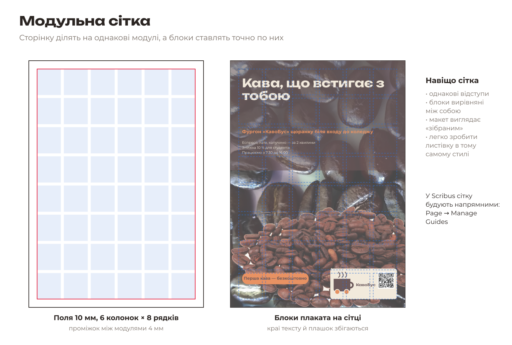
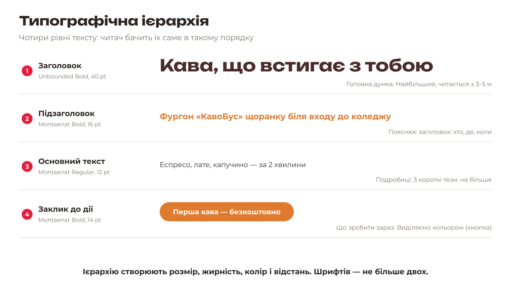
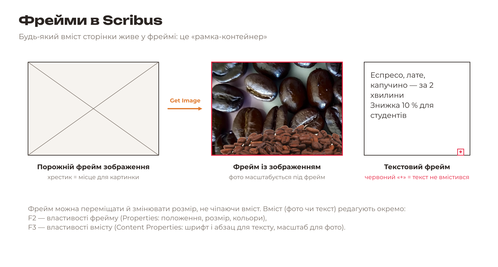
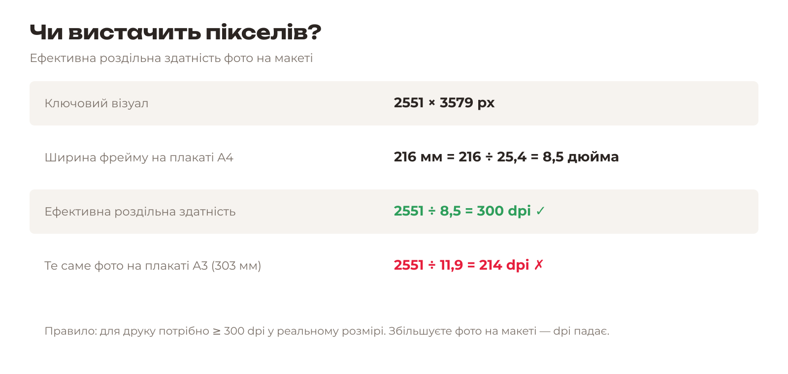

# 6.1. Теорія: сітка, ієрархія, фрейми

[← До уроку](README.md) · [Далі: Новий документ →](02-novyi-dokument.md)

## Чому Scribus, а не Inkscape чи Krita

| Програма | Для чого найкраща |
|---|---|
| Krita | Растр: фото, колаж, ретуш |
| Inkscape | Вектор: логотип, іконки, невеликі макети (візитівка) |
| **Scribus** | **Верстка**: багато тексту, стилі, кілька сторінок, перевірка й PDF/X для друкарні |

Програма верстки нічого не малює сама: вона **збирає** готові зображення й текст на сторінці. Професійні аналоги — Adobe InDesign і Affinity Publisher.

## Формати паперу

Плакат — **A4** (210 × 297 мм) або **A3** (297 × 420 мм). Листівка — **A5** (148 × 210 мм), тобто половина A4. Кожен наступний формат серії A — це попередній, розрізаний навпіл.

Вильоти для плаката й листівки — **3 мм** (для візитівки було 2 мм). Поля (безпечна зона) — **8–10 мм**.

## Модульна сітка

**Модульна сітка** ділить сторінку всередині полів на однакові прямокутники (модулі) з однаковими проміжками. Кожен блок макета — фото, заголовок, текст, логотип — займає один або кілька модулів. Тоді відступи скрізь однакові, краї блоків вирівняні, і макет виглядає «зібраним», навіть якщо елементів багато.

На нашому плакаті сітка проста: поля 10 мм, і весь текст починається від однієї лінії X = 14 мм.

## Типографічна ієрархія

Плакат читають на ходу, за 3–5 секунд. Тому текст ділять на рівні, і кожен наступний помітно менший або тихіший за попередній:

1. **Заголовок** — головна думка, найбільший кегль, шрифт для заголовків.
2. **Підзаголовок** — пояснює заголовок, акцентний колір.
3. **Основний текст** — 3 короткі тези, звичайне накреслення.
4. **Заклик до дії** — що людина має зробити зараз; виділяємо кнопкою.

> Перевірка: відійдіть від екрана на 3 м (або зменште масштаб до 25 %). Ви маєте прочитати заголовок і побачити кнопку.

## Стилі абзаців

**Стиль абзацу** — це збережений набір налаштувань: шрифт, кегль, міжрядковий інтервал, колір, вирівнювання. Ви один раз створюєте стиль «Заголовок» і застосовуєте його до будь-якого тексту одним клацанням. Змінили стиль — змінився весь текст із цим стилем, на плакаті й на листівці. Саме так у верстці зберігають єдиний фірмовий стиль.

## Фрейми

У Scribus не можна просто «написати текст на сторінці» чи «вставити фото»: спочатку створюють **фрейм** (рамку), а потім наповнюють його. Фрейм зображення без картинки показує хрестик. Якщо текст не вміщується в текстовий фрейм, у правому нижньому куті з’являється червоний знак переповнення: збільште фрейм або скоротіть текст.

Два вікна, які знадобляться постійно:

| Клавіша | Вікно | Що там |
|---|---|---|
| `F2` | **Properties** (*Властивості*) | Положення X, Y, розмір, поворот, кольори й прозорість самого фрейму |
| `F3` | **Content Properties** (*Властивості вмісту*) | Для тексту: шрифт, кегль, абзац, стиль. Для фото: масштаб і dpi |

## Чи вистачить пікселів

Scribus не змінює саме фото, а лише масштабує його у фреймі. Якщо розтягнути фото на більший формат, кожен піксель стане більшим, і **ефективна роздільна здатність** впаде. Для друку потрібно не менше **300 dpi** у реальному розмірі.

**Завдання.** Ваш логотип `logo.png` має ширину 1000 px. Яку ширину він може мати на плакаті, щоб було не менше 300 dpi?

Відповідь

1000 ÷ 300 = 3,33 дюйма × 25,4 = **≈ 85 мм**. На плакаті логотип займає 50 мм, тобто 1000 ÷ (50 ÷ 25,4) ≈ **508 dpi** — достатньо.

[← До уроку](README.md) · [Далі: Новий документ →](02-novyi-dokument.md)
