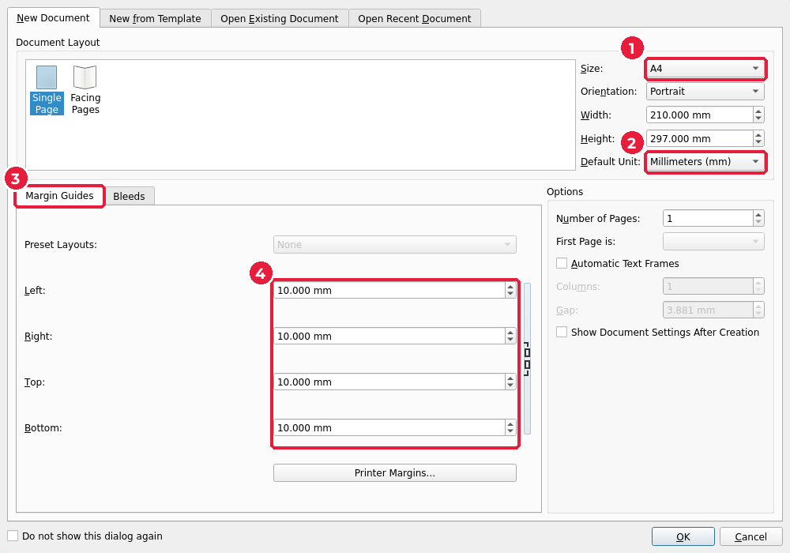
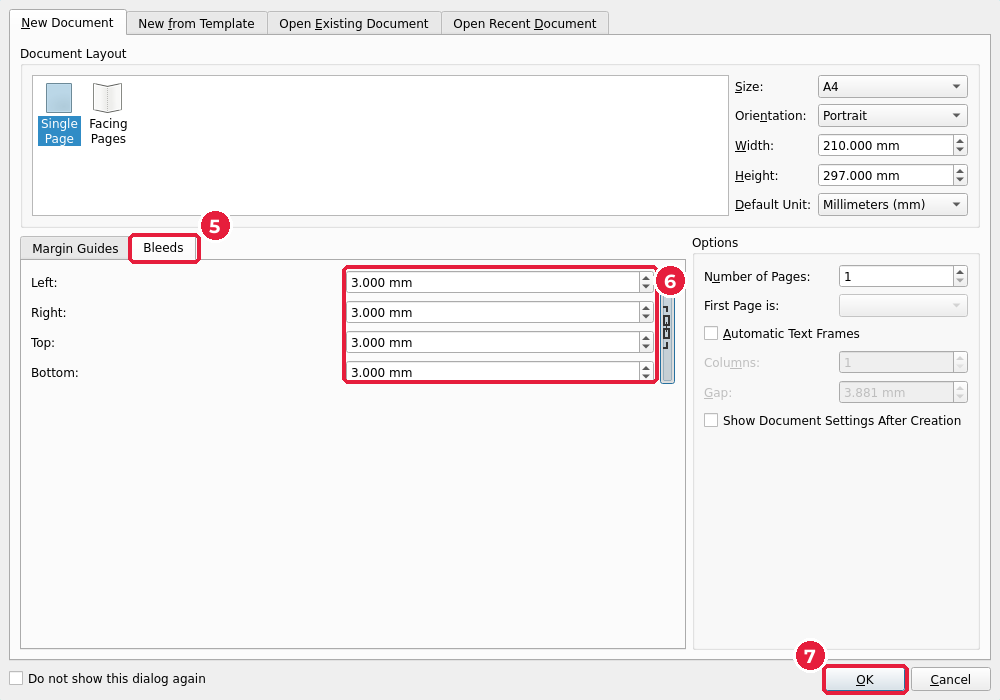
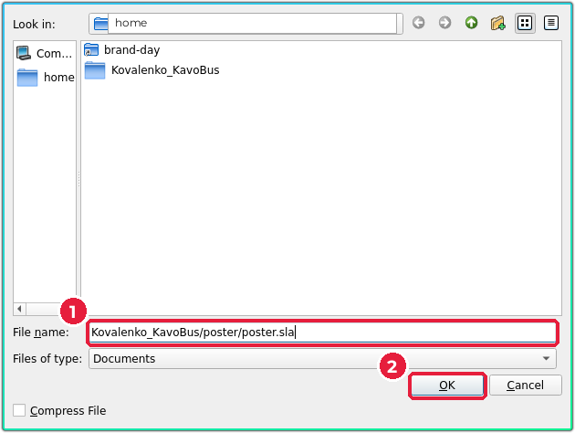

# 6.2. Новий документ

[← Теорія](01-teoriia.md) · [До уроку](README.md) · [Далі: Ключовий візуал →](03-kliuchovyi-vizual.md)

## Крок 1. Розмір, одиниці й поля

Запустіть Scribus. Відкриється вікно **New Document** (*Новий документ*). Якщо Scribus уже відкритий: **File → New…** (*Файл → Створити*), `Ctrl+N`.

1. **Size** (*Розмір*): `A4` (1). **Orientation** (*Орієнтація*): `Portrait` (*Книжкова*).
2. **Default Unit** (*Одиниці*): `Millimeters (mm)` (2). Без цього всі розміри будуть у пунктах.
3. Вкладка **Margin Guides** (*Напрямні полів*) (3): усі чотири поля по `10` мм (4). Значок ланцюжка праворуч від полів зв’язує їх: змінили одне — змінилися всі.

## Крок 2. Вильоти

4. Вкладка **Bleeds** (*Вильоти*) (5): усі чотири по `3` мм (6).
5. Натисніть **OK** (7).

На сторінці з’являться три рамки:

| Рамка | Колір | Що це |
|---|---|---|
| Зовнішня | червона | межа вильотів: сюди тягнемо фон |
| Край сторінки | тінь аркуша | лінія обрізу, 210 × 297 мм |
| Внутрішня | синя | поля: текст і логотип — тільки всередині |

## Крок 3. Збережіть одразу

**File → Save As…** (*Файл → Зберегти як*), `Ctrl+Shift+S`.

1. Перейдіть у свою робочу теку → `poster/` і введіть ім’я `poster.sla` (1).
2. Натисніть **OK** або **Save** (2).

> **SLA** — власний формат Scribus. Він **не містить** зображень і шрифтів, а лише посилання на файли `keyvisual.png`, `logo.png`. Тому не перейменовуйте й не переміщуйте ці файли після вставлення, інакше Scribus їх «загубить». Щоб віднести проєкт на інший комп’ютер, використовуйте **File → Collect for Output…** (*Зібрати для виведення*): Scribus скопіює в одну теку `.sla`, усі зображення й шрифти.

Далі зберігайте часто: `Ctrl+S`.

[← Теорія](01-teoriia.md) · [До уроку](README.md) · [Далі: Ключовий візуал →](03-kliuchovyi-vizual.md)
