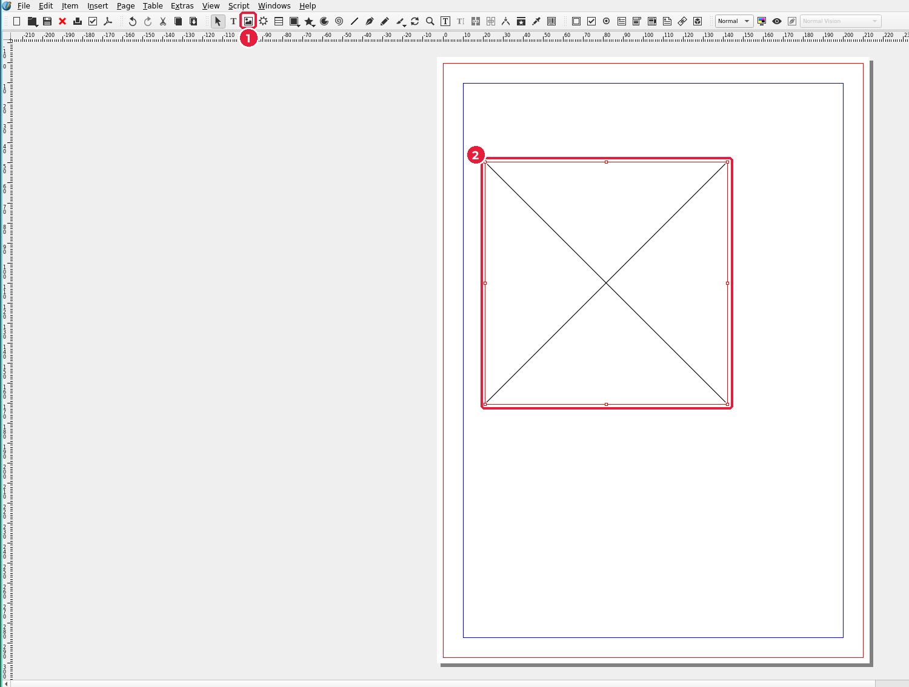
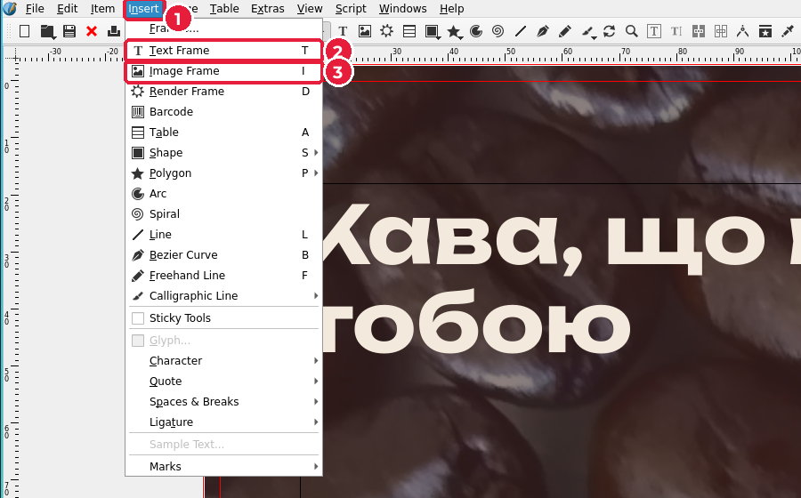
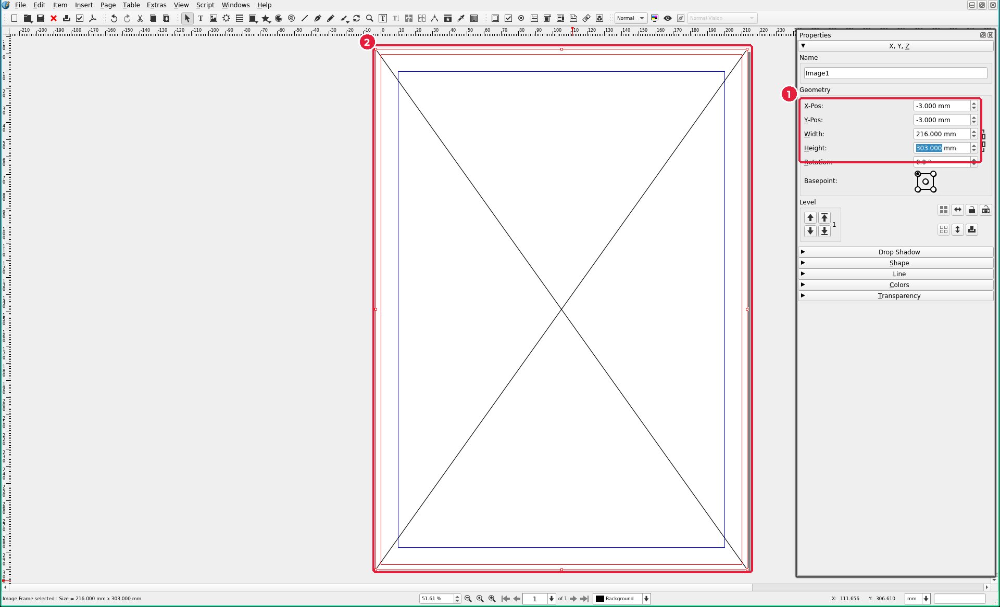
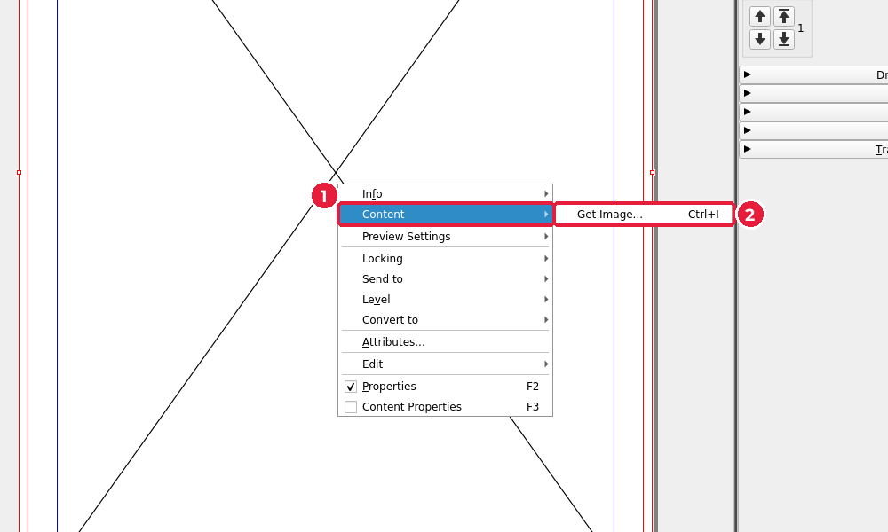
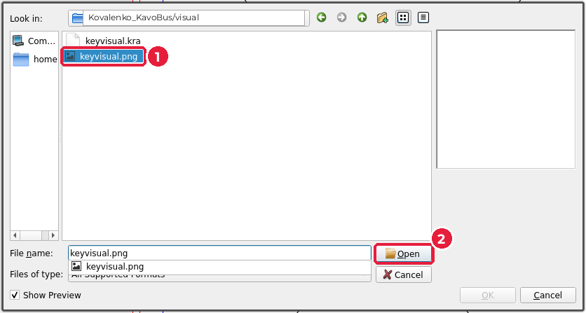
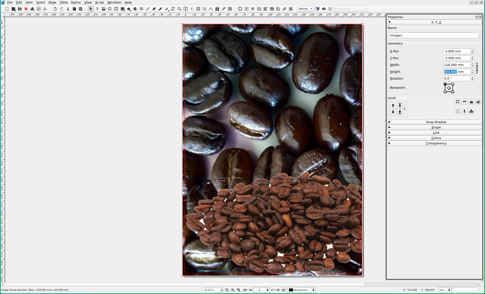
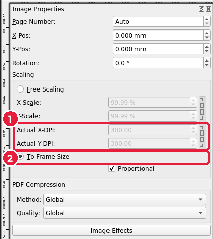

# 6.3. Ключовий візуал

[← Новий документ](02-novyi-dokument.md) · [До уроку](README.md) · [Далі: Кольори бренду й підкладка →](04-kolory.md)

Ключовий візуал займе весь плакат разом із вильотами: 210 + 3 + 3 = **216 мм** на 297 + 3 + 3 = **303 мм**. Саме такий розмір ви задали полотну в Krita (урок 5).

## Крок 1. Намалюйте фрейм зображення

1. На панелі інструментів оберіть **Image Frame** (*Фрейм зображення*) (1), клавіша `I`. Те саме є в меню **Insert → Image Frame** (*Вставити → Фрейм зображення*).
2. Протягніть мишею прямокутник будь-якого розміру на сторінці (2). З’явиться фрейм із хрестиком.

У меню **Insert** (1) є обидва інструменти фреймів, які знадобляться на цьому уроці: **Text Frame** (*Текстовий фрейм*, `T`) (2) і **Image Frame** (`I`) (3).

## Крок 2. Точний розмір і положення

1. Відкрийте **Properties** (*Властивості*), `F2`. Розділ **X, Y, Z** уже розгорнутий.
2. У групі **Geometry** (*Геометрія*) (1) введіть значення й після кожного натискайте `Enter`:

| Поле | Значення | Чому |
|---|---|---|
| **X-Pos** | `-3` | на 3 мм лівіше за край (виліт) |
| **Y-Pos** | `-3` | на 3 мм вище за край (виліт) |
| **Width** | `216` | 210 + 3 + 3 |
| **Height** | `303` | 297 + 3 + 3 |

Фрейм (2) тепер точно збігається з червоною рамкою вильотів.

> Якщо **Width** і **Height** змінюються разом, вимкніть ланцюжок праворуч від них.

## Крок 3. Вставте зображення

1. Клацніть фрейм правою кнопкою миші → **Content** (*Вміст*) (1) → **Get Image…** (*Отримати зображення*) (2), `Ctrl+I`.

2. Перейдіть у теку `visual/`, оберіть `keyvisual.png` (1) і натисніть **Open** (2).

Зображення заповнить фрейм.

## Крок 4. Підженіть зображення під фрейм і перевірте dpi

1. Відкрийте **Content Properties** (*Властивості вмісту*), `F3`. Для фрейму зображення це вікно називається **Image Properties**.
2. У групі **Scaling** (*Масштабування*) увімкніть **To Frame Size** (*За розміром фрейму*) (2) і **Proportional** (*Пропорційно*). Тепер фото завжди змінюватиметься разом із фреймом без спотворень.
3. Подивіться на **Actual X-DPI** і **Actual Y-DPI** (*Фактична роздільна здатність*) (1): має бути **300** або більше.

> Менше 300? Значить, у Krita полотно було меншим. Найкраще повернутися до `keyvisual.kra` і перевірити **Image → Properties** (*Зображення → Властивості*). Збільшувати фото в Scribus — не вихід: воно стане розмитим.

## Крок 5. Заблокуйте фон

Щоб фото не зсувалося, поки ви розміщуєте текст поверх нього: правою кнопкою → **Locking** (*Блокування*) → **Is Locked** (*Заблоковано*), або `Ctrl+L`. Розблокувати — так само.

`Ctrl+S`.

[← Новий документ](02-novyi-dokument.md) · [До уроку](README.md) · [Далі: Кольори бренду й підкладка →](04-kolory.md)
