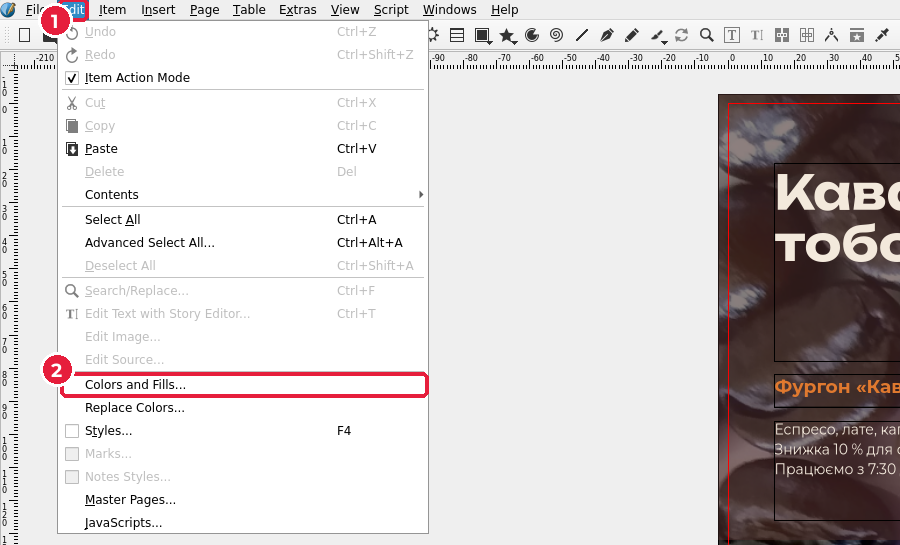
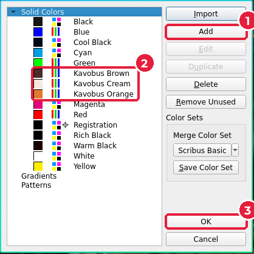
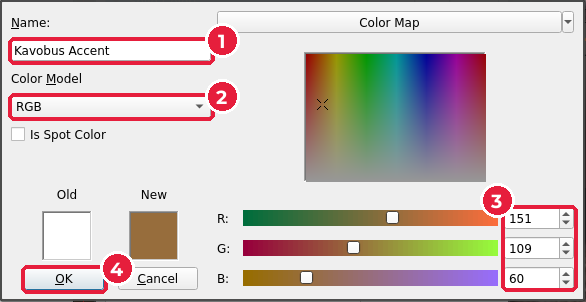
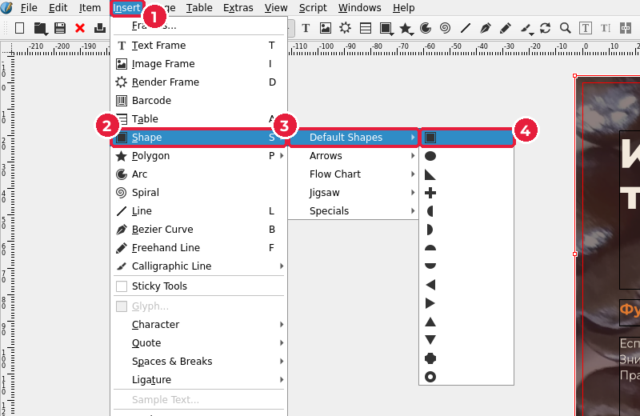
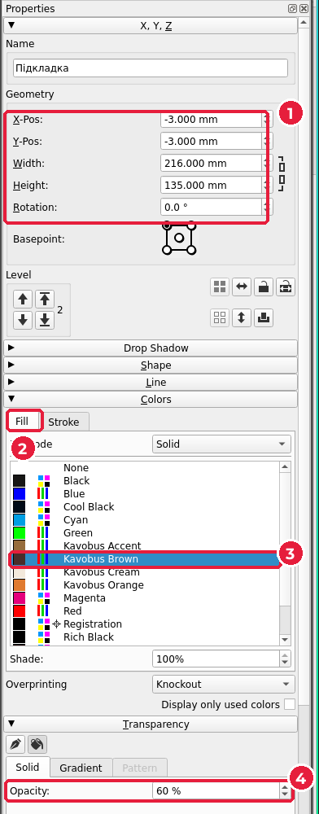

# 6.4. Кольори бренду й підкладка

[← Ключовий візуал](03-kliuchovyi-vizual.md) · [До уроку](README.md) · [Далі: Текст і стилі абзаців →](05-tekst-styli.md)

## Крок 1. Додайте кольори бренду в документ

У Scribus кольори зберігають **у документі** під власними назвами. Тоді в усіх списках кольорів ви обиратимете `Kavobus Brown`, а не шукатимете відтінок навмання. А якщо колір доведеться змінити, він зміниться скрізь одразу.

1. Відкрийте **Edit** (*Редагування*) (1) → **Colors and Fills…** (*Кольори й заливки*) (2).

2. У вікні **Colors and Fills** натисніть **Add** (*Додати*) (1).

3. У вікні **Edit Color** (*Редагування кольору*):
   - **Name** (*Назва*) (1): назва бренду + назва кольору, наприклад `Kavobus Brown`.
   - **Color Model** (*Колірна модель*) (2): `RGB`.
   - **R**, **G**, **B** (3): значення кольору від 0 до 255.
   - Натисніть **OK** (4).

4. Повторіть для всіх кольорів палітри. Вони з’являться у списку (2). Закрийте вікно кнопкою **OK** (3).

### Як перевести HEX у RGB

У мудборді кольори записано в форматі HEX (`#4A2C2A`), а Scribus просить три числа. HEX — це ті самі три числа R, G, B, записані в шістнадцятковій системі, по дві цифри на кожне:

| Колір | HEX | R | G | B |
|---|---|---|---|---|
| Kavobus Cream | `#F3E9DC` | 243 | 233 | 220 |
| Kavobus Brown | `#4A2C2A` | 74 | 44 | 42 |
| Kavobus Orange | `#E07A2F` | 224 | 122 | 47 |
| Kavobus Accent | `#976D3C` | 151 | 109 | 60 |

Перевести свої кольори найпростіше так: в Inkscape відкрийте **Fill and Stroke** (`Shift+Ctrl+F`), вставте HEX у поле **RGBA** і подивіться на повзунки **R**, **G**, **B** у режимі RGB. Або порахуйте самі: `4A` = 4 × 16 + 10 = **74**.

> Чому не CMYK одразу? Друкарня все одно переведе кольори в CMYK під свій папір і машину. Ми зберігаємо RGB-кольори бренду, а в уроці 7 перевіримо, як вони виглядатимуть у друці (екранна кольоропроба).

## Крок 2. Напівпрозора підкладка під текст

Світлий текст погано читається на строкатому фото. Рішення — темна напівпрозора **підкладка**: прямокутник у кольорі бренду, через який трохи видно фото.

1. **Insert** (*Вставити*) (1) → **Shape** (*Фігура*) (2) → **Default Shapes** (*Стандартні фігури*) (3) → квадрат (4). Клавіша `S`.

2. Протягніть прямокутник на верхній частині сторінки.
3. У **Properties** (`F2`) задайте розмір (1): **X** = `-3`, **Y** = `-3`, **Width** = `216`, **Height** = `135`. Підкладка займає верхню частину плаката разом із вильотами зліва, справа й зверху.
4. Розгорніть розділ **Colors** (*Кольори*), вкладка **Fill** (*Заливка*) (2): оберіть `Kavobus Brown` (3).
5. На вкладці **Stroke** (*Обведення*) оберіть `None` (*Немає*), щоб прибрати контур.
6. Розгорніть розділ **Transparency** (*Прозорість*): **Opacity** (*Непрозорість*) = `60 %` (4).

> Нова фігура з’являється **поверх** фото, а текстові фрейми ви створите пізніше — вони будуть поверх підкладки. Порядок шарів змінюють кнопками-стрілками в групі **Level** (*Рівень*) у тому самому вікні.

Підберіть непрозорість під своє фото: заголовок має читатися, а фото — бути помітним. Зазвичай підходить 50–70 %.

`Ctrl+S`.

[← Ключовий візуал](03-kliuchovyi-vizual.md) · [До уроку](README.md) · [Далі: Текст і стилі абзаців →](05-tekst-styli.md)
