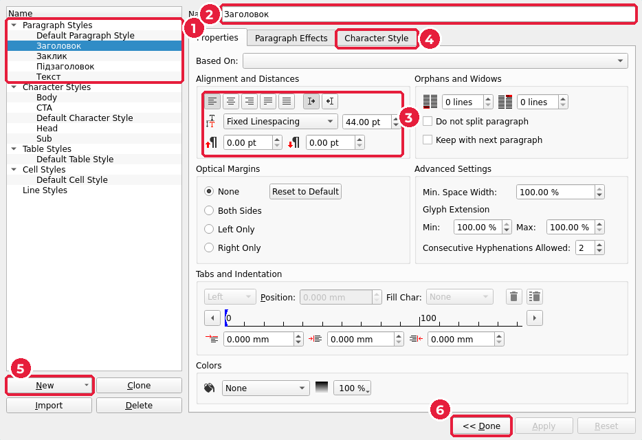
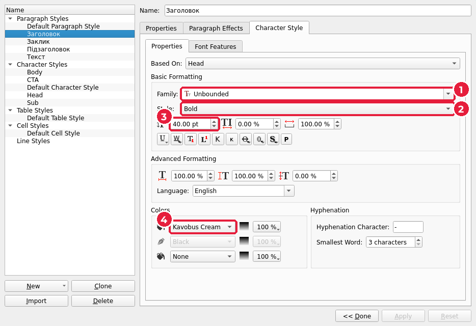
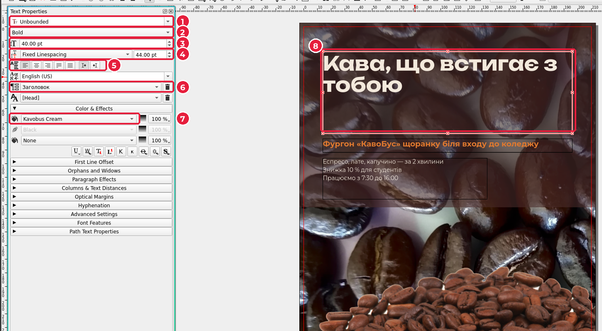
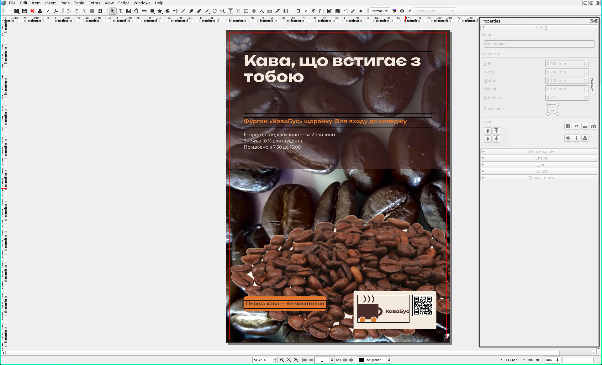

# 6.5. Текст і стилі абзаців

[← Кольори бренду й підкладка](04-kolory.md) · [До уроку](README.md) · [Далі: Логотип, QR-код і заклик до дії →](06-lohotyp-qr.md)

Спочатку створимо стилі абзаців, а потім текстові фрейми. Так кожен новий текст одразу отримує фірмовий вигляд.

## Крок 1. Стилі абзаців

1. Відкрийте **Edit → Styles…** (*Редагування → Стилі*), `F4`. Відкриється **Style Manager** (*Менеджер стилів*).
2. Натисніть стрілку біля **New** (*Створити*) (5) → **Paragraph Style** (*Стиль абзацу*). Новий стиль з’явиться у списку **Paragraph Styles** (1).
3. У полі **Name** (*Назва*) (2) введіть `Заголовок`.
4. На вкладці **Properties** (*Властивості*), група **Alignment and Distances** (*Вирівнювання й відстані*) (3): вирівнювання ліворуч (перша кнопка), **Fixed Linespacing** (*Фіксований інтервал*), `44 pt`.
5. Відкрийте вкладку **Character Style** (*Стиль символів*) (4) і задайте шрифт, кегль і колір із таблиці нижче.
6. Натисніть **Apply** (*Застосувати*).

На вкладці **Character Style** задайте: **Family** (*Гарнітура*) (1), **Style** (*Накреслення*, наприклад `Bold`) (2), кегль (3) і колір тексту в групі **Colors** (4).

Повторіть кроки 2–6 для решти стилів:

| Стиль | Шрифт | Кегль / інтервал | Колір | Вирівнювання |
|---|---|---|---|---|
| `Заголовок` | Unbounded Bold | 40 / 44 pt | Kavobus Cream | ліворуч |
| `Підзаголовок` | Montserrat Bold | 16 / 20 pt | Kavobus Orange | ліворуч |
| `Текст` | Montserrat Regular | 12 / 17 pt | Kavobus Cream | ліворуч |
| `Заклик` | Montserrat Bold | 14 / 18 pt | Kavobus Brown | по центру |

Шрифти й кольори — ваші, з мудборду. Міжрядковий інтервал беріть приблизно **кегль × 1,1** для заголовків і **кегль × 1,4** для основного тексту.

7. Закрийте менеджер кнопкою **<< Done** (*Готово*) (6).

## Крок 2. Текстові фрейми

1. **Insert → Text Frame** (*Вставити → Текстовий фрейм*), `T`. Протягніть прямокутник на сторінці.
2. У **Properties** (`F2`) задайте положення й розмір:

| Фрейм | X | Y | W | H |
|---|---|---|---|---|
| Заголовок | 14 | 18 | 182 | 60 |
| Підзаголовок | 14 | 82 | 182 | 10 |
| Переваги (3 тези) | 14 | 96 | 120 | 30 |

Усі фрейми починаються від X = 14 мм: це спільна лінія сітки. Права межа 14 + 182 = 196 мм, тобто всередині поля (200 мм).

3. Двічі клацніть усередині фрейму: з’явиться курсор. Введіть текст. Кожна теза — окремий абзац (`Enter`).

> Великий текст зручніше вводити в редакторі: **Edit → Edit Text with Story Editor…** (*Редагування → Редагувати текст у редакторі тексту*), `Ctrl+T`.

## Крок 3. Застосуйте стилі

1. Виділіть фрейм інструментом **Select Item** (*Вибір*, чорна стрілка) — вийдіть із режиму редагування тексту клавішею `Esc`.
2. Відкрийте **Content Properties** (`F3`). Для текстового фрейму це вікно називається **Text Properties**.
3. У списку стилів абзацу (6) оберіть потрібний стиль. Шрифт (1), накреслення (2), кегль (3), інтервал (4), вирівнювання (5) і колір (7) зміняться автоматично для всього тексту у фреймі (8).

> Не змінюйте шрифт і кегль вручну в цьому вікні: тоді текст «відірветься» від стилю. Хочете інший кегль заголовка — змініть стиль у **Style Manager**, і всі заголовки зміняться разом.

## Крок 4. Перевірте переповнення

Якщо в правому нижньому куті фрейму з’явився червоний знак, текст не вмістився. Збільшіть висоту фрейму (**Height**) або скоротіть текст. Швидкий спосіб: правою кнопкою по фрейму → **Adjust Frame Height to Text** (*Підігнати висоту фрейму під текст*).

Зараз плакат має виглядати так:

`Ctrl+S`.

[← Кольори бренду й підкладка](04-kolory.md) · [До уроку](README.md) · [Далі: Логотип, QR-код і заклик до дії →](06-lohotyp-qr.md)
