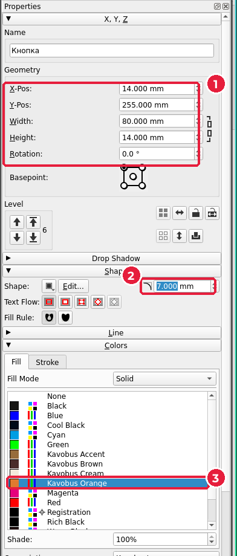
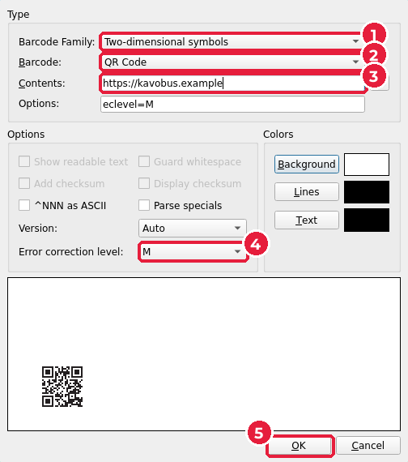
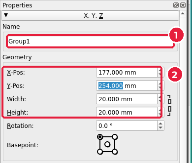
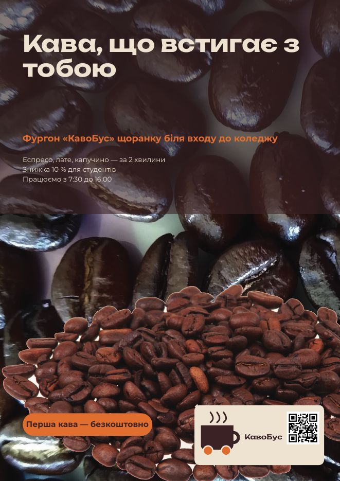

# 6.6. Логотип, QR-код і заклик до дії

[← Текст і стилі абзаців](05-tekst-styli.md) · [До уроку](README.md) · [Далі: Листівка A5 →](07-lystivka.md)

Нижня частина плаката відповідає на запитання «що робити далі?»: кнопка із закликом до дії, логотип і QR-код.

## Крок 1. Кнопка

1. Намалюйте прямокутник: **Insert → Shape** (`S`), як у [підуроці 6.4](04-kolory.md).
2. У **Properties** (`F2`):
   - **X** = `14`, **Y** = `255`, **Width** = `80`, **Height** = `14` (1).
   - Розділ **Shape** (*Форма*): заокруглення кутів (2) = `7` мм, тобто половина висоти. Так кнопка стане «пігулкою».
   - Розділ **Colors** → **Fill**: `Kavobus Orange` (3). **Stroke**: `None`.

3. Поверх кнопки створіть текстовий фрейм (`T`): **X** = `14`, **Y** = `259`, **Width** = `80`, **Height** = `8`. Введіть заклик, наприклад «Перша кава — безкоштовно», і застосуйте стиль `Заклик`.

> Заклик до дії — це дієслово або вигода: «Приходь», «Замов», «Перша кава — безкоштовно». Не більше 3–5 слів.

## Крок 2. Світла плашка

Логотип і QR-код погано видно на фото, тому покладемо їх на світлу плашку.

1. Ще один прямокутник: **X** = `120`, **Y** = `250`, **Width** = `80`, **Height** = `37`.
2. **Shape** → заокруглення `3` мм. **Fill**: `Kavobus Cream`. **Stroke**: `None`.

Перевірка: 120 + 80 = 200 мм, 250 + 37 = 287 мм. Плашка торкається полів, але не виходить за них.

## Крок 3. Логотип

1. Фрейм зображення (`I`): **X** = `124`, **Y** = `254`, **Width** = `50`, **Height** = `27`.
2. Правою кнопкою → **Content → Get Image…** (`Ctrl+I`) → `logo/logo.png`.
3. **Content Properties** (`F3`): **To Frame Size** і **Proportional**.

Чи вистачить роздільної здатності? `logo.png` має ширину 1000 px, а на плакаті — 50 мм: 1000 ÷ (50 ÷ 25,4) ≈ **508 dpi**. Більше 300 — добре.

## Крок 4. QR-код

Scribus уміє сам створювати QR-коди, і вони будуть векторними: чіткими при будь-якому розмірі.

1. **Insert → Barcode** (*Вставити → Штрих-код*).
2. У вікні **Insert Barcode**:
   - **Barcode Family** (*Сімейство*) (1): `Two-dimensional symbols` (*Двовимірні коди*).
   - **Barcode** (2): `QR Code`.
   - **Contents** (*Вміст*) (3): та сама адреса, що й на візитівці, наприклад `https://kavobus.example`.
   - **Error correction level** (*Рівень корекції помилок*) (4): `M`.
   - Натисніть **OK** (5).

> Не натискайте синю кнопку зі стрілками праворуч від **Contents**: вона повертає зразок адреси за замовчуванням.

3. Курсор зміниться: клацніть будь-де на сторінці, щоб поставити код.
4. QR-код з’явиться як **група** векторних квадратиків. У **Properties** (`F2`):
   - **Name** (1): перейменуйте `Group1` на `QR-код`, щоб не заплутатися.
   - **X** = `177`, **Y** = `254`, **Width** = `20`, **Height** = `20` (2).

5. Перевірте код телефоном, навівши камеру на екран.

> QR-код має бути **темним на світлому** фоні і мати вільне поле навколо. Тому він і стоїть на кремовій плашці, а не на фото.

## Крок 5. Як знайти «загублений» об’єкт

На плакаті вже понад десять об’єктів, і деякі лежать один під одним: клацання вибирає верхній. Відкрийте **Windows → Outline** (*Вікна → Структура*): там список усіх об’єктів сторінки за назвами. Клацніть назву — об’єкт виділиться.

Зараз плакат готовий:

`Ctrl+S`.

[← Текст і стилі абзаців](05-tekst-styli.md) · [До уроку](README.md) · [Далі: Листівка A5 →](07-lystivka.md)
