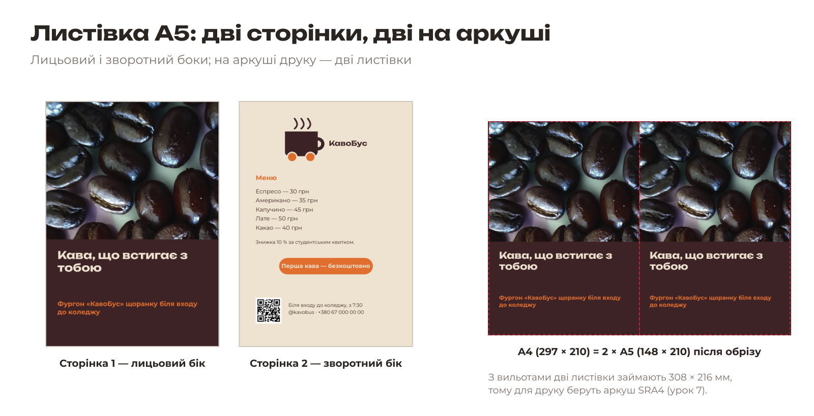
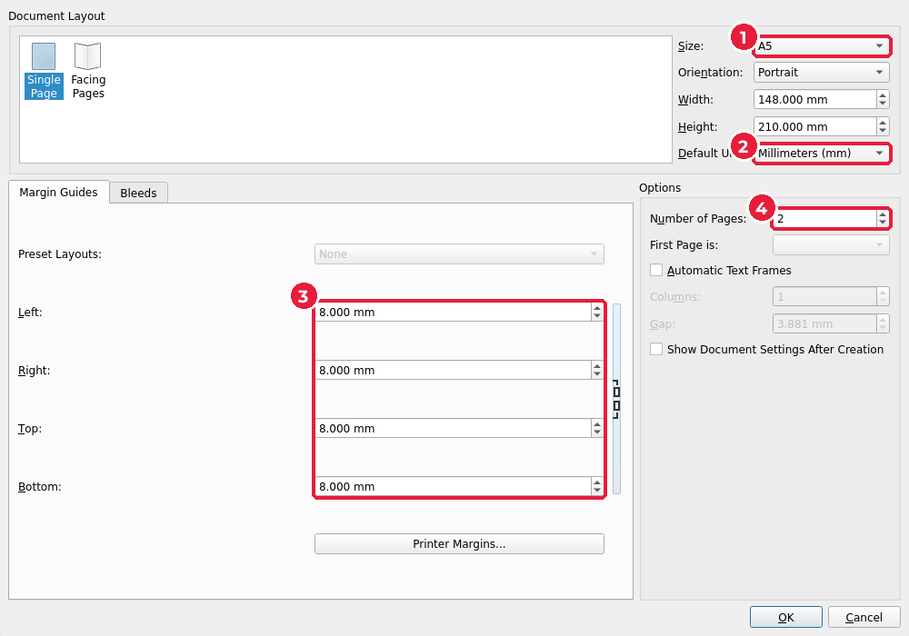
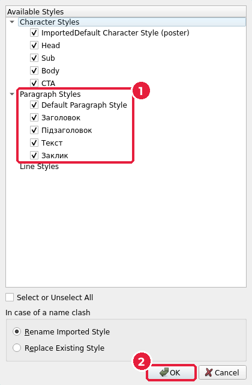
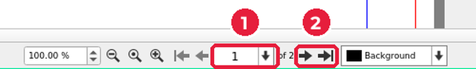

# 6.7. Листівка A5

[← Логотип, QR-код і заклик до дії](06-lohotyp-qr.md) · [До уроку](README.md) · [Далі: Збереження й чорновий PDF →](08-chornovyi-pdf.md)

Листівку роздають у руки, тому на ній **більше тексту**, ніж на плакаті: меню, ціни, адреса. Стиль той самий: ті ж кольори, шрифти й стилі абзаців. Лицьовий бік привертає увагу, зворотний — інформує.

## Крок 1. Новий документ на 2 сторінки

Плакат залиште відкритим: він знадобиться. **File → New…** (`Ctrl+N`).

> Це вікно може відкритися з іншими налаштуваннями, ніж при запуску Scribus, наприклад формат `Letter` і дюйми. Перевірте кожне поле.

1. **Size** (1): `A5`. **Orientation**: `Portrait`.
2. **Default Unit** (2): `Millimeters (mm)`.
3. **Margin Guides** (3): усі поля по `8` мм. Якщо ланцюжок праворуч не натиснутий, введіть усі чотири значення.
4. **Number of Pages** (*Кількість сторінок*) (4): `2`.
5. Вкладка **Bleeds**: усі по `3` мм. **OK**.

Одразу збережіть: **File → Save As…** → `flyer/flyer.sla`.

## Крок 2. Перенесіть стилі й кольори з плаката

Не створюйте стилі заново — імпортуйте їх.

1. **Edit → Styles…** (`F4`) → **Import** (*Імпортувати*). Оберіть `poster/poster.sla`.
2. У вікні **Choose Styles** (*Вибір стилів*) переконайтеся, що позначено всі стилі абзаців (1), і натисніть **OK** (2).

3. Так само кольори: **Edit → Colors and Fills…** → **Import** → `poster/poster.sla` → **OK**.

> Ще один спосіб: виділіть фрейм на плакаті, `Ctrl+C`, перейдіть у листівку через меню **Windows** (*Вікна*) — внизу меню список відкритих документів — і `Ctrl+V`. Фрейм вставиться в те саме місце разом зі своїм стилем і кольорами.

## Крок 3. Сторінка 1 — лицьовий бік

| Об’єкт | Як зробити | X | Y | W | H |
|---|---|---|---|---|---|
| Фото | Фрейм зображення, `keyvisual.png`, **To Frame Size** | −3 | −3 | 154 | 216 |
| Фон під текст | Прямокутник, `Kavobus Brown`, непрозорий | −3 | 118 | 154 | 95 |
| Заголовок | Текстовий фрейм, стиль `Заголовок` | 10 | 126 | 128 | 40 |
| Підзаголовок | Текстовий фрейм, стиль `Підзаголовок` | 10 | 170 | 128 | 20 |

Фрейм менший, ніж на плакаті, але пропорції ті самі (154 : 216 = 216 : 303), тому фото вміститься повністю. Роздільна здатність навіть зросте: 2551 px на 154 мм ≈ 420 dpi.

Заголовок на 40 pt на A5 не поміститься. Не міняйте стиль `Заголовок` (він спільний з плакатом), а створіть у **Style Manager** копію: виділіть `Заголовок` → **Clone** (*Клонувати*) → назва `Заголовок A5`, кегль `26 pt`, інтервал `30 pt`.

## Крок 4. Сторінка 2 — зворотний бік

Перейдіть на другу сторінку: введіть номер у поле внизу вікна (1) або натисніть стрілку **Next Page** (*Наступна сторінка*) (2).

| Об’єкт | Як зробити | X | Y | W | H |
|---|---|---|---|---|---|
| Фон | Прямокутник, `Kavobus Cream` | −3 | −3 | 154 | 216 |
| Логотип | Фрейм зображення, `logo.png` | 39 | 14 | 70 | 37 |
| «Меню» | Текстовий фрейм, стиль `Підзаголовок` | 14 | 62 | 120 | 10 |
| Пункти меню з цінами | Текстовий фрейм, новий стиль `Меню`: Montserrat Regular 14/22 pt, `Kavobus Brown` | 14 | 74 | 120 | 40 |
| Знижка | Текстовий фрейм, стиль `Текст`, колір `Kavobus Brown` | 14 | 118 | 120 | 8 |
| Кнопка + заклик | Як на плакаті | 34 | 134 / 138 | 80 | 14 / 8 |
| QR-код | **Insert → Barcode** | 14 | 168 | 22 | 22 |
| Адреса й контакти | Текстовий фрейм, стиль `Текст`, колір `Kavobus Brown` | 42 | 172 | 92 | 16 |

> На кремовому фоні кремовий текст зі стилю `Текст` не видно. Колір окремого фрейму можна змінити у **Content Properties** (`F3`) → **Color & Effects**, але краще створити стиль `Текст темний` клонуванням.

Кнопку з плаката можна скопіювати (`Ctrl+C`) і вставити (`Ctrl+V`), а потім змінити **X** і **Y**.

Результат:

| Сторінка 1 | Сторінка 2 |
|---|---|
|  |  |

`Ctrl+S`.

[← Логотип, QR-код і заклик до дії](06-lohotyp-qr.md) · [До уроку](README.md) · [Далі: Збереження й чорновий PDF →](08-chornovyi-pdf.md)
