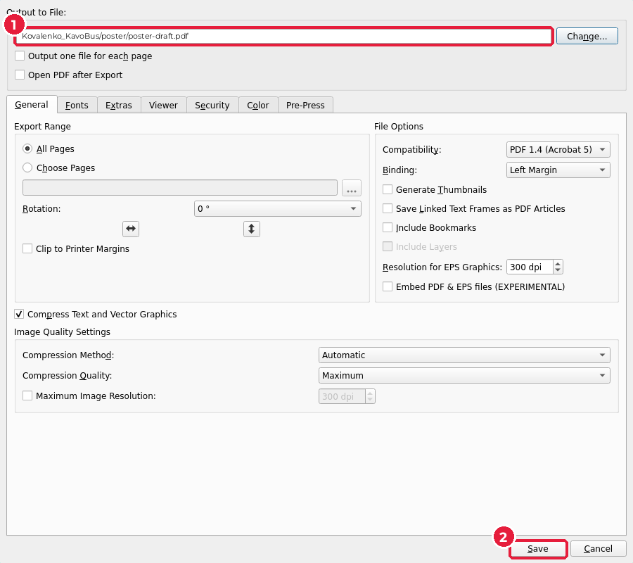

# 6.8. Збереження й чорновий PDF

[← Листівка A5](07-lystivka.md) · [До уроку](README.md) · [Урок 7: Препрес →](../07-prepres/README.md)

**Чорновий PDF** — файл для перегляду: показати парі, відкрити на телефоні, перевірити на іншому комп’ютері. Його не відправляють у друкарню: PDF для друку з мітками обрізу й перевіркою кольорів ви зробите в уроці 7.

## Крок 1. Збережіть проєкти

У кожному документі натисніть `Ctrl+S`. Перевірте, що у вашій робочій теці є `poster/poster.sla` і `flyer/flyer.sla`.

## Крок 2. Експортуйте PDF

Для кожного документа (плакат, потім листівка):

1. **File → Export → Save as PDF…** (*Файл → Експорт → Зберегти як PDF*), `Ctrl+Shift+P`.
2. У полі **Output to File** (*Вивести у файл*) (1) змініть ім’я: `poster-draft.pdf` (для листівки — `flyer-draft.pdf`). Кнопка **Change…** (*Змінити*) відкриває вікно вибору теки.
3. Решту налаштувань залиште як є і натисніть **Save** (*Зберегти*) (2).

> Якщо Scribus перед експортом показує вікно **Preflight Verifier** (*Перевірка перед друком*) з помилками, натисніть **Ignore Errors** (*Ігнорувати помилки*): для чорнового PDF це не страшно. Помилки ви виправите в уроці 7.

## Крок 3. Перевірте PDF

Відкрийте `poster-draft.pdf` у переглядачі PDF або браузері:

- шрифти правильні (не замінені на стандартні), кирилиця на місці;
- текст не обрізаний, немає червоних знаків переповнення;
- фото чітке при збільшенні до 100 %;
- QR-код читається телефоном з екрана.

## Взаємоперевірка

Обміняйтеся з парою чорновими PDF і перевірте одне в одного за чеклістом:

- [ ] Плакат A4 і листівка A5 з вильотами 3 мм, фото й фон доходять до червоної рамки.
- [ ] Весь текст, логотип і QR-код — усередині полів.
- [ ] Ієрархія: заголовок читається з 3 м, є кнопка із закликом до дії.
- [ ] Шрифтів не більше двох, кольори — лише з палітри бренду.
- [ ] Текст оформлено стилями абзаців, а не вручну.
- [ ] Фото має 300 dpi або більше (**Content Properties → Actual DPI**).
- [ ] Листівка має 2 сторінки, стиль той самий, що й у плаката.
- [ ] Збережено `poster.sla`, `flyer.sla`, `poster-draft.pdf`, `flyer-draft.pdf`.

[← Листівка A5](07-lystivka.md) · [До уроку](README.md) · [Урок 7: Препрес →](../07-prepres/README.md)
