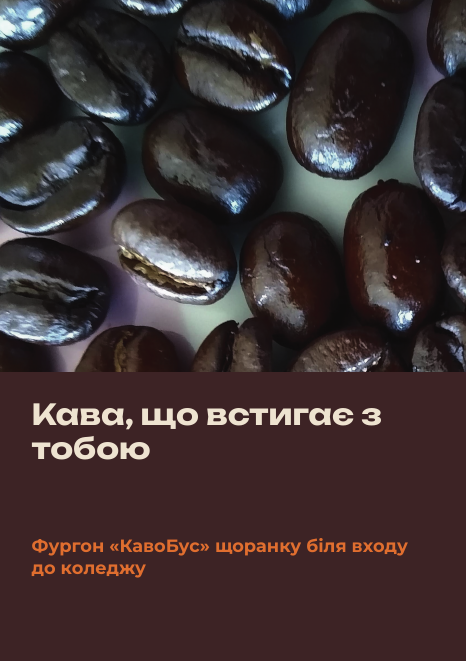
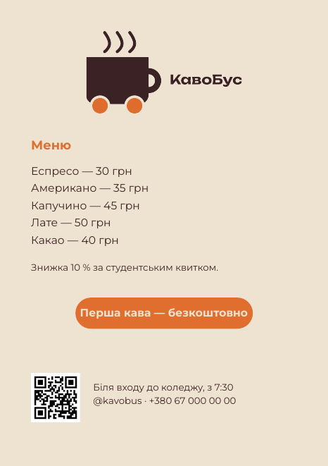

# Урок 6. Плакат і листівка (Scribus)

**Програма:** Scribus 1.6

**Верстка** — це розміщення тексту й зображень на сторінці за правилами: сітка, ієрархія, стилі. На цьому уроці ви зберете з готових частин (ключовий візуал, логотип, кольори, шрифти) плакат A4 і двосторонню листівку A5 у програмі верстки Scribus.

| Плакат A4 | Листівка A5, лицьовий бік | Листівка A5, зворотний бік |
|---|---|---|
|  |  |  |

## Що потрібно перед початком

- Ключовий візуал `visual/keyvisual.png` (урок 5).
- Логотип `logo/logo.png` (урок 3).
- Кольори й шрифти з мудборду (урок 2).
- Тексти: слоган, 3 тези про продукт, заклик до дії, контакти. Напишіть їх на папері або в бриф заздалегідь, щоб не вигадувати під час верстки.
- Порожні теки `poster/` і `flyer/` у вашій робочій теці.

## Підуроки

| № | Тема | Що робимо |
|---|---|---|
| 6.1 | [Теорія: сітка, ієрархія, фрейми](01-teoriia.md) | Модульна сітка, рівні тексту, фрейми, роздільна здатність фото |
| 6.2 | [Новий документ](02-novyi-dokument.md) | A4, поля, вильоти, збереження `.sla` |
| 6.3 | [Ключовий візуал](03-kliuchovyi-vizual.md) | Фрейм зображення на весь аркуш із вильотами, перевірка dpi |
| 6.4 | [Кольори бренду й підкладка](04-kolory.md) | Кольори документа, напівпрозора підкладка під текст |
| 6.5 | [Текст і стилі абзаців](05-tekst-styli.md) | Текстові фрейми, шрифти, стилі абзаців |
| 6.6 | [Логотип, QR-код і заклик до дії](06-lohotyp-qr.md) | Кнопка, плашка з логотипом і QR-кодом |
| 6.7 | [Листівка A5](07-lystivka.md) | Двосторінковий документ у тому самому стилі |
| 6.8 | [Збереження й чорновий PDF](08-chornovyi-pdf.md) | `.sla` і PDF для перегляду |

## Результат уроку

| Файл | Навіщо |
|---|---|
| `poster/poster.sla` | Вихідний файл плаката для редагування |
| `poster/poster-draft.pdf` | Чорновий PDF: показати парі, перевірити на екрані |
| `flyer/flyer.sla` | Вихідний файл листівки (2 сторінки A5) |
| `flyer/flyer-draft.pdf` | Чорновий PDF листівки |

PDF для друкарні (PDF/X із мітками обрізу) ви зробите в уроці 7.

## Критерії оцінювання

- Плакат і листівка: сітка, ієрархія тексту, стилі абзаців, вильоти, зображення ≥ 300 dpi: **0–2 бали**.

> На macOS замість `Ctrl` натискайте `Cmd`, а замість `Alt` — `Option`.

[← Урок 5](../05-kliuchovyi-vizual/README.md) · [Урок 7: Препрес →](../07-prepres/README.md)
