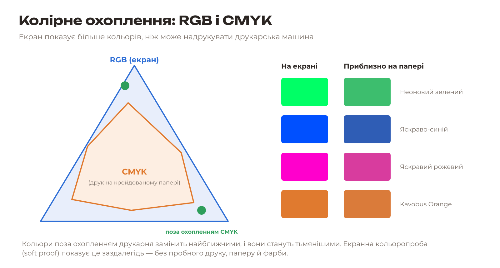
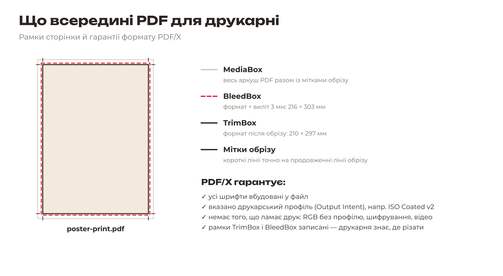
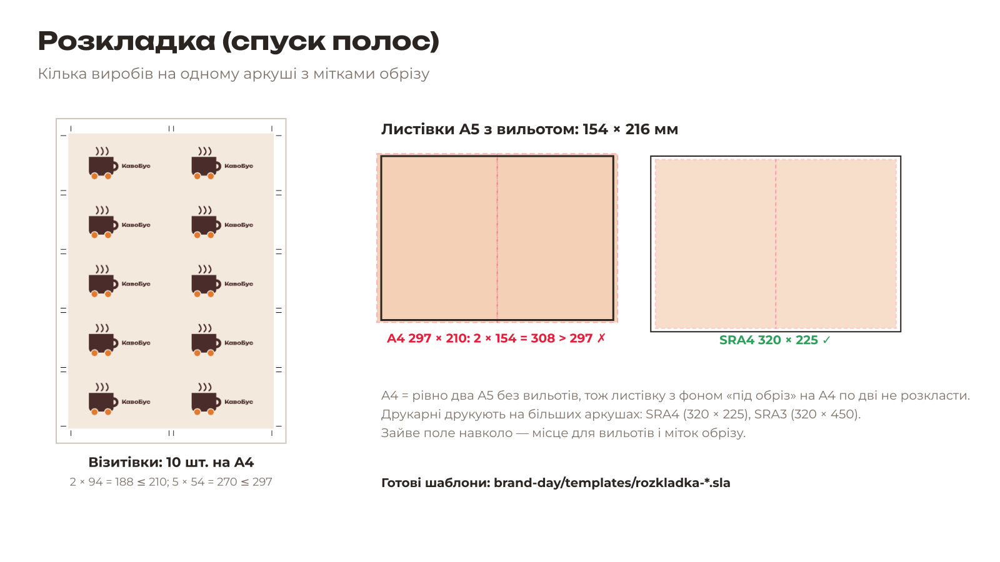

# 7.1. Теорія: CMYK, PDF/X, розкладка

[← До уроку](README.md) · [Далі: Екранна кольоропроба в Krita →](02-krita-kolorproba.md)

## Колірне охоплення

**Колірне охоплення** (gamut) — усі кольори, які пристрій може відтворити. Екран світиться (RGB), а папір лише відбиває світло, на який нанесено фарби CMYK. Тому охоплення друку менше: найяскравіші екранні кольори надрукувати неможливо.

Що буде з кольором поза охопленням? Під час переведення в CMYK його замінять найближчим доступним. Яскраво-зелений стане трав’яним, ультрасиній — «джинсовим». Щоб це не стало несподіванкою, використовують **екранну кольоропробу** (soft proof): програма показує на екрані, як колір виглядатиме на папері, за **ICC-профілем** друку.

**ICC-профіль** описує конкретні умови друку: машину, фарби, папір. Ми використовуємо стандартний профіль для офсетного друку на крейдованому папері — **FOGRA39** (у Krita — `FOGRA39L Coated`, у Scribus — `ISO Coated v2`, це той самий стандарт).

## PDF/X — PDF для друкарні

Звичайний PDF може бути будь-яким: зі шрифтами, яких немає в друкарні, з RGB-кольорами без опису, з паролем. **PDF/X** — це стандарт ISO 15930: PDF зі строгими правилами саме для друку. Ми використовуємо **PDF/X-4** (сучасний, дозволяє прозорість). Друкарні також приймають PDF/X-1a — уточнюйте вимоги.

## Розкладка (спуск полос)

Друкувати одну візитівку на окремому аркуші дорого. Тому вироби **розкладають** на великому аркуші й потім ріжуть по мітках обрізу. Це називається **спуском полос** (imposition).

Двосторонній виріб розкладають на двох сторінках: на першій усі лицьові боки, на другій усі зворотні — у дзеркальному порядку, щоб після перевертання аркуша кожен зворотний бік потрапив точно під свій лицьовий. У наших шаблонах вироби однакові й стоять симетрично, тож порядок збігається автоматично.

## Екологія друку

- Екранна кольоропроба замість пробних відбитків заощаджує папір і фарбу.
- Файли PDF/X друкарня друкує без виправлень: менше браку — менше відходів.
- Щільна розкладка (10 візитівок на аркуші, а не 8) зменшує кількість аркушів і обрізків.
- Тираж обирайте під реальну потребу: 100 візитівок, які роздадуть, краще за 1000, які викинуть.

[← До уроку](README.md) · [Далі: Екранна кольоропроба в Krita →](02-krita-kolorproba.md)
