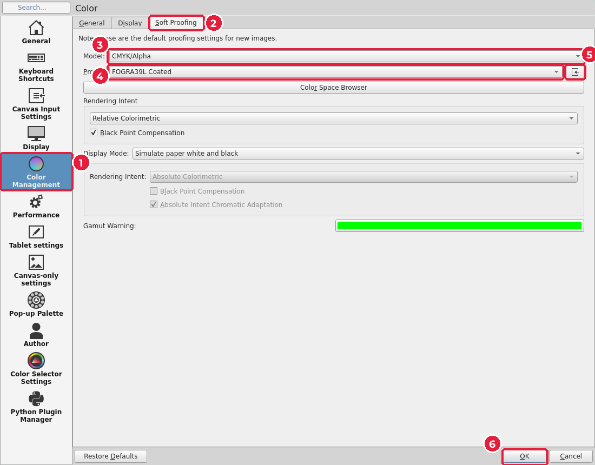
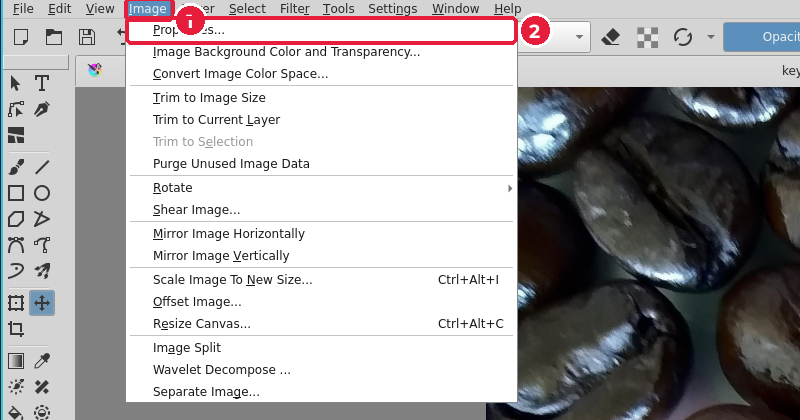
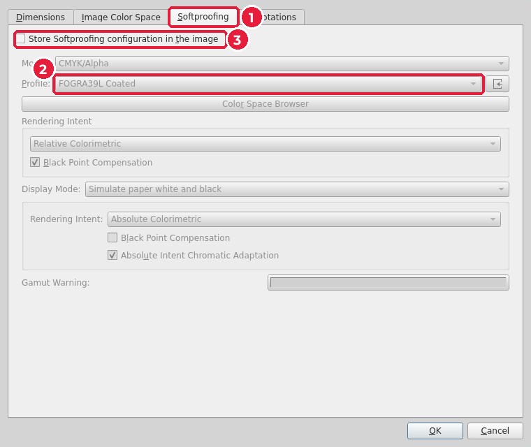
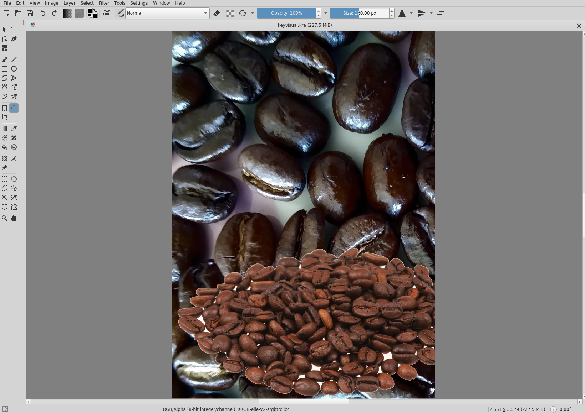
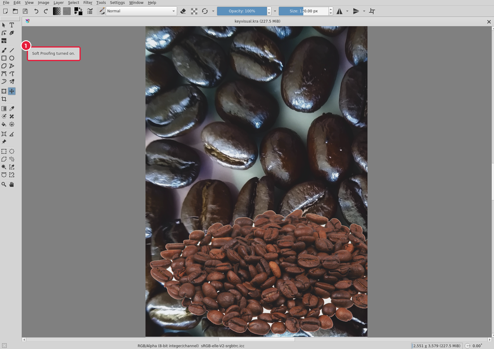
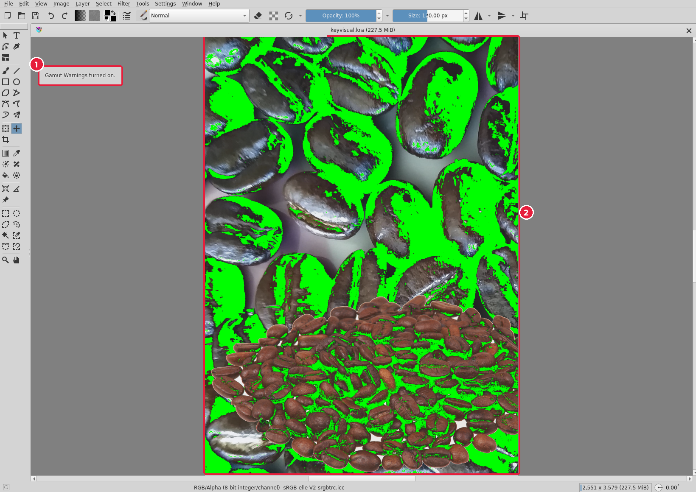

# 7.2. Екранна кольоропроба в Krita

[← Теорія](01-teoriia.md) · [До уроку](README.md) · [Далі: Кольоропроба й перевірка в Scribus →](03-scribus-perevirka.md)

Перевіримо ключовий візуал до того, як він потрапить на плакат. Відкрийте `visual/keyvisual.kra`.

## Крок 1. Профіль друку для кольоропроби

Це налаштування робиться один раз на комп’ютері.

1. **Settings → Configure Krita…** (*Параметри → Налаштувати Krita*) → **Color Management** (*Керування кольором*) (1) → вкладка **Soft Proofing** (*Кольоропроба*) (2).
2. **Model** (*Модель*) (3): `CMYK/Alpha`.
3. **Profile** (*Профіль*) (4): `FOGRA39L Coated`. Якщо його немає у списку, натисніть кнопку імпорту (5) і оберіть {{asset icc/FOGRA39L_coated.icc}}.
4. **OK** (6).

## Крок 2. Перевірте, що профіль застосовано до зображення

Налаштування з кроку 1 діють для нових зображень. Для вже відкритого:

1. **Image** (*Зображення*) (1) → **Properties…** (*Властивості*) (2).

2. Вкладка **Softproofing** (1). Профіль (2) має бути `FOGRA39L Coated`. Якщо там інший, увімкніть **Store Softproofing configuration in the image** (*Зберігати налаштування кольоропроби в зображенні*) (3) і оберіть профіль. **OK**.

## Крок 3. Увімкніть кольоропробу

Так зображення виглядає звичайно (RGB):

Натисніть `Ctrl+Y` (**View → Soft Proofing**, *Вигляд → Кольоропроба*). Krita підтвердить повідомленням (1). Кольори стануть трохи тьмянішими й теплішими — так зображення виглядатиме на папері.

## Крок 4. Знайдіть кольори поза охопленням

Натисніть `Ctrl+Shift+Y` (**View → Out of Gamut Warnings**, *Вигляд → Попередження про охоплення*) (1). Кольори, які не можна надрукувати точно, зафарбуються зеленим (2).

**Що робити із зеленим:**

| Що позначено | Що робити |
|---|---|
| Великі **яскраві** ділянки (неонові, насичено-сині) | Шар фільтра **HSV/HSL Adjustment** (*Коригування HSV*) зі зменшеною насиченістю на 10–20 %, поки зелене не зменшиться |
| **Найтемніші** тіні (як на прикладі) | Нічого: друкарня передасть їх найближчим темним кольором, різниця майже не помітна |
| Окремі дрібні точки | Нічого: на папері цього не видно |

Головне правило: порівнюйте із вимкненою кольоропробою (`Ctrl+Y`). Якщо вигляд у режимі кольоропроби вас влаштовує — зображення готове до друку.

Вимкніть попередження й кольоропробу тими самими клавішами. Якщо змінювали зображення, знову експортуйте `keyvisual.png` (урок 5, крок 7): Scribus оновить його на плакаті автоматично.

[← Теорія](01-teoriia.md) · [До уроку](README.md) · [Далі: Кольоропроба й перевірка в Scribus →](03-scribus-perevirka.md)
