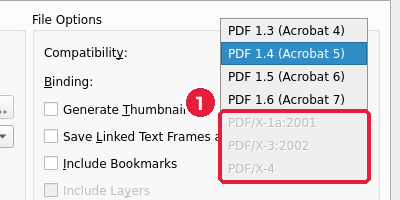
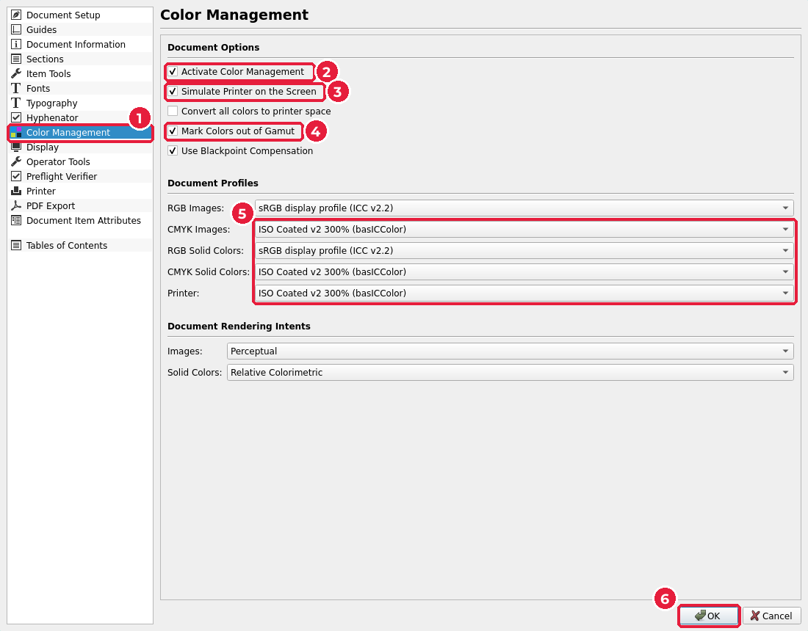
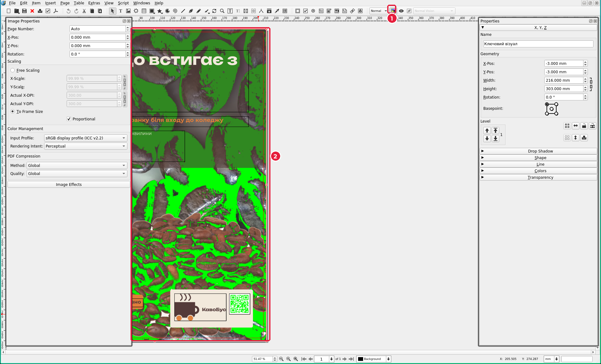
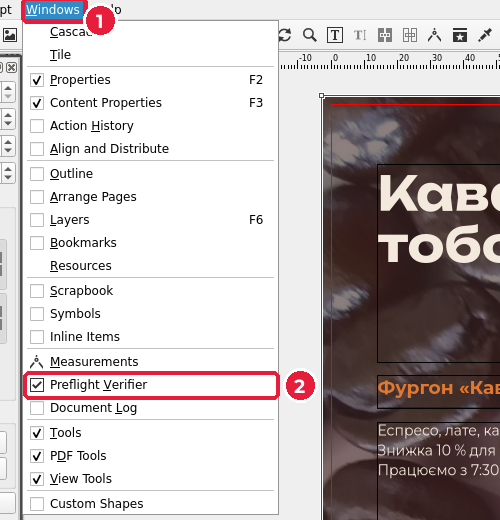
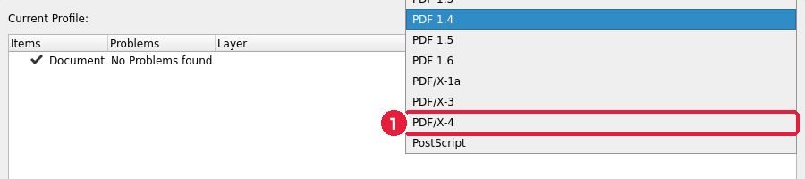
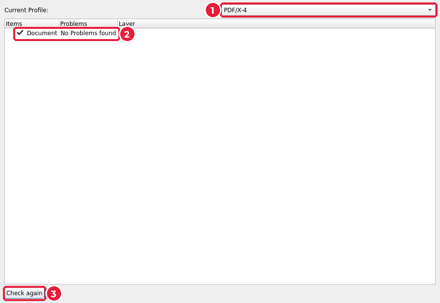

# 7.3. Кольоропроба й перевірка в Scribus

[← Екранна кольоропроба в Krita](02-krita-kolorproba.md) · [До уроку](README.md) · [Далі: PDF/X для друкарні →](04-pdfx.md)

Відкрийте `poster/poster.sla`. Усе, що робимо з плакатом, потім повторіть для листівки.

## Крок 1. Увімкніть керування кольором

Без цього Scribus не дозволить зберегти PDF/X: у списку форматів вони будуть сірими (1).

1. **File → Document Setup…** (*Файл → Параметри документа*).
2. Розділ **Color Management** (*Керування кольором*) (1):
   - **Activate Color Management** (*Увімкнути керування кольором*) (2);
   - **Simulate Printer on the Screen** (*Імітувати принтер на екрані*) (3) — це і є кольоропроба;
   - **Mark Colors out of Gamut** (*Позначати кольори поза охопленням*) (4).
3. Профілі (5) залиште за замовчуванням: для CMYK і принтера — `ISO Coated v2 300% (basICColor)`.
4. **OK** (6).

## Крок 2. Подивіться на позначені кольори

Кнопка на панелі інструментів (1) швидко вмикає й вимикає кольоропробу. Кольори поза охопленням зафарбовані зеленим (2).

Як і в Krita: великі яскраві ділянки варто виправити (у Krita або змінивши колір у **Edit → Colors and Fills**), а темні тіні — ні. Зверніть увагу: чорний QR-код теж зелений. Чистий RGB-чорний перетворюється на чотири фарби одночасно — це забагато фарби для паперу. Для невеликого QR-коду це не критично, але для великих чорних площ друкарні радять чорний лише з фарби K.

Після перевірки вимкніть **Mark Colors out of Gamut** у **Document Setup**, щоб зелений не заважав.

## Крок 3. Перевірка перед друком (preflight)

**Preflight Verifier** (*Перевірка перед друком*) автоматично шукає типові помилки.

1. **Windows** (*Вікна*) (1) → **Preflight Verifier** (2).

2. У списку **Current Profile** (*Поточний профіль*) оберіть `PDF/X-4` (1): перевірка підлаштується під вимоги цього формату.

3. Натисніть **Check again** (*Перевірити знову*) (3). Мета — **No Problems found** (*Проблем не знайдено*) (2).

## Типові проблеми

Клацніть рядок із проблемою — Scribus виділить об’єкт на сторінці.

| Повідомлення | Що означає | Як виправити |
|---|---|---|
| **Text overflow** | Текст не вмістився у фрейм | Збільшіть фрейм або скоротіть текст |
| **Image resolution below … DPI** | Фото замале для цього розміру | Інше фото або менший фрейм (урок 6.3) |
| **Missing Image** | Файл зображення перейменовано чи переміщено | Правою кнопкою → **Content → Get Image** знову |
| **Empty Image Frame** | Порожній фрейм зображення | Видаліть його (`Delete`) |
| **Object is not on a Page** | Об’єкт лежить поза сторінкою | Видаліть або перемістіть на сторінку |
| **Transparency used** | Є прозорість | Для PDF/X-4 — допустимо (наша підкладка) |
| **Object is a placed PDF** | Вставлено PDF як зображення | Для розкладки — допустимо (урок 7.5) |

Додатково перевірте очима те, чого програма не знає: весь важливий текст усередині синіх полів, фон доходить до червоної рамки вильотів.

[← Екранна кольоропроба в Krita](02-krita-kolorproba.md) · [До уроку](README.md) · [Далі: PDF/X для друкарні →](04-pdfx.md)
