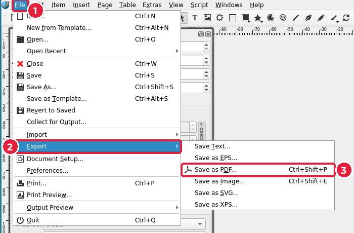
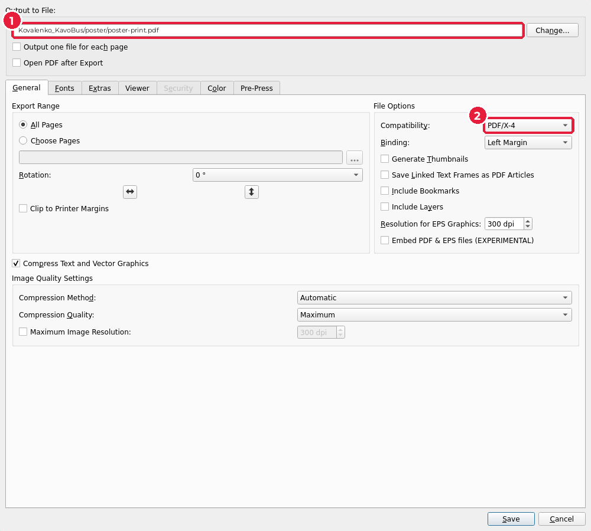
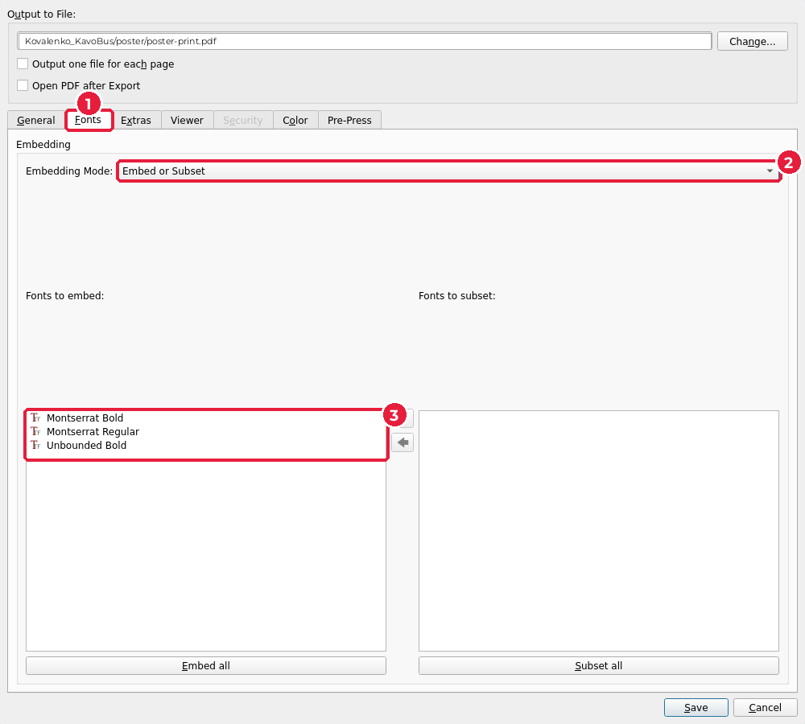
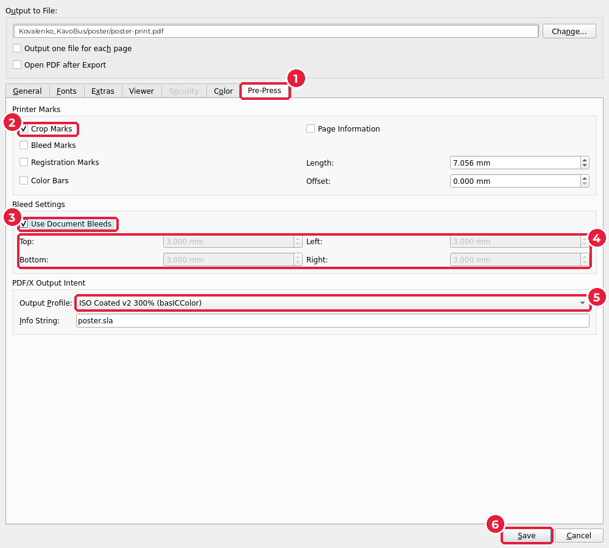

# 7.4. PDF/X для друкарні

[← Кольоропроба й перевірка в Scribus](03-scribus-perevirka.md) · [До уроку](README.md) · [Далі: Розкладка →](05-rozkladka.md)

## Плакат: PDF/X-4 з мітками обрізу

1. **File** (1) → **Export** (*Експорт*) (2) → **Save as PDF…** (*Зберегти як PDF*) (3), `Ctrl+Shift+P`.

> Якщо з’явилося вікно **Preflight Verifier** з помилками — натисніть **Cancel** і виправте їх (підурок 7.3). **Ignore Errors** (*Ігнорувати помилки*) натискайте лише тоді, коли знаєте, що попередження допустиме.

2. Вкладка **General** (*Загальні*):
   - **Output to File** (1): `poster-print.pdf` у теці `poster/`.
   - **Compatibility** (*Сумісність*) (2): `PDF/X-4`.

3. Вкладка **Fonts** (*Шрифти*) (1): **Embedding Mode** (*Режим вбудовування*) (2) — `Embed or Subset` (*Вбудувати або вбудувати частково*). У списку (3) — усі шрифти макета: вони потраплять у PDF, і друкарні не знадобиться їх встановлювати.

4. Вкладка **Pre-Press** (*Додрукарська підготовка*) (1):
   - **Crop Marks** (*Мітки обрізу*) (2);
   - **Use Document Bleeds** (*Використовувати вильоти документа*) (3): у полях (4) з’являться 3 мм — вильоти з документа;
   - **Output Profile** (*Профіль виведення*) (5): `ISO Coated v2 300% (basICColor)`.
5. **Save** (*Зберегти*) (6).

## Перевірте PDF

Відкрийте `poster-print.pdf` у переглядачі PDF:

- навколо плаката є білі поля з мітками обрізу в кутах;
- фото й фон заходять за мітки на 3 мм — це вильоти;
- текст чіткий при збільшенні (шрифти вбудовані).

> У переглядачі PDF відкрийте властивості документа (**File → Properties** або **Document Properties**). Там видно розмір сторінки й список вбудованих шрифтів.

## Листівка: PDF/X-4 для розкладки

Листівку друкарня друкуватиме по дві на аркуші (підурок 7.5), тому мітки обрізу на кожній сторінці не потрібні: їх додасть розкладка.

1. Відкрийте `flyer/flyer.sla`, увімкніть керування кольором (підурок 7.3, крок 1) і пройдіть перевірку.
2. `Ctrl+Shift+P` → **Output to File**: `flyer-print.pdf` у теці `flyer/` → **Compatibility**: `PDF/X-4`.
3. **Pre-Press**: **Crop Marks** — **вимкнено**, **Use Document Bleeds** — **увімкнено**. **Save**.

Результат: 2 сторінки 154 × 216 мм (A5 + вильоти).

> Візитівка вже має свій PDF для друку: `card/card-print.pdf` з уроку 4.

[← Кольоропроба й перевірка в Scribus](03-scribus-perevirka.md) · [До уроку](README.md) · [Далі: Розкладка →](05-rozkladka.md)
