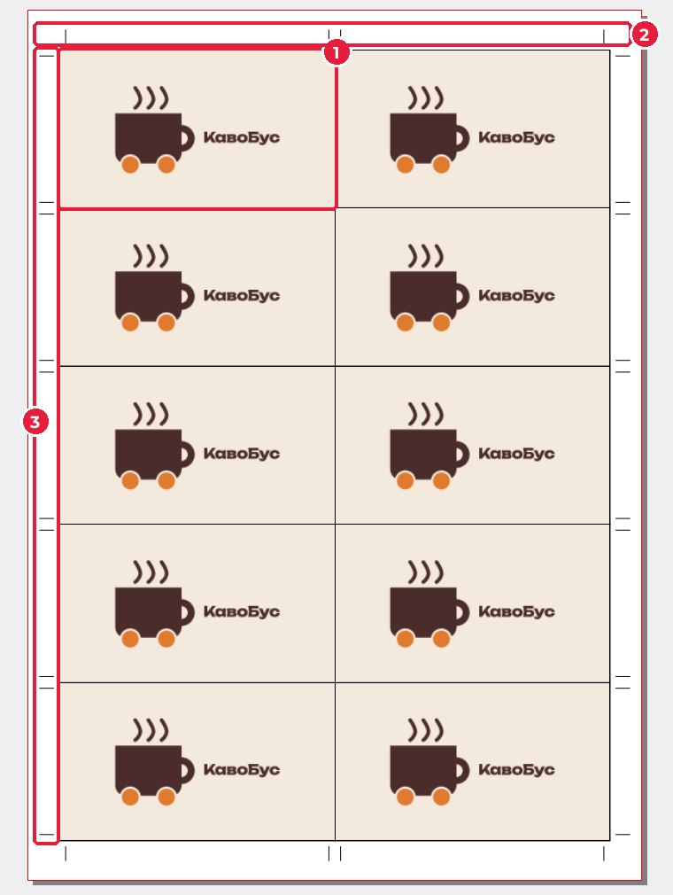
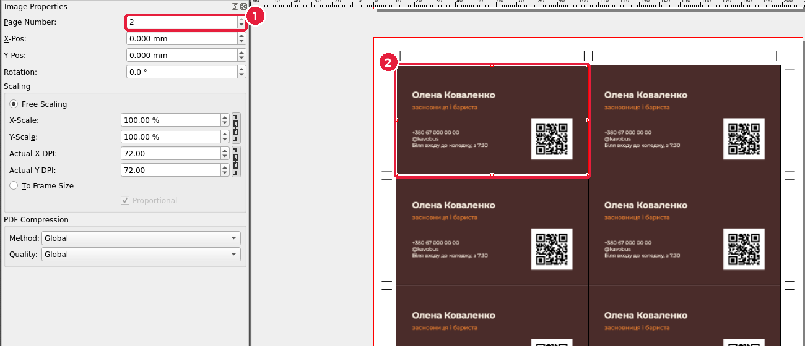
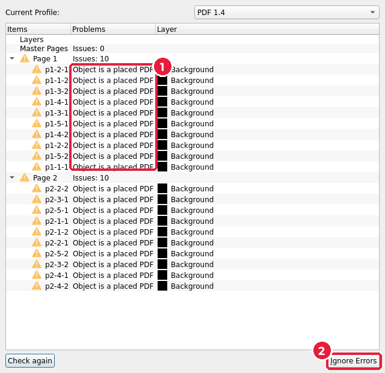
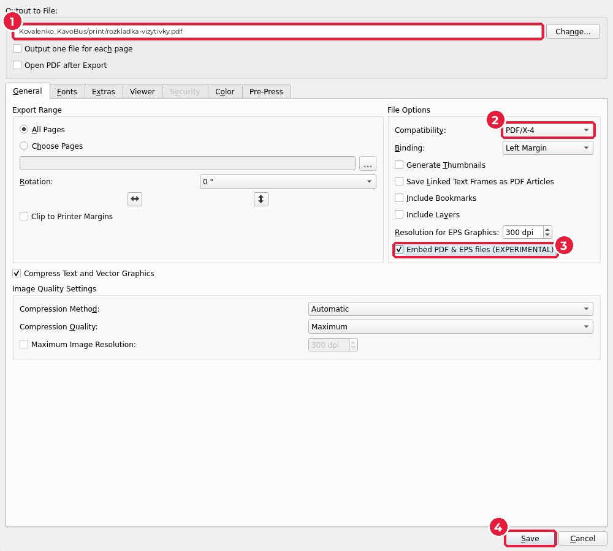
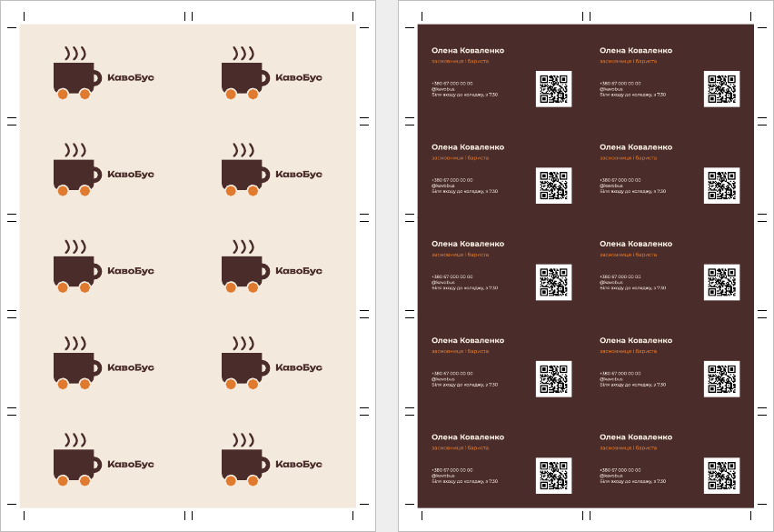
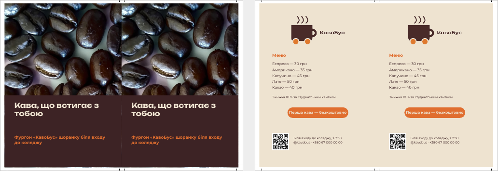

# 7.5. Розкладка

[← PDF/X для друкарні](04-pdfx.md) · [До уроку](README.md) · [Далі: Заявка до друкарні →](06-zaiavka.md)

Розкладку не треба будувати вручну: у {{asset templates/}} є готові шаблони Scribus. Фрейми в них уже пов’язані з файлами `../card/card-print.pdf` і `../flyer/flyer-print.pdf`, а мітки обрізу намальовані. Шаблон, скопійований у вашу теку `print/`, сам «підхопить» ваші візитівки й листівки.

## Крок 1. Скопіюйте шаблони

Скопіюйте {{asset templates/rozkladka-vizytivky.sla short}} і {{asset templates/rozkladka-lystivky.sla short}} з {{asset templates/}} у теку `print/` вашої робочої теки. Поруч із `print/` мають лежати теки `card/` і `flyer/` з PDF-файлами для друку.

## Крок 2. Відкрийте розкладку візитівок

**File → Open…** (`Ctrl+O`) → `print/rozkladka-vizytivky.sla`.

На сторінці 1 — десять лицьових боків вашої візитівки (1), кожна з вильотами 2 мм. Мітки обрізу (2, 3) стоять на полях аркуша навпроти кожної лінії різу.

Перейдіть на сторінку 2 (стрілка внизу вікна): там зворотні боки. Виділіть будь-яку візитівку й відкрийте **Content Properties** (`F3`): **Page Number** (*Номер сторінки*) (1) = `2`. Тобто фрейм (2) показує другу сторінку файлу `card-print.pdf`.

> Бачите сірі прямокутники замість візитівок? Значить, Scribus не знайшов `../card/card-print.pdf`: перевірте назви тек і файлу. Також для показу PDF у Scribus потрібна програма Ghostscript — якщо її немає, зверніться до викладача.

## Крок 3. Збережіть PDF розкладки

1. `Ctrl+Shift+P`. Перевірка покаже **Object is a placed PDF** (*Об’єкт — вставлений PDF*) для кожної візитівки (1). Для розкладки це нормально: натисніть **Ignore Errors** (2).

2. Вкладка **General**:
   - **Output to File** (1): `rozkladka-vizytivky.pdf` у теці `print/`;
   - **Compatibility** (2): `PDF/X-4`;
   - **Embed PDF & EPS files (EXPERIMENTAL)** (*Вбудовувати PDF і EPS*) (3) — увімкніть. Так візитівки залишаться векторними. Без цієї позначки Scribus перетворить їх на растр 300 dpi.
3. **Pre-Press**: **Crop Marks** — **вимкнено** (мітки вже намальовано на аркуші). **Save** (4).

Результат — аркуш A4 з двох сторінок:

## Крок 4. Розкладка листівок

Те саме з `print/rozkladka-lystivky.sla` → `rozkladka-lystivky.pdf`. Аркуш тут **SRA4** (320 × 225 мм): дві листівки з вильотами (2 × 154 = 308 мм) на A4 (297 мм) не вміщуються.

## Розрахунок аркушів

| Виріб | Тираж | На аркуші | Аркушів |
|---|---|---|---|
| Візитівки | 100 | 10 | 100 ÷ 10 = **10** |
| Листівки | 200 | 2 | 200 ÷ 2 = **100** |

Друкарні зазвичай додають 3–5 % аркушів «на приладку» (налаштування машини). Порахуйте для свого тиражу і впишіть у заявку.

[← PDF/X для друкарні](04-pdfx.md) · [До уроку](README.md) · [Далі: Заявка до друкарні →](06-zaiavka.md)
