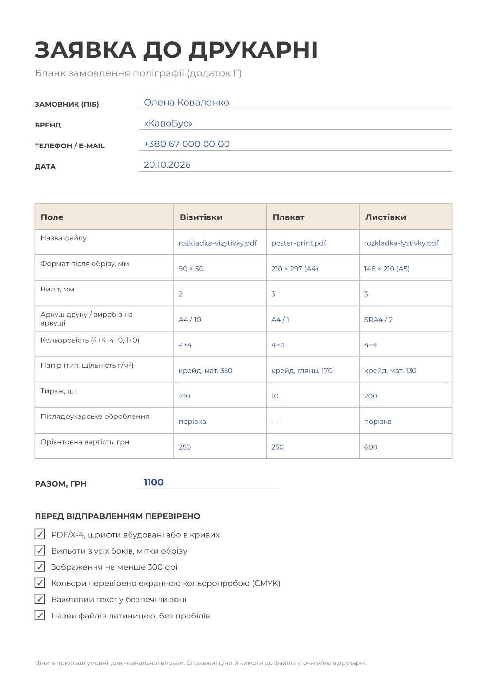

# 7.6. Заявка до друкарні

[← Розкладка](05-rozkladka.md) · [До уроку](README.md) · [Урок 8: Пітч →](../08-pitch/README.md)

Друкарня отримує не лише файли, а й **заявку**: що друкувати, на чому, скільки і з якою обробкою. Без неї менеджер друкарні не зможе порахувати ціну.

## Крок 1. Відкрийте бланк

Скопіюйте {{asset templates/zaiavka-a4.svg}} у теку `print/` як `zaiavka.svg` і відкрийте в Inkscape. Бланк на заблокованому шарі **Бланк**, пишіть на шарі **Мої відповіді** інструментом **Text** (`T`) — так само, як у брифі (урок 2).

## Крок 2. Заповніть поля

| Поле | Як заповнити |
|---|---|
| Назва файлу | Точна назва PDF: `rozkladka-vizytivky.pdf`, `poster-print.pdf`, `rozkladka-lystivky.pdf` |
| Формат після обрізу | Розмір готового виробу: 90 × 50, A4, A5 |
| Виліт | 2 мм (візитівка), 3 мм (плакат, листівка) |
| Аркуш / виробів на аркуші | З розкладки: A4 / 10, A4 / 1, SRA4 / 2 |
| Кольоровість | **4+4** — повноколірний друк з обох боків, **4+0** — з одного, **1+0** — один колір (чорний) з одного боку |
| Папір | Тип і щільність: візитівки 300–350 г/м², плакат 150–200 г/м², листівки 115–170 г/м². Крейдований (гладкий) — яскравіші кольори; матовий — без відблисків |
| Тираж | Скільки примірників реально потрібно |
| Післядрукарське оброблення | Порізка, ламінування, скруглення кутів тощо |
| Орієнтовна вартість | Див. крок 3 |

## Крок 3. Порахуйте вартість

Ціни різні в кожній друкарні, тому для вправи використайте **умовні ціни** (або ціни, які дасть викладач):

| Виріб | Умовна ціна |
|---|---|
| Візитівки 4+4, 350 г/м², з порізкою | 25 грн за аркуш A4 (10 шт.) |
| Плакат A4 4+0, 170 г/м² | 25 грн за штуку |
| Листівки A5 4+4, 130 г/м², з порізкою | 6 грн за аркуш SRA4 (2 шт.) |

**Приклад:** 100 візитівок = 10 аркушів × 25 = 250 грн; 10 плакатів × 25 = 250 грн; 200 листівок = 100 аркушів × 6 = 600 грн. **Разом 1100 грн.**

Ці ж розрахунки знадобляться на пітчі (урок 8): клієнт завжди питає «скільки це коштуватиме?».

## Крок 4. Чекліст і збереження

Позначте пункти чекліста внизу бланка, лише якщо справді перевірили кожен. Збережіть `zaiavka.svg` і за потреби — PDF (**File → Save a Copy…** → PDF).

Приклад заповненої заявки:



## Що відправити в друкарню

```
print/
├── rozkladka-vizytivky.pdf
├── rozkladka-lystivky.pdf
└── zaiavka.pdf
poster/
└── poster-print.pdf
```

> Назви файлів — латиницею, без пробілів: так їх правильно прочитає будь-яка система. Перед відправленням відкрийте кожен PDF ще раз.

## Чекліст уроку

- [ ] Ключовий візуал перевірено кольоропробою в Krita.
- [ ] У Scribus увімкнено керування кольором, Preflight Verifier: **No Problems found** для плаката й листівки.
- [ ] `poster-print.pdf`: PDF/X-4, вильоти 3 мм, мітки обрізу, шрифти вбудовані.
- [ ] `flyer-print.pdf`: PDF/X-4, 2 сторінки, вильоти 3 мм.
- [ ] `rozkladka-vizytivky.pdf` і `rozkladka-lystivky.pdf` з мітками обрізу, лицьові й зворотні боки на своїх сторінках.
- [ ] Заявку заповнено, вартість пораховано.

[← Розкладка](05-rozkladka.md) · [До уроку](README.md) · [Урок 8: Пітч →](../08-pitch/README.md)
