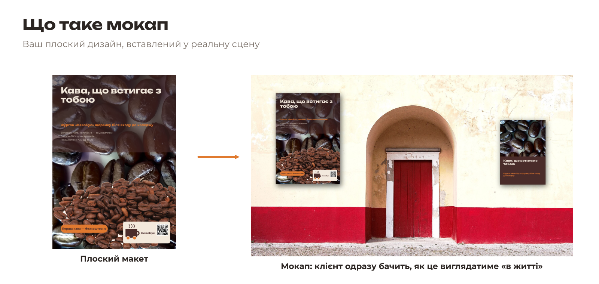
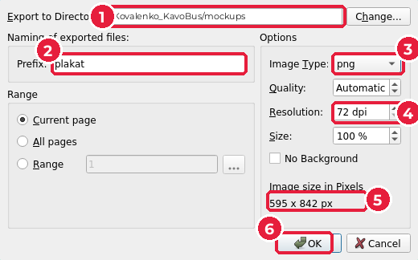
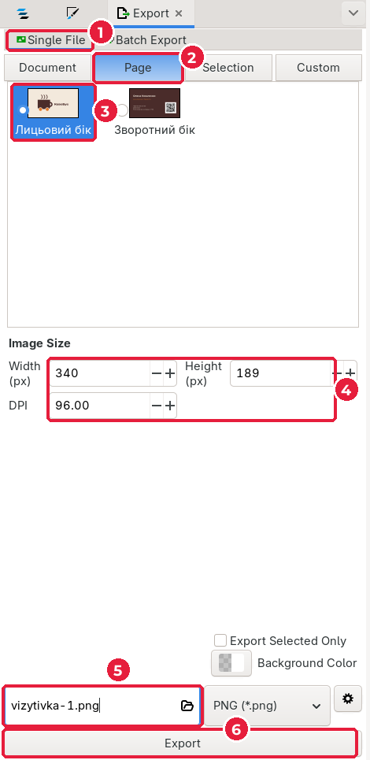
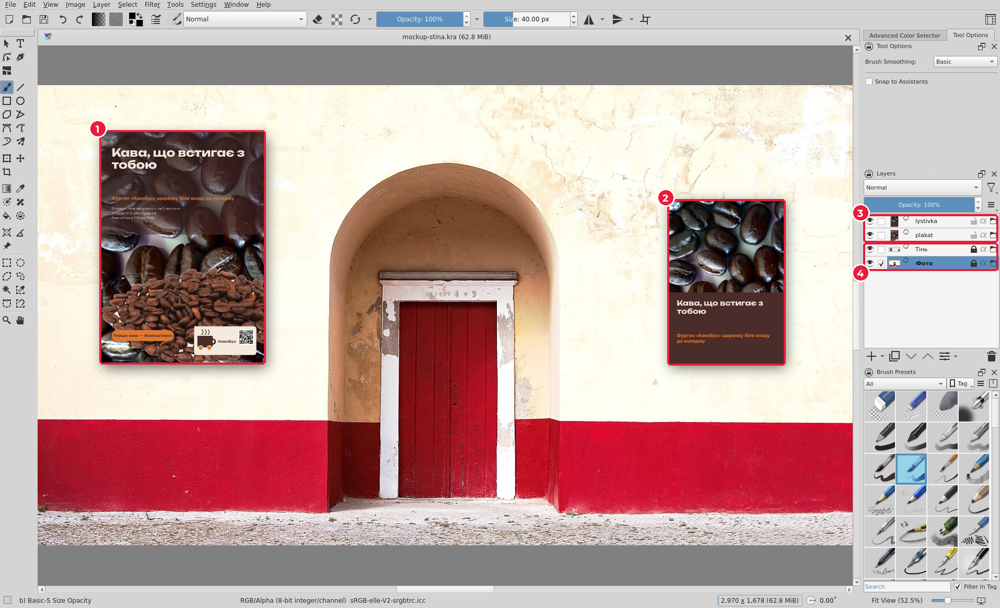
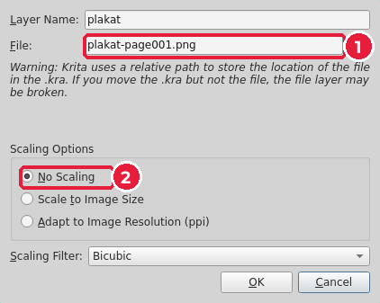
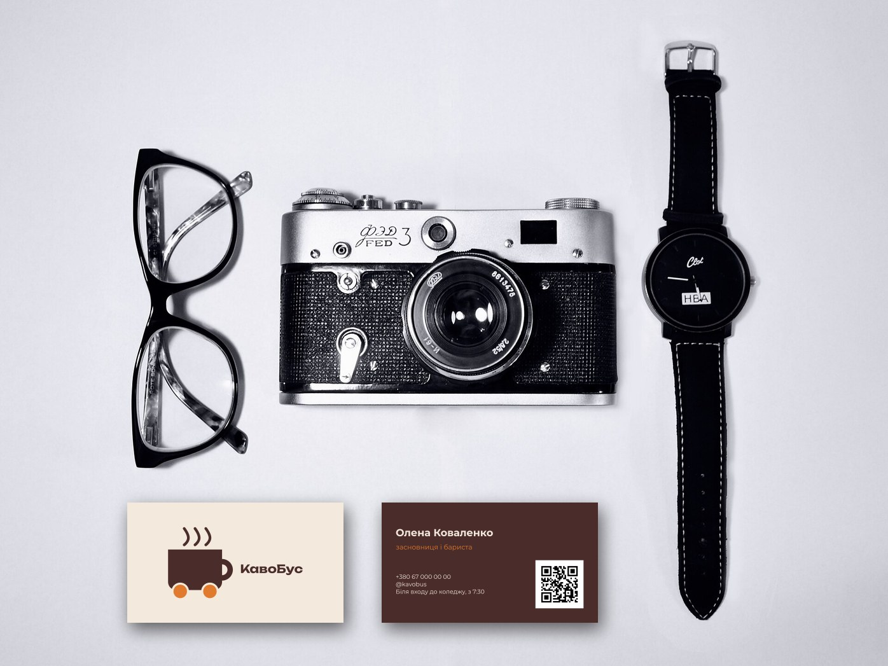

# 8.1. Мокапи в Krita

[← До уроку](README.md) · [Далі: Ціна пакета →](02-tsina.md)

**Мокап** (mockup) — фото реальної сцени, у яку вставлено ваш дизайн: плакат на стіні, візитівки на столі. Клієнтові легше уявити бренд «у житті», ніж оцінювати плоский PDF.

У {{asset mockups/}} є два готові шаблони Krita:

| Шаблон | Що в ньому | Які файли потрібні |
|---|---|---|
| {{asset mockups/mockup-stina.kra short}} | стіна з плакатом і листівкою | `plakat-page001.png`, `lystivka-page001.png` |
| {{asset mockups/mockup-stil.kra short}} | стіл із двома візитівками | `vizytivka-1.png`, `vizytivka-2.png` |

Шари в шаблонах — **файлові шари** (file layers): вони не містять малюнка, а показують PNG-файл, що лежить поруч. Тому достатньо зберегти свої дизайни під потрібними назвами — і мокап «оживе» сам.

## Крок 1. Скопіюйте шаблони

Скопіюйте **весь вміст** теки {{asset mockups/}} у теку `mockups/` вашої робочої теки. Там уже лежать файли-заглушки з тими самими назвами: їх ви зараз заміните своїми дизайнами.

## Крок 2. Плакат і листівка в PNG (Scribus)

1. Відкрийте `poster/poster.sla`.
2. **File → Export → Save as Image…** (*Файл → Експорт → Зберегти як зображення*), `Ctrl+Shift+E`.
3. У вікні **Export as Image(s)**:
   - **Export to Directory** (*Тека*) (1): ваша тека `mockups/` (кнопка **Change…**);
   - **Prefix** (*Префікс назви*) (2): `plakat`;
   - **Image Type** (*Тип*) (3): `png` — за замовчуванням там стоїть інший формат;
   - **Resolution** (*Роздільна здатність*) (4): `72 dpi` — для показу на екрані більше не треба. Розмір (5): 595 × 842 px;
   - **OK** (6).

Scribus сам додасть до назви номер сторінки: вийде `plakat-page001.png`. Саме таку назву й чекає шаблон.

4. Так само для листівки: `flyer/flyer.sla` → префікс `lystivka` → `lystivka-page001.png` (експортується поточна, перша сторінка).

## Крок 3. Візитівка в PNG (Inkscape)

1. Відкрийте `card/card.svg`, потім **File → Export…** (`Shift+Ctrl+E`).
2. На панелі **Export**: **Single File** (*Один файл*) (1) → **Page** (*Сторінка*) (2) → оберіть сторінку **Лицьовий бік** (3).
3. Розмір (4) залиште за замовчуванням: 340 × 189 px, 96 DPI.
4. У полі імені (5) введіть `vizytivka-1.png`; кнопкою з текою поруч оберіть теку `mockups/`. **Export** (6).

5. Повторіть для сторінки **Зворотний бік** з назвою `vizytivka-2.png`.

> Розміри підібрано так, щоб дизайни за замовчуванням точно лягли в рамки мокапів. Якщо змінити DPI чи розмір, дизайн стане більшим або меншим за своє місце.

## Крок 4. Відкрийте мокап

**File → Open…** у Krita → `mockups/mockup-stina.kra`. Ваш плакат (1) і листівка (2) вже на стіні.

На панелі **Layers**: шари з дизайнами (3) і заблоковані шари **Тінь** та **Фото** (4). Значок біля назви шару означає файловий шар.

Двічі клацніть шар `plakat` (або `F3`): у полі **File** (1) видно, який PNG він показує. **No Scaling** (*Без масштабування*) (2) — файл вставляється піксель у піксель.

> Змінили плакат? Знову експортуйте `plakat-page001.png` з тією самою назвою — Krita оновить шар автоматично.
>
> Бачите заглушку з написом «плакат A4»? Значить, назва файлу не збігається або PNG лежить в іншій теці.

## Крок 5. Збережіть JPG для показу

**File → Export…** → `mockup-stina.jpg` → якість 90 % → **OK** (так само, як в [уроці 5](../05-kliuchovyi-vizual/07-eksport.md)). Те саме для `mockup-stil.kra` → `mockup-stil.jpg`.

Віддайте обидва JPG викладачеві (флеш-носій або спільна тека) — їх показуватимуть на проєкторі під час вашого пітчу.

## Звідки фото

Фото для мокапів — з ліцензією CC0 (Wikimedia Commons), див. {{asset photos/CREDITS.md}}. Для власних мокапів шукайте фото на Unsplash або Pexels: «white wall», «desk flat lay», «poster mockup».

[← До уроку](README.md) · [Далі: Ціна пакета →](02-tsina.md)
