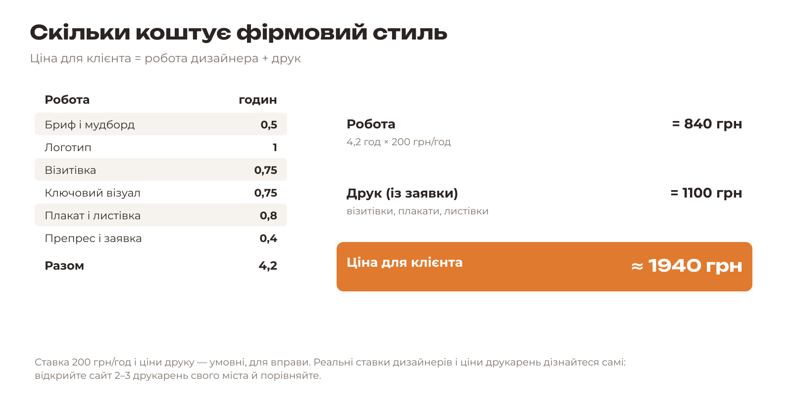

# 8.2. Ціна пакета

[← Мокапи в Krita](01-mokapy.md) · [До уроку](README.md) · [Далі: Пітч і голосування →](03-pitch.md)

Перше питання будь-якого клієнта: «Скільки це коштуватиме?». Відповідь складається з двох частин.

## Формула

**Ціна для клієнта = години роботи × ставка + вартість друку**

| Складова | Звідки взяти |
|---|---|
| Години роботи | Скільки часу ви витратили на кожен виріб сьогодні (див. розклад дня) |
| Ставка | Скільки коштує година роботи дизайнера. На воркшопі — **200 грн/год** (умовно) |
| Вартість друку | Рядок «Разом» із заявки до друкарні (урок 7.6) |

## Завдання

1. Запишіть, скільки годин пішло на кожен етап: бриф і мудборд, логотип, візитівку, ключовий візуал, плакат і листівку, препрес.
2. Помножте суму годин на ставку.
3. Додайте вартість друку із заявки.
4. Округліть до зручної суми — так ціна звучить упевнено.

Приклад «КавоБус»

4,2 год × 200 грн/год = 840 грн; друк = 1100 грн; разом 1940 грн → **«близько двох тисяч гривень»**.

## Як говорити про ціну

- Називайте суму одразу й упевнено: «Пакет коштує 2000 гривень».
- Поясніть, з чого вона складається: «840 — робота, 1100 — друк 100 візитівок, 10 плакатів і 200 листівок».
- Покажіть цінність: «За ці гроші ви отримуєте логотип, візитівки, плакат і листівки в одному стилі — і файли, готові для будь-якої друкарні».

> Справжні ставки дизайнерів дуже різні: від кількохсот гривень за годину для початківця до тисяч для відомої студії. Порівняйте ціни 2–3 друкарень свого міста — це корисна навичка для роботи.

[← Мокапи в Krita](01-mokapy.md) · [До уроку](README.md) · [Далі: Пітч і голосування →](03-pitch.md)
