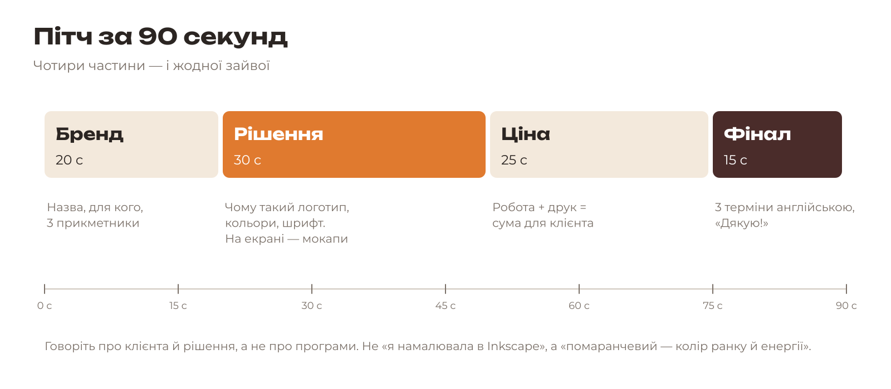

# 8.3. Пітч і голосування

[← Ціна пакета](02-tsina.md) · [До уроку](README.md) · [Далі: Рефлексія й збереження →](04-refleksiia.md)

## Формат

15 здобувачів × 1,5 хвилини = 22 хвилини. Таймер — на проєкторі. Коли час вийшов, виступ закінчується, навіть якщо ви не договорили: це частина вправи.

## План виступу

| Частина | Що сказати | Приклад «КавоБус» |
|---|---|---|
| **Бренд**, 20 с | Назва, для кого, 3 прикметники з брифу | «КавоБус — кава-фургон біля коледжу для студентів, які поспішають. Швидкий, теплий, дружній.» |
| **Рішення**, 30 с | Чому такий логотип, кольори, шрифт. На екрані — ваші мокапи | «Логотип — чашка на колесах: кава, що їде до тебе. Коричневий — кава, помаранчевий — ранок і енергія. Шрифт Unbounded — округлий і сучасний.» |
| **Ціна**, 25 с | Сума й з чого вона складається (8.2) | «Пакет — близько 2000 гривень: 840 за дизайн і 1100 за друк.» |
| **Фінал**, 15 с | 3 терміни англійською, подяка | «Bleed, crop marks, mockup. Дякую!» |

**Поради:**
- Говоріть про **рішення для клієнта**, а не про програми.
- Дивіться на слухачів, а не на екран.
- Потренуйтеся один раз з парою, засікши час на телефоні.

## Англійський бонус

Назвіть під час виступу 3 дизайнерські терміни англійською — правильно й до речі.

| English | Українською |
|---|---|
| brand identity | фірмовий стиль |
| logo / wordmark | логотип / шрифтовий логотип |
| moodboard | мудборд, дошка настрою |
| vector / raster | векторне / растрове |
| path, node, Bezier curve | контур, вузол, крива Безьє |
| fill / stroke | заливка / обведення |
| layer, mask, selection | шар, маска, виділення |
| resolution, dpi | роздільна здатність, точок на дюйм |
| bleed, safe zone, crop marks | виліт, безпечна зона, мітки обрізу |
| layout, grid | макет, модульна сітка |
| typeface, font size, kerning | гарнітура, кегль, кернінг |
| print-ready PDF | PDF для друку (оригінал-макет) |
| preflight | перевірка перед друком |
| soft proof | екранна кольоропроба |
| imposition | розкладка, спуск полос |
| mockup | мокап |
| call to action | заклик до дії |

## Голосування

Кожен отримує **3 наліпки** й клеїть їх на роздруковані назви брендів на дошці. За себе голосувати не можна. Можна віддати всі три наліпки одному бренду або розподілити.

Голосуйте за те, що **працює**: чи зрозуміло, що це за бізнес? Чи впізнається стиль на всіх виробах? Чи переконливо звучала ціна?

## Підсумок

Викладач називає 3 найсильніші роботи й найчастіші помилки дня. Особистий відгук — «сильна сторона» і «наступного разу» — кожен отримує письмово в оцінювальному аркуші.

[← Ціна пакета](02-tsina.md) · [До уроку](README.md) · [Далі: Рефлексія й збереження →](04-refleksiia.md)
