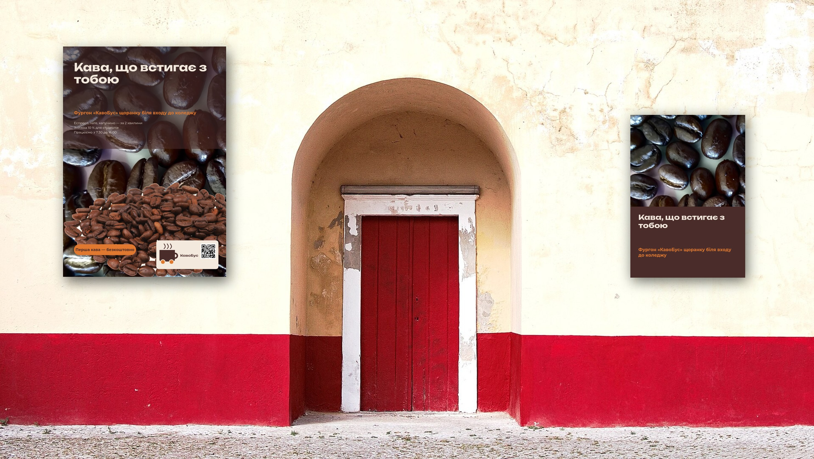

# Урок 8. Пітч і захист

**Програми:** Scribus, Inkscape, Krita

**Пітч** — коротка презентація проєкту для клієнта чи інвестора. На цьому уроці ви покажете свій бренд на мокапах, назвете ціну пакета й за 90 секунд переконаєте групу, що ваш фірмовий стиль працює.

## Що потрібно перед початком

- Готові `poster/poster.sla`, `flyer/flyer.sla`, `card/card.svg` (уроки 4–6).
- Заповнена заявка до друкарні з вартістю друку (урок 7).
- Шаблони мокапів з {{asset mockups/}}.

## Підуроки

| № | Тема | Що робимо |
|---|---|---|
| 8.1 | [Мокапи в Krita](01-mokapy.md) | Експорт дизайнів у PNG, шаблони мокапів, JPG для показу |
| 8.2 | [Ціна пакета](02-tsina.md) | Години × ставка + друк |
| 8.3 | [Пітч і голосування](03-pitch.md) | Структура виступу, англійські терміни, голосування, підсумок |
| 8.4 | [Рефлексія й збереження](04-refleksiia.md) | Що навчився, копія файлів, прибирання |

\* Мокапи й розрахунок ціни готують до початку блоку 7: наприкінці уроку 7 або поки інші закінчують препрес. Викладач збирає JPG-мокапи всіх здобувачів в одну теку на своєму ПК.

## Результат уроку

| Файл | Навіщо |
|---|---|
| `mockups/mockup-stina.jpg` | Плакат і листівка на стіні — для проєктора |
| `mockups/mockup-stil.jpg` | Візитівки на столі — для проєктора |
| Розрахунок ціни (на папері чи в заявці) | Відповідь на питання «скільки це коштує?» |

## Критерії оцінювання

- Пітч: аргументація, розрахунок ціни, термінологія: **0–1 бал**.
- Самостійність, дедлайни, взаємоперевірка, порядок на робочому місці: **0–1 бал**.

> На macOS замість `Ctrl` натискайте `Cmd`, а замість `Alt` — `Option`.

[← Урок 7](../07-prepres/README.md) · [До всіх уроків](../README.md)
